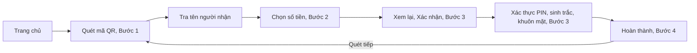
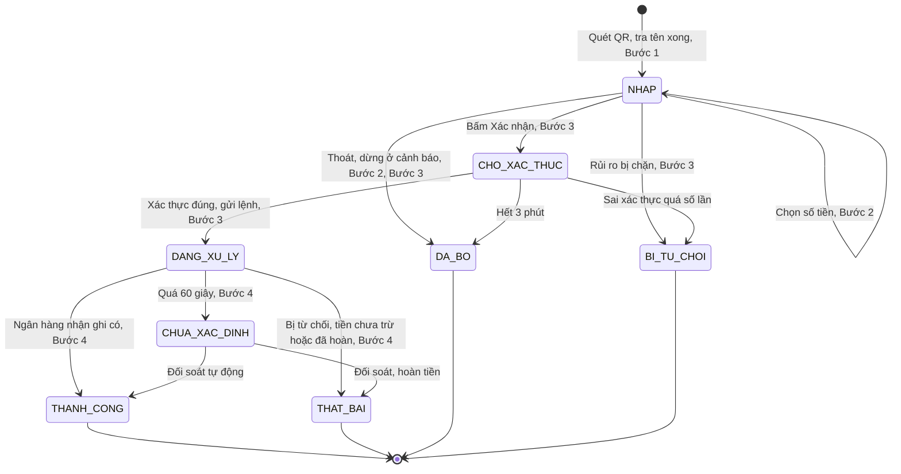
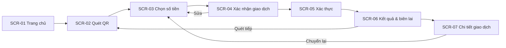

# Đề 4 · Chuyển khoản QR

> **Mã:** DE04 · **Độ khó:** 4/8 · **Vai trò:** 1 (người chuyển tiền) · **Nền tảng:** App ngân hàng iOS / Android

Tính năng chuyển khoản bằng mã QR trong app ngân hàng, theo đúng các bước người dùng làm: **quét mã QR → chọn số tiền → xác thực và xác nhận chuyển khoản → hoàn thành**. Đây là đề đầu tiên có **tiền thật đi qua**, xác thực nhiều mức theo quy định và trạng thái "chưa xác định" khi hệ thống chưa có kết quả. Đề gồm **1 tính năng**, là **1 luồng** gồm 4 bước và các màn hình; tài liệu gồm 1 PRD và 1 SRS.

## Tính năng

| **Tính năng** | **Luồng** | **PRD** | **SRS** |
| --- | --- | --- | --- |
| Chuyển khoản QR | Quét mã QR → Chọn số tiền → Xác thực & xác nhận chuyển khoản → Hoàn thành chuyển khoản | [PRD](docs/PRD.md) | [SRS](docs/SRS.md) |

## Các bước và màn hình của luồng

| **Bước** | **Tên bước** | **Màn hình** | **Phạm vi** |
| --- | --- | --- | --- |
| Bước 1 | Quét mã QR | SCR-01, SCR-02 | Mở quét nhanh, camera hoặc ảnh thư viện, nhận diện VietQR tĩnh và động, tra tên người nhận, QR không hỗ trợ |
| Bước 2 | Chọn số tiền | SCR-03 | Nhập số tiền (QR tĩnh) hoặc số tiền khoá (QR động), bằng chữ, gợi ý nhanh, nội dung, tài khoản nguồn, số dư, hạn mức |
| Bước 3 | Xác thực & xác nhận chuyển khoản | SCR-04, SCR-05 | Xem lại, xác nhận, cảnh báo lừa đảo và chuyển trùng, PIN / sinh trắc / khuôn mặt, gửi lệnh |
| Bước 4 | Hoàn thành chuyển khoản | SCR-06, SCR-07 | Đang xử lý, thành công, thất bại, chưa xác định, biên lai, chia sẻ, lưu người nhận, chi tiết giao dịch |

Luồng: Bước 1 Quét mã QR → Bước 2 Chọn số tiền → Bước 3 Xác thực & xác nhận chuyển khoản → Bước 4 Hoàn thành chuyển khoản.

## Luồng chuyển khoản QR



## Vòng đời giao dịch (dùng chung cả đề)



## Bản đồ màn hình



## Bối cảnh chung

Chuyển khoản QR đã thay tiền mặt ở chợ, quán ăn, cửa hàng nhỏ. Người trả tiền cần **nhanh** vì có người chờ phía sau, nhưng cũng phải **chắc chắn**: QR có thể bị dán đè, số tiền có thể gõ nhầm, và kẻ gian có thể gọi điện dẫn dắt nạn nhân chuyển tiền. Bài toán thiết kế chính là cân bằng tốc độ và an toàn ở mỗi bước, đồng thời tuân thủ quy định xác thực của Ngân hàng Nhà nước.

| **Nhóm người dùng** | **Nhu cầu chính** |
| --- | --- |
| Người trả tiền ở cửa hàng | Quét, chọn tiền, xác thực, xong trong vài giây; kết quả to rõ |
| Người chia tiền với bạn bè | Quét ảnh QR từ tin nhắn, chia sẻ biên lai |
| Người mua online | QR có sẵn số tiền, nội dung |
| Người lớn tuổi, ít rành công nghệ | Đọc rõ người nhận và số tiền, được cảnh báo lừa đảo |

Ngoài phạm vi cả đề: mở tài khoản, đăng nhập và cài Smart OTP, đăng ký sinh trắc khuôn mặt (chỉ dẫn link), phía người nhận (tạo QR, thông báo tiền về), lịch sử giao dịch đầy đủ, tra soát, QR thanh toán qua cổng merchant, QR rút tiền ATM, QR quốc tế, chuyển khoản bằng số tài khoản (xem Đề 7).

## Quy ước dùng chung

- Tiền tệ VND, không có số lẻ; định dạng `250.000 ₫`; số tiền luôn kèm cách đọc bằng chữ ở màn nhập và xác nhận.
- Mã QR theo chuẩn VietQR (dựa trên chuẩn EMVCo); người nhận là tài khoản hoặc thẻ của ngân hàng thành viên Napas.
- Ngưỡng xác thực, hạn mức, phí là **cấu hình**; giá trị trong tài liệu là giá trị hiện hành theo Quyết định 2345/QĐ-NHNN.
- Số tổng đài hiển thị dạng `{số}`.
- Mã BR, MSG, UC đánh số liên tục trong cả đề: Bước 1 dùng BR-01–10, MSG-01–10, UC-01–02; Bước 2 dùng BR-11–20, MSG-11–18, UC-03; Bước 3 dùng BR-21–30, MSG-19–28, UC-04–05; Bước 4 dùng BR-31–38, MSG-29–35, UC-06–07.

## Danh sách màn hình

| **Mã** | **Màn hình** | **Bước** | **Mô tả chi tiết ở** |
| --- | --- | --- | --- |
| SCR-01 | Trang chủ (lối tắt Quét QR) | Quét mã QR | Bước 1 |
| SCR-02 | Quét QR | Quét mã QR | Bước 1 |
| SCR-03 | Chọn số tiền | Chọn số tiền | Bước 2 |
| SCR-04 | Xác nhận giao dịch (gồm màn cảnh báo) | Xác thực & xác nhận | Bước 3 |
| SCR-05 | Xác thực giao dịch | Xác thực & xác nhận | Bước 3 |
| SCR-06 | Kết quả & biên lai | Hoàn thành | Bước 4 |
| SCR-07 | Chi tiết giao dịch | Hoàn thành | Bước 4 |

## Cấu trúc repo

```text
de04-chuyen-khoan-qr/
├── README.md
└── docs/
    ├── PRD.md    Bối cảnh, phạm vi, luồng, use case theo từng bước
    └── SRS.md    Quy tắc, trạng thái, use case, màn hình, API, thông báo theo từng bước
```

## Cách dùng bộ tài liệu

1. Đọc README để nắm luồng 4 bước và vòng đời giao dịch.
2. Đọc PRD để nắm toàn bộ tính năng và luồng, rồi đọc SRS theo từng bước của luồng. Thiết kế đủ trạng thái lỗi của từng bước (QR không hỗ trợ, thiếu số dư, cảnh báo, sai PIN, chưa xác định).
3. Ghép các màn thành một prototype liền mạch từ **SCR-01** tới **SCR-06**.
4. Thiết kế màn hình theo đúng mã SCR, mã MSG trong SRS để dễ đối chiếu khi review.
5. Sơ đồ viết bằng Mermaid, xem trực tiếp trên GitHub hoặc trình xem Markdown có hỗ trợ Mermaid.
