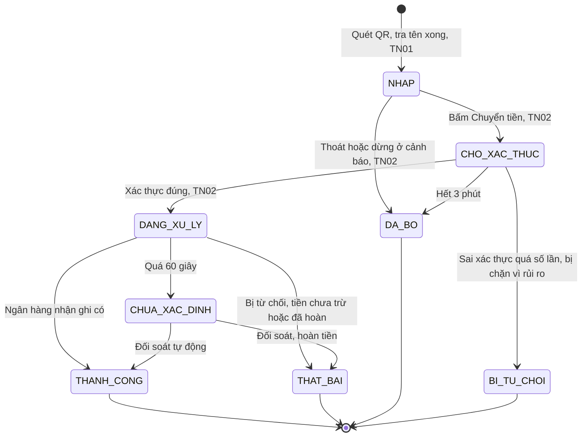
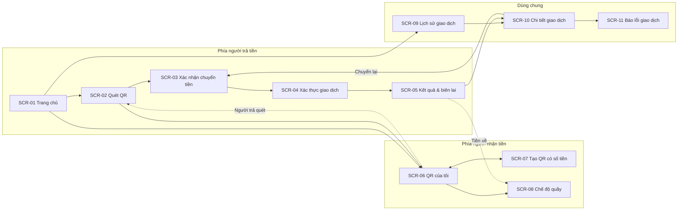

# Đề 4 · Chuyển khoản QR

> **Mã:** DE04 · **Độ khó:** 4/8 · **Vai trò:** 2 (người trả tiền, người nhận tiền) · **Nền tảng:** App ngân hàng iOS / Android

Tính năng chuyển khoản bằng mã QR trong app ngân hàng: người trả tiền quét mã VietQR (từ camera hoặc ảnh), kiểm tra tên người nhận, nhập số tiền, xác thực và nhận kết quả; người nhận tạo QR của mình (có hoặc không có số tiền) và biết ngay khi tiền về. Đây là đề đầu tiên có **tiền thật đi qua** và **xác thực nhiều mức theo quy định**. Đề gồm 4 tính năng; mỗi tính năng có 1 PRD và 1 SRS riêng.

## Tính năng

| **Mã** | **Tính năng** | **Phạm vi** | **PRD** | **SRS** |
| --- | --- | --- | --- | --- |
| TN01 | Quét mã QR | Lối tắt quét, camera, ảnh thư viện, phân loại QR, tra tên người nhận, QR không hỗ trợ | [PRD](docs/TN01-quet-ma-qr/PRD.md) | [SRS](docs/TN01-quet-ma-qr/SRS.md) |
| TN02 | Xác nhận & chuyển tiền | Số tiền, nội dung, hạn mức, cảnh báo lừa đảo, PIN / sinh trắc / khuôn mặt, kết quả, biên lai | [PRD](docs/TN02-xac-nhan-chuyen-tien/PRD.md) | [SRS](docs/TN02-xac-nhan-chuyen-tien/SRS.md) |
| TN03 | Mã QR nhận tiền | QR của tôi, QR có số tiền, mẫu QR, chia sẻ, in, thông báo tiền về, đọc to, chế độ quầy | [PRD](docs/TN03-ma-qr-nhan-tien/PRD.md) | [SRS](docs/TN03-ma-qr-nhan-tien/SRS.md) |
| TN04 | Lịch sử & tra soát | Lịch sử, tìm kiếm, chi tiết, chuyển lại, báo lỗi giao dịch, theo dõi tra soát | [PRD](docs/TN04-lich-su-tra-soat/PRD.md) | [SRS](docs/TN04-lich-su-tra-soat/SRS.md) |

Thứ tự làm gợi ý: TN01 → TN02 → TN03 → TN04.

## Vòng đời giao dịch chuyển khoản QR (dùng chung cả đề)



Khi giao dịch `THANH_CONG`, phía người nhận nhận thông báo tiền về (TN03). Giao dịch `THANH_CONG` hoặc `THAT_BAI` có thể có **yêu cầu tra soát** đi kèm (TN04).

## Bản đồ màn hình



## Bối cảnh chung

Chuyển khoản QR đã thay tiền mặt ở chợ, quán ăn, cửa hàng nhỏ. Người trả tiền cần **nhanh** vì có người chờ phía sau; người nhận cần **biết chắc tiền đã về** vì có thể bị lừa bằng ảnh "chuyển thành công" giả. Cả hai đều có thể là nạn nhân của QR dán đè và lừa đảo qua điện thoại. Bài toán thiết kế chính là cân bằng giữa **tốc độ** và **an toàn**, đồng thời tuân thủ quy định xác thực của Ngân hàng Nhà nước.

| **Nhóm người dùng** | **Nhu cầu chính** |
| --- | --- |
| Người trả tiền ở cửa hàng | Quét, xác thực, xong trong vài giây; kết quả to rõ |
| Người chia tiền với bạn bè | Quét ảnh QR từ tin nhắn, QR có sẵn số tiền |
| Tiểu thương, quán nhỏ | QR cố định, biết tiền về mà không cầm máy, riêng tư trên quầy |
| Người lớn tuổi, ít rành công nghệ | Đọc rõ người nhận và số tiền, được cảnh báo lừa đảo |

Ngoài phạm vi cả đề: mở tài khoản, đăng nhập và cài đặt Smart OTP, đăng ký sinh trắc khuôn mặt (chỉ dẫn link), QR thanh toán qua cổng merchant, QR rút tiền ATM, QR quốc tế, chuyển khoản bằng số tài khoản không qua QR (xem Đề 7), ví điện tử.

## Quy ước dùng chung

- Tiền tệ VND, không có số lẻ; định dạng `250.000 ₫`; số tiền luôn kèm cách đọc bằng chữ ở màn nhập.
- Mã QR theo chuẩn VietQR (dựa trên chuẩn EMVCo), người nhận là tài khoản hoặc thẻ của ngân hàng thành viên Napas.
- Ngưỡng xác thực, hạn mức, phí là **cấu hình**, giá trị trong tài liệu là giá trị hiện hành theo Quyết định 2345/QĐ-NHNN.
- Mã BR, MSG, UC đánh số liên tục trong cả đề: TN01 dùng BR-01–10, MSG-01–10, UC-01–02; TN02 dùng BR-11–24, MSG-11–24, UC-03–04; TN03 dùng BR-25–34, MSG-25–31, UC-05–06; TN04 dùng BR-35–44, MSG-32–39, UC-07–08.
- Tổng đài, số điện thoại khẩn hiển thị dạng `{số}`; giá trị do ngân hàng cấu hình.

## Danh sách màn hình

| **Mã** | **Màn hình** | **Phía** | **Mô tả chi tiết ở** |
| --- | --- | --- | --- |
| SCR-01 | Trang chủ (lối tắt Quét QR, QR của tôi) | Chung | SRS TN01 |
| SCR-02 | Quét QR | Người trả | SRS TN01 |
| SCR-03 | Xác nhận chuyển tiền (gồm màn cảnh báo) | Người trả | SRS TN02 |
| SCR-04 | Xác thực giao dịch | Người trả | SRS TN02 |
| SCR-05 | Kết quả & biên lai | Người trả | SRS TN02 |
| SCR-06 | QR của tôi | Người nhận | SRS TN03 |
| SCR-07 | Tạo QR có số tiền | Người nhận | SRS TN03 |
| SCR-08 | Chế độ quầy | Người nhận | SRS TN03 |
| SCR-09 | Lịch sử giao dịch | Chung | SRS TN04 |
| SCR-10 | Chi tiết giao dịch | Chung | SRS TN04 |
| SCR-11 | Báo lỗi giao dịch | Người trả | SRS TN04 |

## Cấu trúc repo

```text
de04-chuyen-khoan-qr/
├── README.md
└── docs/
    ├── TN01-quet-ma-qr/            PRD.md · SRS.md
    ├── TN02-xac-nhan-chuyen-tien/  PRD.md · SRS.md
    ├── TN03-ma-qr-nhan-tien/       PRD.md · SRS.md
    └── TN04-lich-su-tra-soat/      PRD.md · SRS.md
```

## Cách dùng bộ tài liệu

1. Đọc README để nắm vòng đời giao dịch: mọi tính năng đều bám theo sơ đồ trạng thái ở trên.
2. Với mỗi tính năng: đọc PRD, rồi SRS. Luôn thiết kế **cả hai phía**: người trả thấy gì, người nhận thấy gì ở cùng một giao dịch.
3. Thiết kế đủ trạng thái lỗi và trạng thái "chưa xác định": với app ngân hàng, đây là phần quan trọng nhất.
4. Thiết kế màn hình theo đúng mã SCR, mã MSG trong SRS để dễ đối chiếu khi review.
5. Sơ đồ viết bằng Mermaid, xem trực tiếp trên GitHub hoặc trình xem Markdown có hỗ trợ Mermaid.
