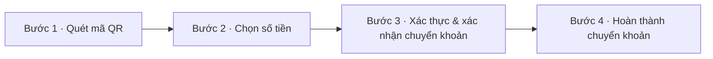
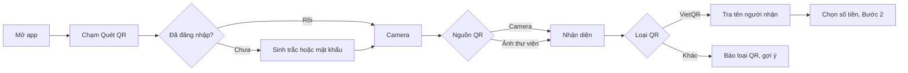
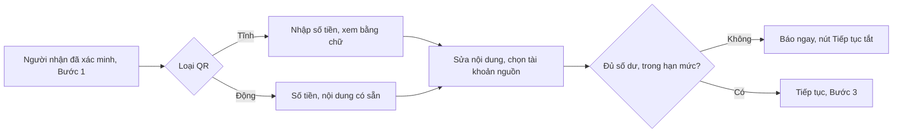
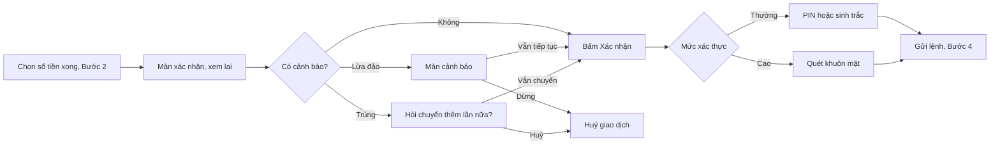
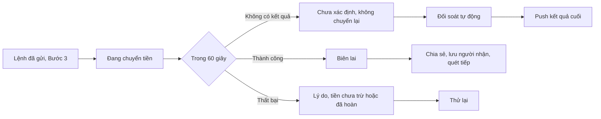

> **Mã:** DE04-PRD · **Trạng thái:** đã chốt · **Người viết:** Design · **SRS:** [SRS.md](SRS.md)

# PRD Chuyển khoản QR

> Đề gồm **1 tính năng**, là **1 luồng** gồm 4 bước và các màn hình: Quét mã QR → Chọn số tiền → Xác thực & xác nhận chuyển khoản → Hoàn thành chuyển khoản. Sơ đồ chung xem [README](../README.md).

## 1. Bối cảnh và vấn đề

### 1.1 Bối cảnh

Tính năng chuyển khoản bằng mã QR trong app ngân hàng, theo đúng các bước người dùng làm: **quét mã QR → chọn số tiền → xác thực và xác nhận chuyển khoản → hoàn thành**. Đây là đề đầu tiên có **tiền thật đi qua**, xác thực nhiều mức theo quy định và trạng thái "chưa xác định" khi hệ thống chưa có kết quả.

Chuyển khoản QR đã thay tiền mặt ở chợ, quán ăn, cửa hàng nhỏ. Người trả tiền cần **nhanh** vì có người chờ phía sau, nhưng cũng phải **chắc chắn**: QR có thể bị dán đè, số tiền có thể gõ nhầm, và kẻ gian có thể gọi điện dẫn dắt nạn nhân chuyển tiền. Bài toán thiết kế chính là cân bằng tốc độ và an toàn ở mỗi bước, đồng thời tuân thủ quy định xác thực của Ngân hàng Nhà nước.

### 1.2 Vấn đề

| **Vấn đề** | **Hệ quả** |
| --- | --- |
| Mở app, đăng nhập, tìm nút quét mất nhiều bước | Người phía sau phải chờ, người dùng chuyển sang tiền mặt |
| Quét trong tối, QR nhỏ hoặc bị lóa không nhận | Đứng loay hoay, quét lại nhiều lần |
| QR được gửi dạng ảnh trong tin nhắn | Không có máy thứ hai để quét |
| QR giả dán đè lên QR thật của cửa hàng | Tiền chuyển nhầm người, khó đòi lại |
| Quét phải QR không phải QR chuyển khoản (link web, QR ví khác) | Báo lỗi chung chung, không biết làm gì |
| Gõ thừa, thiếu số 0 khi nhập tiền | Chuyển 50.000 thành 500.000 ₫ hoặc 5.000 ₫ |
| Bàn phím nhỏ, dấu chấm, dấu phẩy lẫn lộn | Không biết mình đã nhập bao nhiêu |
| Nhập xong mới biết không đủ số dư, vượt hạn mức | Phải quay lại, người bán chờ |
| QR động nhưng vẫn sửa được số tiền | Chuyển thiếu, shop không đối soát được |
| Nội dung chuyển khoản mặc định khó hiểu | Người nhận không biết tiền của ai |
| Không có bước xem lại, sai một số mới phát hiện | Chuyển nhầm, khó đòi lại |
| Không rõ khi nào phải quét khuôn mặt | Người dùng bất ngờ, tưởng app lỗi, bỏ dở |
| Bị kẻ gian gọi điện hướng dẫn chuyển tiền | Mất tiền |
| Vừa chuyển xong lại quét QR cũ chuyển thêm lần nữa | Chuyển trùng |
| Nhập sai PIN nhiều lần không biết còn bao nhiêu lần | Bị khoá Smart OTP bất ngờ |
| Màn "Đang xử lý" quay mãi | Người dùng chuyển lại, bị trừ tiền hai lần |
| Thất bại nhưng không biết tiền đã bị trừ chưa | Lo lắng, gọi tổng đài |
| Màn thành công nhỏ, không có giờ, không có mã | Người bán nghi ảnh chụp giả |
| Muốn gửi bằng chứng chuyển tiền phải chụp màn hình | Lộ số dư, số tài khoản |
| Người nhận quen phải quét QR lại mỗi lần | Mất thời gian |

### 1.3 Mục tiêu

- Từ mở app tới nhận diện được QR ≤ 5 giây (trung vị) khi đã bật đăng nhập sinh trắc.
- Tỉ lệ nhận diện thành công lần quét đầu ≥ 95% với QR hợp lệ.
- 100% QR chuyển khoản hiện **tên chủ tài khoản thật** từ ngân hàng nhận trước khi nhập số tiền.
- Thời gian từ khi vào màn chọn số tiền tới bấm Tiếp tục ≤ 8 giây (trung vị) với QR tĩnh.
- Khiếu nại chuyển sai số tiền qua QR giảm 50%.
- 100% giao dịch QR động chuyển đúng số tiền của QR.
- Thời gian từ màn xác nhận tới gửi lệnh ≤ 7 giây (trung vị) với giao dịch dưới ngưỡng khuôn mặt.
- ≥ 30% giao dịch gặp cảnh báo lừa đảo được khách tự dừng.
- Tỉ lệ bỏ dở ở bước xác thực khuôn mặt ≤ 10%.
- ≥ 99% giao dịch có kết quả cuối trong 60 giây.
- Giao dịch chuyển trùng do "Đang xử lý" lâu giảm 70%.
- ≥ 15% giao dịch thành công được chia sẻ biên lai bằng nút trong app (thay vì chụp màn hình).

## 2. Người dùng

| **Nhóm** | **Nhu cầu với tính năng này** |
| --- | --- |
| Người trả tiền ở cửa hàng, quán ăn | Mở quét nhanh nhất có thể, một tay |
| Người chia tiền với bạn bè | Quét ảnh QR bạn gửi qua tin nhắn |
| Người lớn tuổi | Biết chắc đã quét đúng người nhận; Thấy số tiền bằng chữ để chắc chắn; Xem lại rõ ràng, chữ to |
| Người dùng ở nơi tối | Bật đèn, phóng to để quét được |
| Người trả tiền ở cửa hàng | Gõ nhanh, gợi ý số tiền tròn; Xác nhận một chạm, sinh trắc vân tay hoặc Face ID; Kết quả to rõ để giơ cho người bán |
| Người mua online | Số tiền và nội dung đơn hàng có sẵn, không phải gõ |
| Người có nhiều tài khoản | Chọn tài khoản trả tiền, thấy số dư |
| Người chuyển số tiền lớn | Biết trước phải quét khuôn mặt, được hướng dẫn |
| Người có thể bị lừa | Được cảnh báo đủ mạnh để dừng lại |
| Người chuyển cho bạn bè | Gửi biên lai qua tin nhắn |
| Người gặp lỗi | Biết tiền ở đâu, phải làm gì |
| Người trả cùng một nơi thường xuyên | Lưu người nhận, chuyển lại nhanh |

## 3. Phạm vi

### 3.1 Trong phạm vi (MVP)

**Bước 1 · Quét mã QR**

- Lối tắt Quét QR: trên màn đăng nhập, trang chủ app, biểu tượng app (giữ để mở menu nhanh).
- Màn quét: camera, khung ngắm, đèn flash, phóng to, chọn ảnh từ thư viện.
- Nhận diện QR chuẩn VietQR chuyển tiền tới tài khoản hoặc thẻ của mọi ngân hàng thành viên Napas; phân biệt QR tĩnh (không có số tiền) và QR động (có số tiền).
- Tra tên chủ tài khoản người nhận trước khi chuyển.
- Báo lỗi rõ cho QR không hỗ trợ, QR hỏng.

**Bước 2 · Chọn số tiền**

- Nhập số tiền cho QR tĩnh; số tiền khoá cho QR động.
- Hiện số tiền bằng chữ; gợi ý số tiền nhanh.
- Nội dung chuyển khoản: mặc định, sửa được (QR tĩnh), khoá nếu QR động có nội dung.
- Chọn tài khoản nguồn; hiện số dư khả dụng.
- Kiểm tra ngay số dư, hạn mức giao dịch, hạn mức ngày; hiện phí.

**Bước 3 · Xác thực & xác nhận chuyển khoản**

- Màn xác nhận: người nhận, số tiền và bằng chữ, nội dung, tài khoản nguồn, phí, tổng trừ, cách xác thực sẽ dùng.
- Cảnh báo người nhận đáng ngờ, giao dịch bất thường; cảnh báo chuyển trùng.
- Xác thực theo mức: PIN Smart OTP hoặc sinh trắc thiết bị; sinh trắc khuôn mặt khi vượt ngưỡng hoặc thiết bị mới.
- Giới hạn số lần sai, thời gian chờ xác thực.
- Gửi lệnh chuyển tiền an toàn (không gửi trùng).

**Bước 4 · Hoàn thành chuyển khoản**

- Màn đang xử lý; kết quả: thành công, thất bại, chưa xác định.
- Đối soát tự động giao dịch chưa xác định; thông báo khi có kết quả cuối.
- Biên lai; chia sẻ biên lai dạng ảnh.
- Lưu người nhận; quét tiếp; chuyển lại.
- Chi tiết giao dịch (mở từ thông báo, lịch sử).

### 3.2 Ngoài phạm vi

- QR thanh toán hoá đơn của cửa hàng qua cổng thanh toán (QR merchant), QR rút tiền ATM → phase sau.
- QR thanh toán quốc tế.
- Quét mã vạch, quét hoá đơn giấy để thanh toán.
- Chuyển tiền không qua QR (nhập số tài khoản) – xem Đề 7.
- Chia tiền cho nhiều người, tip.
- Trả bằng thẻ tín dụng, ví điện tử.
- Đổi hạn mức (dẫn link tới cài đặt sẵn có của app).
- Đăng ký, cài Smart OTP, đăng ký sinh trắc khuôn mặt (chỉ dẫn link).
- Tạm giữ giao dịch để nhân viên gọi xác minh.
- Lịch sử giao dịch đầy đủ, tìm kiếm (tính năng sẵn có của app).
- Tra soát, khiếu nại (dẫn tới kênh hỗ trợ sẵn có).
- Phía người nhận tiền (thông báo tiền về).

## 4. Nguyên tắc sản phẩm

### 4.1 Nhanh như rút ví

Quét QR là hành động được ưu tiên nhất trong app: tới được trong 1 chạm từ màn đăng nhập.

### 4.2 Người nhận phải rõ ràng

Sau khi quét, tên chủ tài khoản do ngân hàng nhận trả về luôn hiện to nhất, trước số tiền.

### 4.3 Lỗi phải nói được cần làm gì

Không có "QR không hợp lệ" chung chung: nói rõ đây là loại QR gì và người dùng có thể làm gì tiếp.

### 4.4 Không chuyển tiền trong màn quét

Màn quét chỉ đọc mã. Sau khi quét luôn sang bước chọn số tiền (Bước 2) và bước xác thực, xác nhận (Bước 3).

### 4.5 Số tiền phải đọc được hai lần

Số lớn và bằng chữ luôn đi cùng nhau; dấu chấm ngăn nghìn tự chèn.

### 4.6 Báo lỗi trước khi bấm

Không đủ tiền, vượt hạn mức hiện ngay khi gõ, không đợi tới bước xác nhận.

### 4.7 QR động là hợp đồng

Số tiền người nhận đặt trong QR không sửa được.

### 4.8 Xem lại rồi mới xác thực

Màn xác nhận là một bước riêng, đọc từ trên xuống: người nhận → số tiền → nội dung → nguồn → phí. Bấm "Xác nhận" xong mới xác thực.

### 4.9 Nói trước khi đòi

Nếu cần quét khuôn mặt, màn xác nhận báo trước, kèm lý do.

### 4.10 Cảnh báo phải làm người dùng dừng lại

Cảnh báo lừa đảo là màn riêng, có thời gian chờ ngắn; nút chính là "Dừng giao dịch".

### 4.11 Ba kết quả, không mập mờ

Thành công, thất bại, hoặc chưa xác định, mỗi kết quả nói rõ tiền đang ở đâu và nên làm gì.

### 4.12 Chưa rõ thì đừng chuyển lại

Khi chưa xác định, app nói thẳng "Vui lòng không chuyển lại" và tự báo khi có kết quả.

### 4.13 Bằng chứng gọn, không lộ thông tin

Biên lai có mã giao dịch, thời gian tới giây; không có số dư.

## 5. Quy tắc nghiệp vụ

| **Quy tắc** | **Giá trị** |
| --- | --- |
| Chuẩn QR hỗ trợ | VietQR (theo chuẩn EMVCo) chuyển tiền tới tài khoản, thẻ ngân hàng thành viên Napas |
| QR tĩnh | Không có số tiền; người trả tự nhập |
| QR động | Có số tiền (và có thể có nội dung) do người nhận đặt; người trả không sửa được số tiền |
| Ảnh từ thư viện | JPG, PNG, HEIC; tối đa 10 MB |
| Tra tên người nhận | Bắt buộc; không có tên thì không cho chuyển |
| Thời gian chờ camera | Không nhận được QR sau 15 giây → gợi ý bật đèn, chọn ảnh |
| Số tiền | 1.000 ₫ tới hạn mức giao dịch; tối đa 499.999.999 ₫ |
| Hạn mức mặc định | 100.000.000 ₫/giao dịch, 200.000.000 ₫/ngày |
| Phí | 0 ₫ (cấu hình) |
| Nội dung | Tối đa 100 ký tự; liên ngân hàng tự bỏ dấu |
| Gợi ý nhanh | Tối đa 3 số tiền tròn theo số đã gõ |
| Xác thực thường | Mã PIN Smart OTP 6 số, hoặc sinh trắc thiết bị nếu đã bật |
| Xác thực khuôn mặt | Giao dịch > 10.000.000 ₫, hoặc tổng trong ngày > 20.000.000 ₫, hoặc giao dịch đầu tiên trên thiết bị mới |
| Thời gian xác thực | 3 phút |
| Sai PIN | 5 lần liên tiếp → khoá Smart OTP |
| Khuôn mặt thất bại | 3 lần liên tiếp → tạm khoá 15 phút |
| Cảnh báo trùng | Cùng người nhận, cùng số tiền trong 5 phút |
| Màn cảnh báo | Chờ 5 giây và tích ô xác nhận mới tiếp tục được |
| Thời gian chờ kết quả | 60 giây; quá thì "Chưa xác định" |
| Đối soát | Tự động; có kết quả trong tối đa 1 ngày làm việc |
| Thất bại sau khi đã trừ tiền | Hoàn tự động về tài khoản nguồn |
| Danh bạ người nhận | Tối đa 200; dùng chung với chuyển khoản thường |
| Biên lai | Ảnh PNG; không có số dư |

- Hạn mức, phí là **cấu hình**.
- Ngưỡng là **cấu hình** theo quy định Ngân hàng Nhà nước.

## 6. Luồng trải nghiệm

### 6.1 Toàn bộ luồng

### 6.2 Bước 1 · Quét mã QR

| **Bước** | **Giai đoạn** | **Trải nghiệm** | **Đầu ra** |
| --- | --- | --- | --- |
| 1 | Mở quét | Nút Quét QR ở giữa thanh điều hướng hoặc trên màn đăng nhập | Camera mở |
| 2 | Quét | Khung ngắm, đèn, phóng to; hoặc chọn ảnh | Chuỗi QR |
| 3 | Nhận diện | Rung nhẹ khi đọc được; đọc loại QR | Thông tin người nhận |
| 4 | Tra tên | Hiện tên chủ tài khoản, ngân hàng | Sang Bước 2 |

### 6.3 Bước 2 · Chọn số tiền

| **Bước** | **Giai đoạn** | **Trải nghiệm** | **Đầu ra** |
| --- | --- | --- | --- |
| 1 | Xem người nhận | Tên, ngân hàng ở đầu màn | Biết chuyển cho ai |
| 2 | Chọn số tiền | Bàn phím số, bằng chữ, gợi ý | Số tiền |
| 3 | Nội dung, nguồn | Nội dung mặc định, tài khoản, số dư | Lệnh nháp |
| 4 | Tiếp tục | Kiểm tra số dư, hạn mức | Sang xác nhận |

### 6.4 Bước 3 · Xác thực & xác nhận chuyển khoản

| **Bước** | **Giai đoạn** | **Trải nghiệm** | **Đầu ra** |
| --- | --- | --- | --- |
| 1 | Xem lại | Toàn bộ thông tin, cách xác thực | Người dùng chắc chắn |
| 2 | Cảnh báo (nếu có) | Màn cảnh báo, thời gian chờ | Dừng hoặc tiếp tục có ý thức |
| 3 | Xác nhận | Bấm "Xác nhận" | Lệnh chờ xác thực |
| 4 | Xác thực | PIN, sinh trắc, khuôn mặt | Lệnh được ký, gửi đi |

### 6.5 Bước 4 · Hoàn thành chuyển khoản

| **Bước** | **Giai đoạn** | **Trải nghiệm** | **Đầu ra** |
| --- | --- | --- | --- |
| 1 | Đang xử lý | Vòng chờ, "Đang chuyển tiền…" | – |
| 2 | Kết quả | Biểu tượng lớn, số tiền, người nhận, giờ, mã | Người trả, người bán yên tâm |
| 3 | Sau đó | Chia sẻ biên lai, lưu người nhận, quét tiếp | Bằng chứng, lần sau nhanh hơn |
| 4 | Ngoại lệ | Push khi giao dịch chưa xác định có kết quả | Biết chắc tiền đi hay hoàn |

## 7. Use Cases, User Stories và Acceptance Criteria

### Bước 1 · Quét mã QR

#### UC1. Mở quét nhanh

##### US1.1 Quét ngay từ màn đăng nhập

User Story: Là người trả tiền, tôi muốn chạm Quét QR ngay ở màn đăng nhập để không phải vào trang chủ trước.

AC01: Màn đăng nhập có nút Quét QR; chạm → xác thực sinh trắc → mở camera.

AC02: Trang chủ có nút Quét QR nổi bật ở thanh điều hướng.

AC03: Giữ biểu tượng app có lối tắt "Quét QR".

AC04: Chưa cấp quyền camera → giải thích lý do, hỏi quyền; từ chối thì vẫn chọn ảnh được.

#### UC2. Quét mã

##### US2.1 Quét bằng camera

User Story: Là người trả tiền, tôi muốn quét được cả khi tối hoặc QR nhỏ.

AC01: Đọc được QR ở bất kỳ vị trí nào trong khung hình; rung nhẹ khi đọc được.

AC02: Có nút đèn flash và kéo để phóng to.

AC03: 15 giây không nhận → gợi ý bật đèn, đưa gần hơn, hoặc chọn ảnh.

##### US2.2 Quét từ ảnh

User Story: Là người chia tiền, tôi muốn chọn ảnh QR bạn gửi để chuyển tiền.

AC01: Chọn ảnh từ thư viện; nhận diện QR trong ảnh.

AC02: Ảnh có nhiều QR → cho chọn QR cần dùng.

AC03: Ảnh không có QR → báo rõ.

#### UC3. Nhận diện và kiểm tra người nhận

##### US3.1 Biết chắc người nhận

User Story: Là người trả tiền, tôi muốn thấy tên chủ tài khoản thật để tránh QR giả.

AC01: QR hợp lệ → tra tên tại ngân hàng nhận; hiện tên, ngân hàng, số tài khoản che bớt.

AC02: Tài khoản không tồn tại, bị khoá → báo, không cho chuyển.

AC03: Tài khoản nằm trong danh sách cảnh báo lừa đảo → cảnh báo nổi bật trước khi tiếp tục (cảnh báo toàn trang ở bước xác nhận, Bước 3).

##### US3.2 QR không phải chuyển khoản

AC01: QR là link web → hiện link, hỏi có mở bằng trình duyệt không; cảnh báo không nhập mật khẩu ngân hàng ở link lạ.

AC02: QR merchant, QR ví không liên kết, QR quốc tế → báo "chưa hỗ trợ" và tên loại QR.

AC03: QR hỏng, sai mã kiểm tra → báo quét lại.

### Bước 2 · Chọn số tiền

#### UC4. Chọn số tiền với QR tĩnh

##### US4.1 Nhập không nhầm

User Story: Là người trả tiền, tôi muốn thấy số tiền bằng chữ để không gõ nhầm số 0.

AC01: Bàn phím số mở sẵn; số tiền tự chèn dấu chấm ngăn nghìn.

AC02: Dòng bằng chữ ngay dưới: "Năm mươi nghìn đồng".

AC03: Gõ "50" → gợi ý 50.000, 500.000, 5.000.000 ₫; chạm để chọn.

AC04: Xoá hết → nút Tiếp tục tắt.

#### UC5. Số tiền với QR động

AC01: Số tiền, nội dung từ QR hiện sẵn, khoá, ghi "Số tiền do người nhận đặt".

AC02: QR động không có nội dung → nội dung mặc định, sửa được.

#### UC6. Nội dung, nguồn tiền, giới hạn

##### US6.1 Chọn tài khoản trả tiền

AC01: Mặc định tài khoản chính; chạm để đổi; mỗi tài khoản hiện số dư khả dụng.

AC02: Số dư ẩn mặc định, chạm con mắt để hiện.

##### US6.2 Biết sớm khi không chuyển được

AC01: Số tiền + phí > số dư → báo ngay dưới ô số tiền.

AC02: Vượt hạn mức giao dịch hoặc hạn mức còn lại trong ngày → báo số còn được chuyển, link đổi hạn mức.

AC03: Dưới 1.000 ₫ → báo số tiền tối thiểu.

### Bước 3 · Xác thực & xác nhận chuyển khoản

#### UC7. Xem lại và xác nhận

##### US7.1 Xem lại trước khi chuyển

User Story: Là người trả tiền, tôi muốn xem lại người nhận và số tiền trước khi xác thực để sửa kịp nếu sai.

AC01: Màn xác nhận hiện: số tiền lớn và bằng chữ, tên người nhận, ngân hàng, số tài khoản, nội dung, tài khoản nguồn, phí, tổng trừ.

AC02: Có dòng "Xác thực bằng {PIN / sinh trắc / khuôn mặt}".

AC03: Nút "Sửa" quay lại chọn số tiền, giữ dữ liệu.

##### US7.2 Được cảnh báo

AC01: Người nhận bị báo cáo lừa đảo hoặc giao dịch bất thường → màn cảnh báo toàn trang, nút chính "Dừng giao dịch"; "Tiếp tục" bật sau 5 giây và khi đã tích ô.

AC02: Vừa chuyển cùng người, cùng số tiền trong 5 phút → hỏi lại.

#### UC8. Xác thực

##### US8.1 Xác thực nhanh

AC01: Đã bật sinh trắc thiết bị → hỏi vân tay hoặc Face ID ngay khi bấm Xác nhận.

AC02: Sinh trắc thất bại hoặc huỷ → nhập PIN 6 số.

AC03: Sai PIN → báo số lần còn lại; sai 5 lần → khoá Smart OTP, hướng dẫn mở khoá.

##### US8.2 Xác thực khuôn mặt

AC01: Hướng dẫn trước khi mở camera (nhìn thẳng, đủ sáng, bỏ khẩu trang).

AC02: Thất bại → cho thử lại; 3 lần → tạm khoá 15 phút.

AC03: Chưa đăng ký khuôn mặt → báo ngay ở màn xác nhận, dẫn tới đăng ký, không cho chuyển.

##### US8.3 Không gửi trùng

AC01: Mạng chập chờn, bấm lại nhiều lần → chỉ một lệnh được gửi.

### Bước 4 · Hoàn thành chuyển khoản

#### UC9. Nhận kết quả

##### US9.1 Thành công rõ ràng

User Story: Là người trả tiền, tôi muốn màn thành công to rõ để người bán tin ngay.

AC01: Dấu tích lớn, "Chuyển tiền thành công", số tiền, tên người nhận, ngân hàng, thời gian tới giây, mã giao dịch.

AC02: Không có số dư trên màn kết quả.

##### US9.2 Thất bại

AC01: Lý do dễ hiểu; ghi rõ "Tiền chưa bị trừ" hoặc "Tiền đã được hoàn".

AC02: Nút "Thử lại" mở lại bước chọn số tiền với dữ liệu cũ.

##### US9.3 Chưa xác định

AC01: Giải thích, khuyên không chuyển lại; không có nút Thử lại.

AC02: Khi có kết quả cuối → push; chi tiết giao dịch cập nhật.

#### UC10. Sau khi thành công

##### US10.1 Chia sẻ biên lai

AC01: Nút Chia sẻ tạo ảnh biên lai, mở bảng chia sẻ của điện thoại.

##### US10.2 Lưu người nhận, quét tiếp

AC01: Ô "Lưu người nhận" với tên gợi nhớ; người nhận bị cảnh báo không lưu được.

AC02: "Quét tiếp" mở lại màn quét; "Về trang chủ".

##### US10.3 Chi tiết giao dịch

AC01: Mở từ push, lịch sử: thông tin như biên lai, trạng thái hiện tại.

AC02: Giao dịch thành công có nút "Chuyển lại" (người nhận, số tiền, nội dung cũ).

## 8. Chỉ số theo dõi

| **Chỉ số** | **Định nghĩa** | **Mục tiêu MVP** |
| --- | --- | --- |
| Thời gian tới nhận diện | Từ chạm Quét QR tới đọc được QR hợp lệ | ≤ 5 giây (trung vị) |
| Tỉ lệ nhận diện lần đầu | Phiên quét đọc được QR ngay / phiên quét có QR hợp lệ | ≥ 95% |
| Tỉ lệ dùng ảnh thư viện | Phiên quét bằng ảnh / tổng phiên quét | Theo dõi |
| Tỉ lệ QR không hỗ trợ | Theo loại QR | Theo dõi; ưu tiên phase sau |
| Tỉ lệ dừng sau cảnh báo | Phiên dừng sau cảnh báo tài khoản đáng ngờ / phiên gặp cảnh báo | Theo dõi |
| Thời gian chọn số tiền | Mở **SCR-03** → bấm Tiếp tục (trung vị, QR tĩnh) | ≤ 8 giây |
| Dùng gợi ý nhanh | Lượt chọn gợi ý / lượt nhập số tiền | Theo dõi |
| Gặp lỗi số dư, hạn mức | Lượt hiện lỗi / lượt vào **SCR-03** | Theo dõi |
| Sửa số tiền ở bước xác nhận | Lượt quay lại sửa từ Bước 3 / lượt tới Bước 3 | Theo dõi; cao là dấu hiệu nhập dễ sai |
| Khiếu nại sai số tiền | Số khiếu nại / 10.000 giao dịch QR | Giảm 50% |
| Thời gian xác nhận | Mở **SCR-04** → gửi lệnh (dưới ngưỡng, trung vị) | ≤ 7 giây |
| Quay lại sửa | Lượt bấm Sửa / lượt mở **SCR-04** | Theo dõi |
| Dừng ở cảnh báo | Giao dịch dừng / giao dịch gặp cảnh báo lừa đảo | ≥ 30% |
| Bỏ ở khuôn mặt | Phiên bỏ / phiên cần khuôn mặt | ≤ 10% |
| Khoá Smart OTP | Số lần khoá / 10.000 giao dịch | Theo dõi |
| Có kết quả trong 60 giây | Giao dịch có kết quả cuối ≤ 60 giây / tổng | ≥ 99% |
| Chuyển trùng | Cùng người nhận, cùng tiền trong 5 phút sau "Chưa xác định" | Giảm 70% |
| Chia sẻ biên lai | Giao dịch chia sẻ / giao dịch thành công | ≥ 15% |
| Lưu người nhận | Lượt lưu / giao dịch thành công với người nhận mới | Theo dõi |
| Thời gian đối soát | "Chưa xác định" → kết quả cuối (trung vị) | Theo dõi |

## 9. Phụ thuộc và rủi ro

| **Mục** | **Mô tả** | **Hướng xử lý** |
| --- | --- | --- |
| Dịch vụ tra tên của Napas | Chậm hoặc lỗi | Timeout 5 giây, cho thử lại; không có tên thì không chuyển |
| QR dán đè | Kẻ gian thay QR cửa hàng | Luôn hiện tên chủ tài khoản to, rõ; nhắc người dùng đối chiếu |
| Camera máy cũ | Lấy nét kém | Cho phóng to, đèn, chọn ảnh |
| Ảnh chụp màn hình QR | Có thể chứa QR đã hết hạn | QR động kiểm tra thời hạn (nếu có) |
| Số dư thay đổi | Có giao dịch khác cùng lúc | Kiểm tra lại số dư ở Bước 3 khi gửi lệnh |
| Hạn mức thay đổi | Khách vừa đổi hạn mức | Lấy hạn mức mới mỗi lần mở **SCR-03** |
| Bàn phím hệ điều hành | Có dấu phẩy, chữ | Dùng bàn phím số riêng của app |
| Hệ thống chấm điểm rủi ro | Chậm, lỗi | Quá 800 ms coi như mức cảnh báo nhẹ, không chặn |
| Xác thực khuôn mặt | Máy cũ, thiếu sáng | Hướng dẫn rõ; cho thử lại |
| Quy định thay đổi | Ngưỡng xác thực | Cấu hình |
| Napas, ngân hàng nhận | Không phản hồi | Trạng thái chưa xác định, đối soát tự động |
| Push | Bị tắt | Chi tiết giao dịch luôn có trạng thái mới; banner nhắc khi mở app |
| Ảnh biên lai giả | Người khác sửa ảnh | Mã giao dịch để người nhận tra trong app của họ |

## 10. Câu hỏi mở

> Mọi câu hỏi dưới đây đã được PO chốt ngày 20/11/2026; quyết định ghi sau mỗi câu và đã cập nhật vào SRS.

- Có cho quét khi chưa đăng nhập không? → **Đã chốt:** Không. Chạm Quét QR ở màn đăng nhập sẽ yêu cầu sinh trắc trước, rồi mở camera (SRS BR-01).
- Tra tên người nhận lúc nào? → **Đã chốt:** Ngay sau khi nhận diện, trước khi mở màn nhập số tiền (SRS BR-07).
- QR động có hạn sử dụng không? → **Đã chốt:** Nếu QR chứa thời hạn thì kiểm tra; quá hạn thì báo và không cho chuyển (SRS BR-06).
- Có lưu lịch sử mã đã quét? → **Đã chốt:** Không lưu riêng; người nhận đã chuyển thành công nằm trong lịch sử giao dịch sẵn có của app; chi tiết giao dịch xem Bước 4.
- Nội dung mặc định là gì? → **Đã chốt:** "{TÊN NGƯỜI CHUYỂN} chuyen tien" (SRS BR-13).
- Có cho chọn tài khoản nguồn khác không? → **Đã chốt:** Có, mọi tài khoản thanh toán VND đứng tên khách (SRS BR-14).
- QR động có số tiền vượt hạn mức thì sao? → **Đã chốt:** Hiện số tiền, báo vượt hạn mức, không cho tiếp tục; gợi ý đổi hạn mức (SRS BR-16).
- Có lưu số tiền lần trước cho cùng người nhận? → **Đã chốt:** Không gợi ý số tiền theo lịch sử ở MVP (SRS BR-19).
- Xác nhận trước hay xác thực trước? → **Đã chốt:** Xem lại và bấm Xác nhận trước, rồi mới xác thực (SRS BR-21).
- Có cảnh báo trùng với giao dịch chưa xác định? → **Đã chốt:** Có (SRS BR-24).
- Rủi ro rất cao thì sao? → **Đã chốt:** Chặn giao dịch, hướng dẫn gọi tổng đài; không có tạm giữ ở MVP (SRS BR-23).
- Đổi tài khoản nguồn ở màn xác nhận được không? → **Đã chốt:** Không; bấm Sửa để quay lại Bước 2 (SRS BR-21).
- Màn đang xử lý có cho thoát? → **Đã chốt:** Không trong 10 giây đầu; sau đó cho "Về trang chủ", giao dịch vẫn xử lý tiếp (SRS BR-31).
- Thất bại có hoàn phí? → **Đã chốt:** Có, hoàn cả số tiền và phí nếu đã trừ (SRS BR-33).
- Biên lai có hiện số tài khoản nguồn? → **Đã chốt:** Có, che giữa (SRS BR-35).
- "Thử lại" có cần quét lại? → **Đã chốt:** Không; mở lại bước chọn số tiền, tra tên lại tự động (SRS BR-38).
