> **Mã:** DE04-SRS · **Trạng thái:** đã chốt · **Người viết:** Design · **PRD:** [PRD.md](PRD.md)

# UC-DE04 - Chuyển khoản QR

> SRS này mô tả **1 tính năng**, là **1 luồng** gồm 4 bước: Quét mã QR → Chọn số tiền → Xác nhận & xác thực chuyển khoản → Hoàn thành chuyển khoản. Mã BR, MSG, UC, SCR đánh số liên tục trong toàn tài liệu. Sơ đồ chung xem [README](../README.md).

## 1. Tổng quan

| **Mục** | **Nội dung** |
| --- | --- |
| Mục tiêu | Tính năng chuyển khoản bằng mã QR trong app ngân hàng, theo đúng các bước người dùng làm: **quét mã QR → chọn số tiền → xác nhận, xem lại và xác thực chuyển khoản → hoàn thành** |
| Actor | Người trả tiền · App ngân hàng · Máy chủ ngân hàng · Napas (tra tên tài khoản liên ngân hàng) · Hệ thống chấm điểm rủi ro · Napas · Ngân hàng nhận |
| Luồng | Bước 1 Quét mã QR → Bước 2 Chọn số tiền → Bước 3 Xác nhận & xác thực chuyển khoản → Bước 4 Hoàn thành chuyển khoản |
| Ngoài phạm vi | Mở tài khoản, đăng nhập và cài Smart OTP, đăng ký sinh trắc khuôn mặt (chỉ dẫn link), phía người nhận (tạo QR, thông báo tiền về), lịch sử giao dịch đầy đủ, tra soát, QR thanh toán qua cổng merchant, QR rút tiền ATM, QR quốc tế, chuyển khoản bằng số tài khoản (xem Đề 7) |
| Nền tảng | App ngân hàng iOS / Android |

### Các bước của luồng

| **Bước** | **Mục tiêu** | **Phạm vi** |
| --- | --- | --- |
| Bước 1 · Quét mã QR | Người trả tiền mở quét nhanh, đọc được QR từ camera hoặc ảnh, biết chắc người nhận là ai | Lối tắt quét, quyền camera, màn quét, chọn ảnh, giải mã VietQR, phân loại QR, tra tên người nhận, cảnh báo tài khoản đáng ngờ |
| Bước 2 · Chọn số tiền | Người trả tiền chọn đúng số tiền, nội dung, tài khoản nguồn; biết ngay nếu không đủ tiền hoặc vượt hạn mức | Nhập số tiền (QR tĩnh), số tiền khoá (QR động), bằng chữ, gợi ý nhanh, nội dung, tài khoản nguồn, số dư, phí, hạn mức |
| Bước 3 · Xác nhận & xác thực chuyển khoản | Người trả tiền xem lại, xác nhận, xác thực đúng mức; dừng lại được khi có dấu hiệu lừa đảo | Màn xem lại, cảnh báo lừa đảo, cảnh báo trùng, mức xác thực, PIN Smart OTP, sinh trắc thiết bị, sinh trắc khuôn mặt, khoá khi sai, gửi lệnh |
| Bước 4 · Hoàn thành chuyển khoản | Người trả tiền nhận kết quả rõ ràng, có biên lai, biết làm gì khi lỗi hoặc chưa rõ kết quả | Đang xử lý, thành công, thất bại, chưa xác định, đối soát, hoàn tiền tự động, push kết quả, biên lai, chia sẻ, lưu người nhận, quét tiếp, chi tiết giao dịch, chuyển lại |

## 2. User Story

| **ID** | **As a** | **I want** | **So that** |
| --- | --- | --- | --- |
| US-01 | Người trả tiền | Mở quét QR trong 1 chạm từ màn đăng nhập | Không bắt người khác chờ |
| US-02 | Người trả tiền | Quét được khi tối, QR nhỏ | Không phải dùng tiền mặt |
| US-03 | Người trả tiền | Quét QR từ ảnh trong máy | Chuyển tiền khi bạn gửi QR qua tin nhắn |
| US-04 | Người trả tiền | Thấy tên chủ tài khoản thật | Không chuyển nhầm cho QR giả |
| US-05 | Người trả tiền | Biết vì sao QR không dùng được | Biết làm gì tiếp |
| US-06 | Người trả tiền | Thấy số tiền bằng chữ | Không gõ nhầm số 0 |
| US-07 | Người trả tiền | Chọn nhanh số tiền tròn | Gõ ít hơn |
| US-08 | Người mua online | Số tiền, nội dung có sẵn từ QR | Không phải gõ, không sai |
| US-09 | Người trả tiền | Chọn tài khoản trả, thấy số dư | Trả từ đúng tài khoản |
| US-10 | Người trả tiền | Biết ngay khi không đủ tiền, vượt hạn mức | Không mất thời gian ở bước sau |
| US-11 | Người trả tiền | Xem lại toàn bộ trước khi xác thực | Sửa kịp nếu sai |
| US-12 | Người trả tiền | Biết trước cách xác thực | Không bất ngờ |
| US-13 | Người dùng | Được cảnh báo khi có dấu hiệu lừa đảo | Kịp dừng lại |
| US-14 | Người trả tiền | Xác thực bằng sinh trắc | Không bắt người bán chờ |
| US-15 | Người trả tiền | Không bị chuyển trùng | Không mất tiền oan |
| US-16 | Người trả tiền | Thấy "Thành công" to rõ | Người bán yên tâm |
| US-17 | Người trả tiền | Biết tiền ở đâu khi thất bại | Không lo lắng |
| US-18 | Người trả tiền | Biết không nên chuyển lại khi chưa rõ kết quả | Không bị trừ hai lần |
| US-19 | Người trả tiền | Chia sẻ biên lai không lộ số dư | Làm bằng chứng |
| US-20 | Người trả tiền | Lưu người nhận, chuyển lại | Lần sau nhanh hơn |

## 3. Business Rules

| **Mã** | **Quy tắc** |
| --- | --- |
| BR-01 | **Lối tắt Quét QR** ở màn đăng nhập, thanh điều hướng trang chủ (nút giữa), menu nhanh của biểu tượng app. Chưa đăng nhập → xác thực sinh trắc (hoặc mật khẩu nếu chưa bật sinh trắc) rồi mở thẳng **SCR-02** |
| BR-02 | **Quyền camera**: chưa hỏi → màn giải thích rồi hỏi quyền hệ điều hành; bị từ chối → **SCR-02** hiện MSG-01 với nút "Mở cài đặt" và "Chọn ảnh QR" |
| BR-03 | **Nhận diện bằng camera**: đọc QR ở mọi vị trí trong khung hình, liên tục; đọc được → rung nhẹ, dừng camera. Không đọc được sau 15 giây → hiện gợi ý MSG-02 (không đóng camera) |
| BR-04 | **Ảnh từ thư viện**: JPG, PNG, HEIC ≤ 10 MB. Không có QR → MSG-03. Nhiều QR → khoanh từng QR trên ảnh, người dùng chạm chọn |
| BR-05 | **Phân loại QR** theo nội dung giải mã: `VIETQR_TINH` (VietQR chuyển tiền, không có số tiền), `VIETQR_DONG` (có số tiền), `URL`, `KHONG_HO_TRO` (QR merchant, ví không liên kết Napas, quốc tế, văn bản khác), `HONG` (sai cấu trúc hoặc sai mã kiểm tra CRC) |
| BR-06 | **QR động**: số tiền 1.000–499.999.999 ₫; nội dung (nếu có) giữ nguyên. QR có thời hạn mà đã quá hạn → MSG-05, không cho chuyển |
| BR-07 | **Tra tên người nhận** ngay sau khi giải mã VietQR: cùng ngân hàng → tra nội bộ; khác ngân hàng → tra qua Napas. Có tên → mở **SCR-03** Chọn số tiền (Bước 2). Không tồn tại, đóng, bị khoá → MSG-06. Lỗi hoặc quá 5 giây → MSG-07 với "Thử lại" |
| BR-08 | **Tài khoản đáng ngờ**: tài khoản nhận nằm trong danh sách cảnh báo lừa đảo (của ngân hàng hoặc cơ sở dữ liệu dùng chung) → cờ `CANH_BAO` đi theo giao dịch; **SCR-03** hiện banner cảnh báo, và bước xác nhận (Bước 3) hiện màn cảnh báo toàn trang |
| BR-09 | **QR là URL** → hiện tên miền đầy đủ, MSG-04; chỉ mở bằng trình duyệt ngoài khi người dùng bấm "Mở"; không bao giờ mở trong app ngân hàng |
| BR-10 | **Không lưu ảnh**: ảnh camera không lưu; ảnh thư viện chỉ đọc để giải mã, không tải lên máy chủ. Chỉ chuỗi QR đã giải mã được gửi lên để tra tên |
| BR-11 | **Số tiền** (QR tĩnh): số nguyên VND, 1.000 → min(hạn mức giao dịch, hạn mức còn lại trong ngày, 499.999.999). Bàn phím số riêng của app (0–9, 000, xoá); tự chèn dấu chấm ngăn nghìn; tối đa 9 chữ số |
| BR-12 | **QR động**: số tiền từ QR hiện sẵn và khoá, nhãn "Số tiền do người nhận đặt"; nội dung trong QR (nếu có) cũng khoá. Không có bàn phím |
| BR-13 | **Nội dung**: mặc định "{TÊN NGƯỜI CHUYỂN} chuyen tien"; 1–100 ký tự; chỉ chữ, số, khoảng trắng và `. , - /`, ký tự khác bị loại khi gõ; chuyển liên ngân hàng tự bỏ dấu khi gửi, ghi chú "Nội dung sẽ được gửi không dấu" |
| BR-14 | **Tài khoản nguồn**: tài khoản thanh toán VND đứng tên khách, đang hoạt động, không phong toả chiều ghi nợ; mặc định tài khoản chính. Số dư khả dụng ẩn mặc định, chạm con mắt để hiện |
| BR-15 | **Phí** theo biểu phí cấu hình (hiện 0 ₫); luôn hiện dòng "Phí: Miễn phí" hoặc số tiền. Tổng trừ = số tiền + phí |
| BR-16 | **Hạn mức**: theo giao dịch và theo ngày (00:00–24:00 giờ Việt Nam), mặc định 100.000.000 ₫ và 200.000.000 ₫. Vượt → MSG-12 với số còn được chuyển hôm nay và link "Đổi hạn mức" (mở cài đặt sẵn có của app) |
| BR-17 | **Kiểm tra tức thì** sau mỗi lần gõ (chờ 300 ms): số tiền < 1.000 → MSG-13; tổng trừ > số dư khả dụng → MSG-11; vượt hạn mức → MSG-12. Có lỗi → nút "Xác nhận" tắt |
| BR-18 | **Hiệu lực người nhận**: inquiry_id từ Bước 1 có hiệu lực 10 phút; hết hạn khi bấm Xác nhận → tra tên lại tự động; tên khác lần trước → MSG-14, khách xác nhận lại |
| BR-19 | **Gợi ý nhanh**: từ số đã gõ x (1–3 chữ số), gợi ý x × 1.000, x × 10.000, x × 100.000; chỉ hiện gợi ý hợp lệ theo BR-17; tối đa 3. Không gợi ý theo lịch sử |
| BR-20 | **Thoát giữa chừng**: bấm quay lại → về **SCR-02** quét mã khác; giao dịch nháp bị bỏ, không lưu |
| BR-21 | **Màn xem lại** (**SCR-04**) chỉ đọc, thứ tự: số tiền và bằng chữ; người nhận (tên chủ tài khoản, ngân hàng, số tài khoản đầy đủ); nội dung (bản sẽ gửi); tài khoản nguồn; phí; tổng trừ; cách xác thực. Nút "Sửa" về **SCR-03** giữ dữ liệu; nút chính "Chuyển tiền". Thứ tự luôn là: bấm "Xác nhận" ở màn chọn số tiền → xem lại trên màn này → bấm "Chuyển tiền" → xác thực |
| BR-22 | **Chấm điểm rủi ro** khi mở **SCR-04** (\[TransferPrepare\]): đầu vào gồm cờ người nhận (Bước 1 BR-08), người nhận mới, số tiền so với thói quen 90 ngày, thiết bị mới trong 24 giờ, giờ 23:00–05:00. Kết quả `THAP`, `CANH_BAO`, `CHAN`. Quá 800 ms hoặc lỗi → coi là `CANH_BAO` mức nhẹ (chỉ banner, không màn toàn trang) |
| BR-23 | **Theo kết quả**: `THAP` → bình thường. `CANH_BAO` (hoặc cờ người nhận) → trước **SCR-04** hiện màn cảnh báo toàn trang (MSG-19, thêm MSG-20 nếu đọc được đang có cuộc gọi thoại); "Tiếp tục" bật sau 5 giây và khi tích "Tôi hiểu rủi ro và tự chịu trách nhiệm"; nút chính "Dừng giao dịch". `CHAN` → giao dịch `BI_TU_CHOI`, MSG-21 |
| BR-24 | **Cảnh báo trùng**: có giao dịch `THANH_CONG` hoặc `CHUA_XAC_DINH` cùng người nhận, cùng số tiền trong 5 phút → khi bấm "Chuyển tiền" hiện MSG-22 \[Vẫn chuyển\] \[Huỷ\] |
| BR-25 | **Mức xác thực**: `THUONG` = PIN Smart OTP 6 số, hoặc sinh trắc thiết bị (vân tay, Face ID) nếu khách đã bật. `KHUON_MAT` = sinh trắc khuôn mặt có kiểm tra người thật, đối chiếu dữ liệu đã đăng ký từ CCCD gắn chip; áp dụng khi số tiền > 10.000.000 ₫, hoặc tổng đã chuyển trong ngày + số tiền > 20.000.000 ₫, hoặc giao dịch chuyển tiền đầu tiên trên thiết bị mới. **SCR-04** ghi rõ cách xác thực trước khi bấm |
| BR-26 | **Chưa đăng ký khuôn mặt** mà cần `KHUON_MAT` → **SCR-04** hiện MSG-23 thay nút Chuyển tiền bằng "Đăng ký ngay"; không cho chuyển |
| BR-27 | **Sinh trắc thiết bị** (mức `THUONG`): bấm Chuyển tiền → hộp thoại sinh trắc của hệ điều hành ngay; huỷ hoặc thất bại theo hệ điều hành → chuyển sang nhập PIN trên **SCR-05** |
| BR-28 | **PIN**: bàn phím số xáo vị trí; sai → MSG-24 với số lần còn lại; sai 5 lần liên tiếp → khoá Smart OTP (MSG-25), giao dịch `BI_TU_CHOI`. **Khuôn mặt**: thất bại → thử lại; 3 lần liên tiếp → tạm khoá xác thực khuôn mặt 15 phút (MSG-26), giao dịch `BI_TU_CHOI` |
| BR-29 | **Thời gian**: **SCR-05** có hiệu lực 3 phút kể từ khi bấm Chuyển tiền; hết → giao dịch `DA_BO`, quay về **SCR-04** với MSG-27, bấm Chuyển tiền lại để bắt đầu lại |
| BR-30 | **Gửi lệnh**: xác thực đúng → ký lệnh bằng Smart OTP, gọi \[TransferSubmit\] kèm idempotency key sinh khi mở **SCR-04**; bấm, gửi lại nhiều lần chỉ tạo 1 lệnh. Máy chủ kiểm tra lại số dư, hạn mức; lỗi → MSG-28 và quay về **SCR-03**. Gửi thành công → giao dịch `DANG_XU_LY`, mở **SCR-06** (Bước 4) |
| BR-31 | **Đang xử lý** (**SCR-06**): vòng chờ, "Đang chuyển tiền…", tóm tắt người nhận, số tiền. 10 giây đầu không có nút thoát; sau đó hiện "Về trang chủ" (giao dịch vẫn xử lý, kết quả qua push). App gọi \[TransferStatus\] mỗi 2 giây |
| BR-32 | **Kết quả trong 60 giây**: `THANH_CONG` (ngân hàng nhận ghi có) hoặc `THAT_BAI` (bị từ chối). Quá 60 giây không có kết quả → `CHUA_XAC_DINH` |
| BR-33 | **Thất bại**: hiện lý do theo mã (MSG-30); tiền chưa trừ → "Tiền chưa bị trừ"; đã trừ → hoàn số tiền và phí về tài khoản nguồn ngay, "Tiền đã được hoàn" |
| BR-34 | **Chưa xác định**: MSG-31; không có nút Thử lại. Máy chủ tra cứu trạng thái mỗi 5 phút; có kết quả cuối trong tối đa 1 ngày làm việc; thất bại mà đã trừ → hoàn tự động. Có kết quả cuối → push MSG-32; chi tiết giao dịch cập nhật |
| BR-35 | **Biên lai**: trạng thái, số tiền và bằng chữ, người nhận (tên, ngân hàng, số tài khoản che giữa), nội dung đã gửi, phí, tài khoản nguồn che giữa, thời gian (giờ:phút:giây, ngày), mã giao dịch, nhãn "Chuyển khoản QR". Không có số dư |
| BR-36 | **Chia sẻ biên lai**: tạo ảnh PNG theo BR-35 có logo ngân hàng; mở bảng chia sẻ của hệ điều hành; chỉ cho `THANH_CONG` |
| BR-37 | **Lưu người nhận**: trên **SCR-06** khi `THANH_CONG` và người nhận chưa có trong danh bạ; tên gợi nhớ 1–30 ký tự (mặc định tên chủ tài khoản); danh bạ tối đa 200, dùng chung với chuyển khoản thường; không lưu người nhận có cờ cảnh báo |
| BR-38 | **Thử lại / Chuyển lại**: "Thử lại" (`THAT_BAI`) và "Chuyển lại" (chi tiết giao dịch `THANH_CONG`) mở **SCR-03** (Bước 2) điền sẵn người nhận, số tiền (QR động thì vẫn khoá), nội dung; tra tên lại tự động |

## 4. Trạng thái

### 4.1 Bước 1 · Quét mã QR

#### Trạng thái màn quét

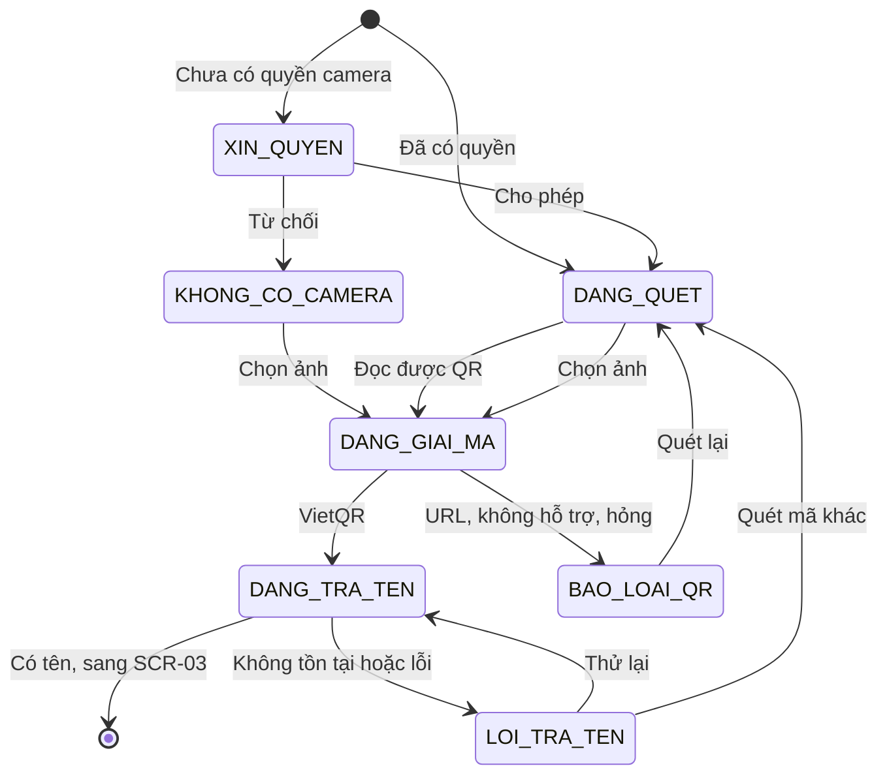

#### Hiển thị theo loại QR

| **Loại** | **Hiển thị** |
| --- | --- |
| `VIETQR_TINH`, `VIETQR_DONG` | Lớp phủ "Đang kiểm tra người nhận…" rồi sang **SCR-03** |
| `URL` | Bottom sheet MSG-04: tên miền, \[Mở\] \[Quét lại\] |
| `KHONG_HO_TRO` | Bottom sheet MSG-08 kèm tên loại QR nếu nhận ra |
| `HONG` | Toast MSG-09, tiếp tục quét |

### 4.2 Bước 2 · Chọn số tiền

#### Trạng thái nút Xác nhận trên SCR-03

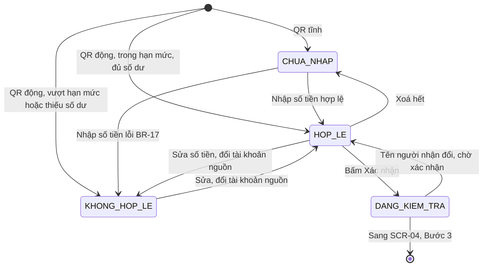

| **Trạng thái** | **Hiển thị nút** |
| --- | --- |
| `CHUA_NHAP` | "Xác nhận" tắt |
| `KHONG_HOP_LE` | Tắt; lỗi đỏ dưới ô số tiền |
| `HOP_LE` | "Xác nhận" bật |
| `DANG_KIEM_TRA` | Spinner, không bấm lại được |

### 4.3 Bước 3 · Xác nhận & xác thực chuyển khoản

#### Giao dịch trong phạm vi Bước 3

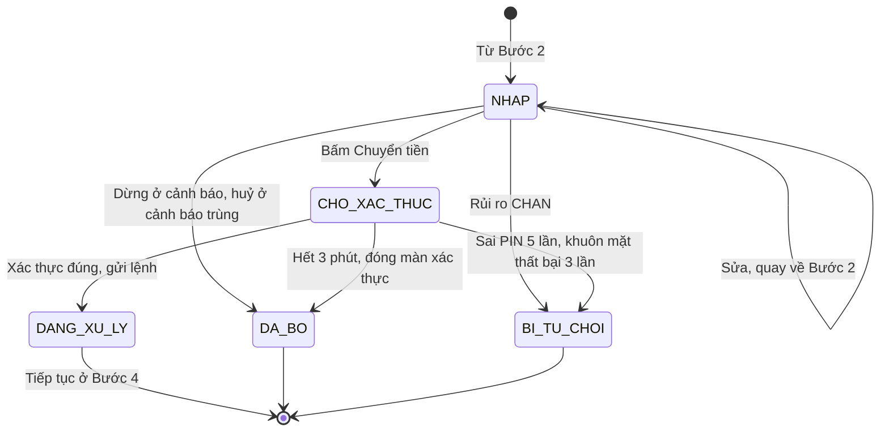

`DA_BO`, `BI_TU_CHOI` không xuất hiện trong lịch sử giao dịch; `BI_TU_CHOI` được ghi log an ninh.

#### Hiển thị nút trên SCR-04

| **Tình huống** | **Hiển thị** |
| --- | --- |
| Bình thường | "Chuyển tiền" (chính), "Sửa" (phụ) |
| Cần khuôn mặt, đã đăng ký | "Chuyển tiền" + dòng "Giao dịch này cần xác thực khuôn mặt" |
| Cần khuôn mặt, chưa đăng ký | "Đăng ký ngay" thay "Chuyển tiền", MSG-23 |
| Rủi ro lỗi, cảnh báo nhẹ | Banner vàng trên đầu màn |

### 4.4 Bước 4 · Hoàn thành chuyển khoản

#### Giao dịch trong phạm vi Bước 4

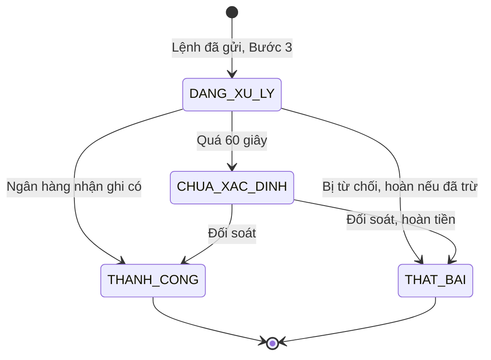

#### Hiển thị trên SCR-06

| **Trạng thái** | **Hiển thị** | **Nút** |
| --- | --- | --- |
| `DANG_XU_LY` | Vòng chờ, "Đang chuyển tiền…" | "Về trang chủ" sau 10 giây |
| `THANH_CONG` | Tích xanh lớn, "Chuyển tiền thành công", biên lai | Chia sẻ, Lưu người nhận, Quét tiếp, Về trang chủ |
| `THAT_BAI` | Biểu tượng đỏ, MSG-30 | Thử lại, Về trang chủ |
| `CHUA_XAC_DINH` | Đồng hồ vàng, MSG-31 | Xem chi tiết, Về trang chủ |

## 5. Use Case

### Bước 1 · Quét mã QR

#### UC-01 Mở màn quét

| **Mục** | **Nội dung** |
| --- | --- |
| Tiền điều kiện | App đã cài, thiết bị đã đăng ký với ngân hàng |
| Hậu điều kiện thành công | **SCR-02** mở với camera hoạt động, hoặc chế độ chỉ chọn ảnh |
| Hậu điều kiện thất bại | Ở lại màn đăng nhập hoặc trang chủ |

**Luồng chính**

| **Bước** | **Actor** | **Mô tả** |
| --- | --- | --- |
| 1 | Người trả tiền | Chạm "Quét QR" ở màn đăng nhập |
| 2 | App | Gọi xác thực sinh trắc của hệ điều hành |
| 3 | Người trả tiền | Xác thực thành công |
| 4 | App | Đăng nhập nền (\[Login\]), mở **SCR-02**, bật camera |

**Luồng thay thế**

| **Mã** | **Điều kiện** | **Xử lý** |
| --- | --- | --- |
| A1 | Đã đăng nhập, chạm nút giữa trang chủ | Mở **SCR-02** ngay |
| A2 | Chưa bật sinh trắc | Nhập mật khẩu rồi mở **SCR-02** |
| A3 | Chưa hỏi quyền camera | Màn giải thích "App cần camera để quét mã QR" → hỏi quyền (BR-02) |
| A4 | Từ chối quyền camera | **SCR-02** chế độ chỉ chọn ảnh, MSG-01 |

**Luồng lỗi**

| **Mã** | **Điều kiện** | **Xử lý** |
| --- | --- | --- |
| E1 | Sinh trắc thất bại 3 lần | Chuyển sang nhập mật khẩu |
| E2 | Camera bị app khác chiếm | MSG-10, nút Chọn ảnh vẫn dùng được |

#### UC-02 Quét, nhận diện và tra tên người nhận

| **Mục** | **Nội dung** |
| --- | --- |
| Tiền điều kiện | **SCR-02** đang mở |
| Hậu điều kiện thành công | Có thông tin người nhận (tên, ngân hàng, số tài khoản, số tiền và nội dung nếu QR động, cờ cảnh báo); mở **SCR-03** |
| Hậu điều kiện thất bại | Ở lại **SCR-02** với thông báo |

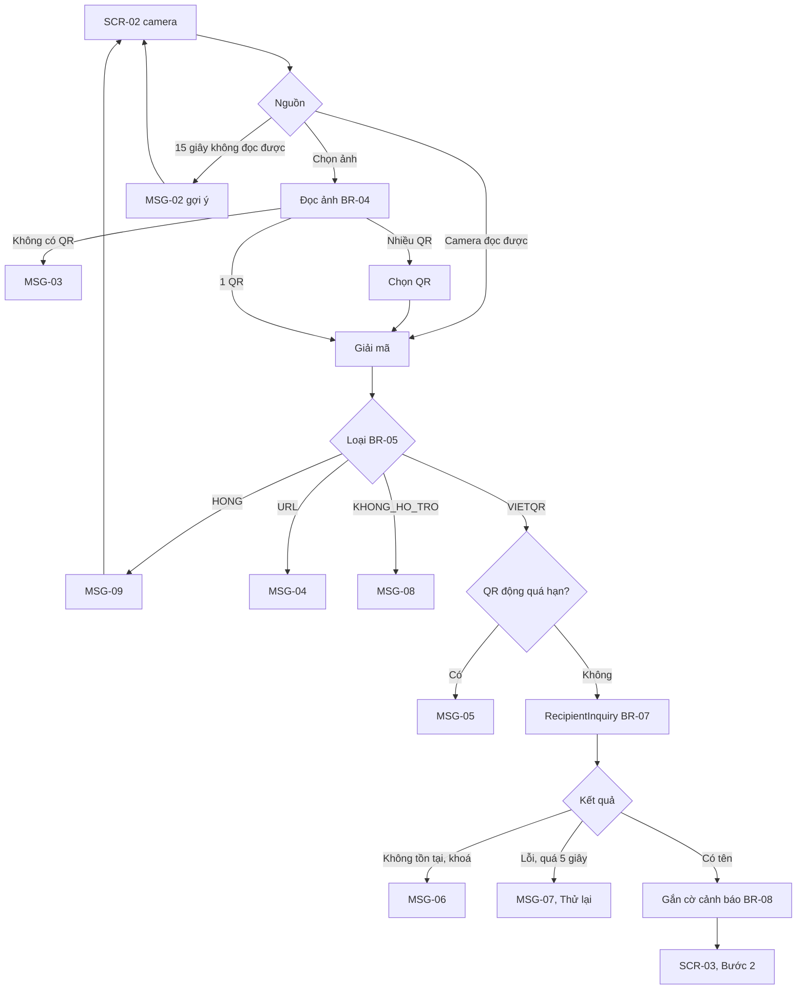

**Luồng chính**

| **Bước** | **Actor** | **Mô tả** |
| --- | --- | --- |
| 1 | Người trả tiền | Đưa camera vào QR |
| 2 | App | Đọc được QR, rung nhẹ, dừng camera; giải mã, phân loại `VIETQR_TINH` |
| 3 | App | Hiện lớp phủ "Đang kiểm tra người nhận…"; gọi \[RecipientInquiry\] |
| 4 | Máy chủ | Tra tên (nội bộ hoặc qua Napas); kiểm tra danh sách cảnh báo |
| 5 | App | Nhận tên chủ tài khoản, ngân hàng; mở **SCR-03** |

**Luồng thay thế**

| **Mã** | **Điều kiện** | **Xử lý** |
| --- | --- | --- |
| A1 | QR động | Số tiền, nội dung từ QR được chuyển sang **SCR-03** và khoá số tiền (Bước 2) |
| A2 | Chọn ảnh từ thư viện | Theo BR-04 |
| A3 | Ảnh có nhiều QR | Khoanh từng QR, người dùng chạm chọn |
| A4 | Tài khoản trong danh sách cảnh báo | Vẫn mở **SCR-03** với cờ `CANH_BAO` (BR-08) |
| A5 | Bật đèn, phóng to | Nút đèn; kéo hai ngón hoặc thanh trượt để phóng to |

**Luồng lỗi**

| **Mã** | **Điều kiện** | **Xử lý** |
| --- | --- | --- |
| E1 | QR hỏng | MSG-09, tiếp tục quét |
| E2 | QR không hỗ trợ | MSG-08 |
| E3 | QR là URL | MSG-04 (BR-09) |
| E4 | QR động quá hạn | MSG-05 |
| E5 | Tài khoản không tồn tại, bị khoá | MSG-06 |
| E6 | Tra tên lỗi hoặc quá 5 giây | MSG-07; thử lại tối đa 3 lần rồi gợi ý quét lại |

### Bước 2 · Chọn số tiền

#### UC-03 Chọn số tiền

| **Mục** | **Nội dung** |
| --- | --- |
| Tiền điều kiện | Có người nhận đã tra tên (Bước 1) |
| Hậu điều kiện thành công | Lệnh nháp có số tiền, nội dung, tài khoản nguồn hợp lệ; mở **SCR-04** Xem lại giao dịch (Bước 3) |
| Hậu điều kiện thất bại | Ở lại **SCR-03** với lỗi, hoặc bỏ giao dịch |

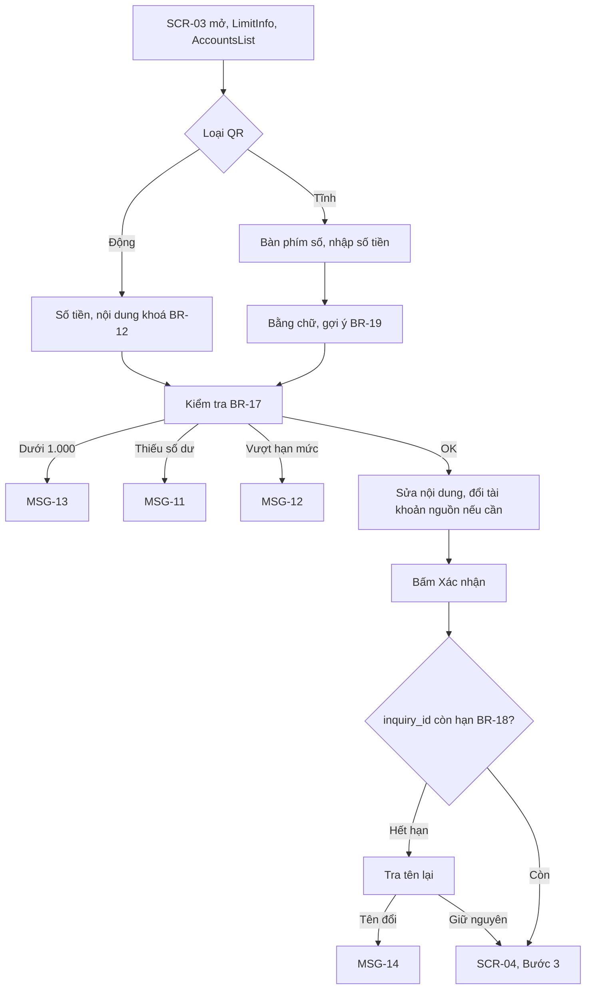

**Luồng chính**

| **Bước** | **Actor** | **Mô tả** |
| --- | --- | --- |
| 1 | App | Mở **SCR-03**: người nhận, tài khoản nguồn mặc định; gọi \[AccountsList\], \[LimitInfo\] |
| 2 | Người trả tiền | Gõ "35" |
| 3 | App | Hiện "35" và gợi ý 35.000, 350.000, 3.500.000 ₫ |
| 4 | Người trả tiền | Chạm 35.000 ₫ |
| 5 | App | Hiện "35.000 ₫ · Ba mươi lăm nghìn đồng"; kiểm tra BR-17 hợp lệ |
| 6 | Người trả tiền | Giữ nội dung mặc định, bấm "Xác nhận" |
| 7 | App | inquiry_id còn hạn → mở **SCR-04** Xem lại giao dịch (Bước 3) |

**Luồng thay thế**

| **Mã** | **Điều kiện** | **Xử lý** |
| --- | --- | --- |
| A1 | QR động | Bỏ bước 2–5 (BR-12) |
| A2 | Đổi tài khoản nguồn | Bottom sheet danh sách tài khoản, số dư từng tài khoản; chọn xong kiểm tra lại BR-17 |
| A3 | Người nhận có cờ cảnh báo (Bước 1 BR-08) | Banner đỏ MSG-15 trên đầu **SCR-03** |
| A4 | Quay lại | BR-20 |

**Luồng lỗi**

| **Mã** | **Điều kiện** | **Xử lý** |
| --- | --- | --- |
| E1 | Không đủ số dư | MSG-11 |
| E2 | Vượt hạn mức | MSG-12 |
| E3 | Dưới số tiền tối thiểu | MSG-13 |
| E4 | Tên người nhận đổi khi tra lại | MSG-14 |
| E5 | Không lấy được số dư, hạn mức | MSG-16; nút Xác nhận vẫn bật, máy chủ kiểm tra ở Bước 3 |
| E6 | Không còn tài khoản nguồn hợp lệ | MSG-17, không cho tiếp tục |

### Bước 3 · Xác nhận & xác thực chuyển khoản

#### UC-04 Xem lại giao dịch

| **Mục** | **Nội dung** |
| --- | --- |
| Tiền điều kiện | Lệnh nháp hợp lệ từ Bước 2 |
| Hậu điều kiện thành công | Giao dịch `CHO_XAC_THUC`, mở xác thực |
| Hậu điều kiện thất bại | `DA_BO`, `BI_TU_CHOI`, hoặc quay về **SCR-03** |

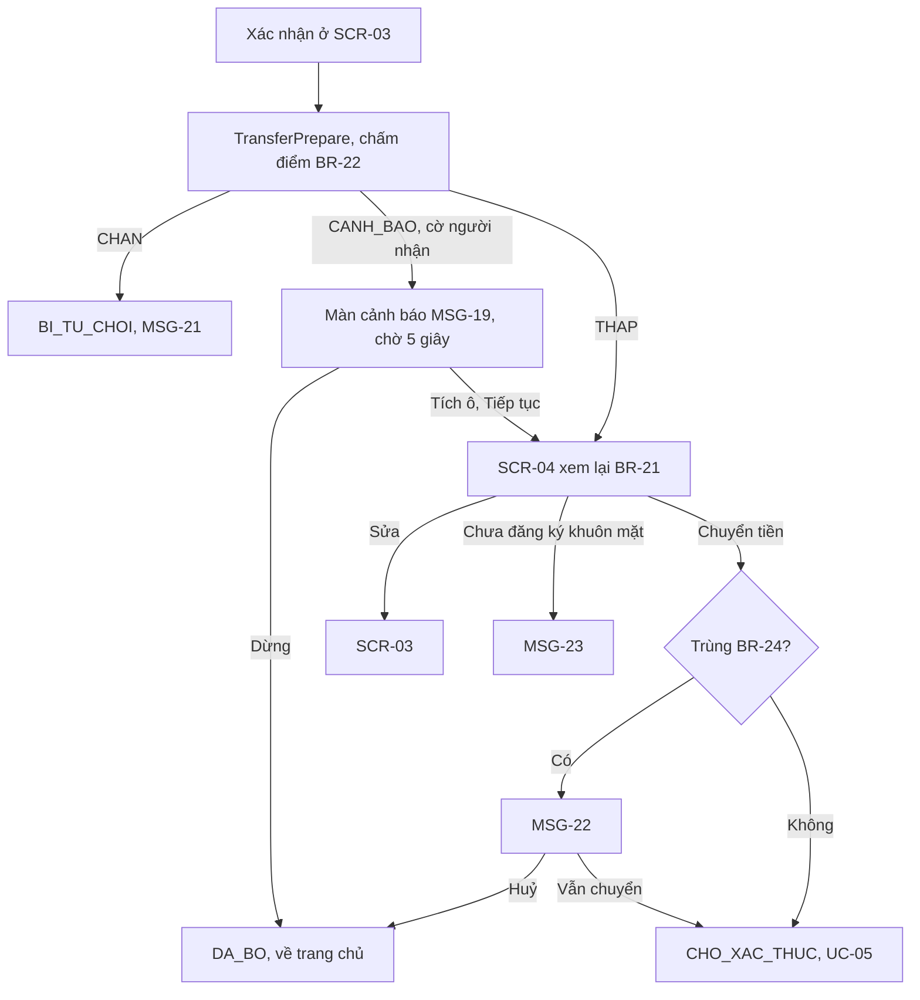

**Luồng chính**

| **Bước** | **Actor** | **Mô tả** |
| --- | --- | --- |
| 1 | App | Gọi \[TransferPrepare\]; nhận transaction_id, mức xác thực, kết quả rủi ro `THAP` |
| 2 | App | Hiện **SCR-04** theo BR-21 |
| 3 | Người trả tiền | Kiểm tra, bấm "Chuyển tiền" |
| 4 | App | Không trùng; giao dịch `CHO_XAC_THUC`; sang UC-05 |

**Luồng thay thế**

| **Mã** | **Điều kiện** | **Xử lý** |
| --- | --- | --- |
| A1 | Rủi ro `CANH_BAO` | Màn cảnh báo trước **SCR-04** (BR-23) |
| A2 | Bấm Sửa | Về **SCR-03** (Bước 2), giữ dữ liệu |
| A3 | Có giao dịch trùng | MSG-22 (BR-24) |

**Luồng lỗi**

| **Mã** | **Điều kiện** | **Xử lý** |
| --- | --- | --- |
| E1 | Rủi ro `CHAN` | MSG-21 |
| E2 | Cần khuôn mặt, chưa đăng ký | MSG-23 |
| E3 | \[TransferPrepare\] lỗi mạng | MSG-28, ở lại **SCR-03** |

#### UC-05 Xác thực và gửi lệnh

| **Mục** | **Nội dung** |
| --- | --- |
| Tiền điều kiện | Giao dịch `CHO_XAC_THUC` |
| Hậu điều kiện thành công | Lệnh được gửi; giao dịch `DANG_XU_LY`; mở **SCR-06** (Bước 4) |
| Hậu điều kiện thất bại | `DA_BO` hoặc `BI_TU_CHOI`; tiền không bị trừ |

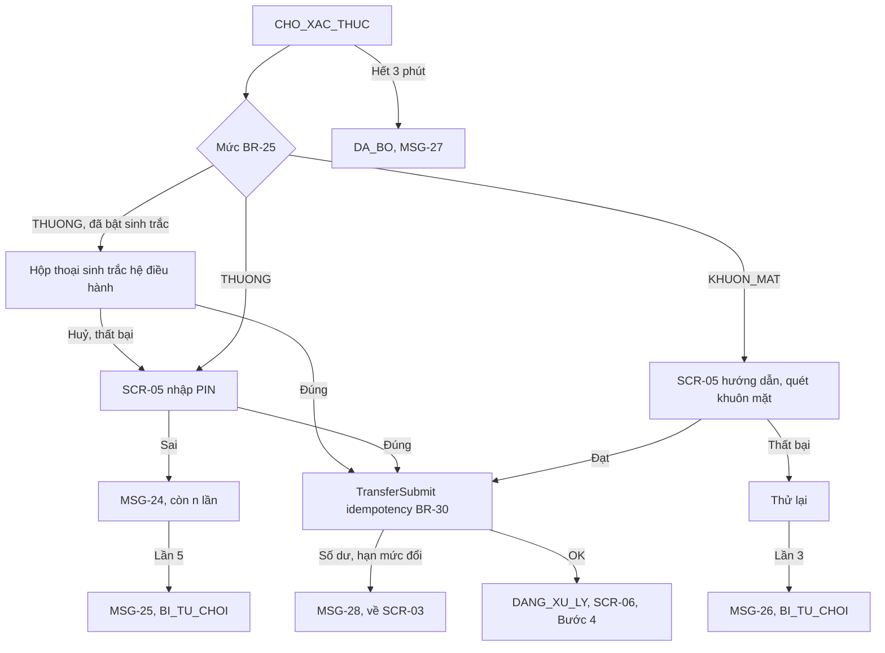

**Luồng chính**

| **Bước** | **Actor** | **Mô tả** |
| --- | --- | --- |
| 1 | App | Mức `THUONG`, đã bật Face ID → hiện hộp thoại Face ID |
| 2 | Người trả tiền | Xác thực thành công |
| 3 | App | Ký lệnh, gọi \[TransferSubmit\] |
| 4 | Máy chủ | Kiểm tra lại số dư, hạn mức; nhận lệnh |
| 5 | App | Mở **SCR-06** trạng thái "Đang chuyển tiền…" (Bước 4) |

**Luồng thay thế**

| **Mã** | **Điều kiện** | **Xử lý** |
| --- | --- | --- |
| A1 | Chưa bật sinh trắc | Nhập PIN trên **SCR-05** |
| A2 | Mức `KHUON_MAT` | Hướng dẫn → camera trước → \[FaceVerify\] |
| A3 | Quên PIN | Link "Quên PIN" mở luồng đặt lại Smart OTP; giao dịch `DA_BO` |

**Luồng lỗi**

| **Mã** | **Điều kiện** | **Xử lý** |
| --- | --- | --- |
| E1 | Sai PIN | MSG-24; lần 5 → MSG-25 |
| E2 | Khuôn mặt thất bại 3 lần | MSG-26 |
| E3 | Hết 3 phút | MSG-27 |
| E4 | Máy chủ báo số dư, hạn mức không còn đủ | MSG-28 |
| E5 | Mất mạng khi gửi | Gửi lại cùng idempotency key; không chắc lệnh đã tới → vẫn mở **SCR-06**, Bước 4 xử lý `CHUA_XAC_DINH` |

### Bước 4 · Hoàn thành chuyển khoản

#### UC-06 Nhận kết quả

| **Mục** | **Nội dung** |
| --- | --- |
| Tiền điều kiện | Giao dịch `DANG_XU_LY` |
| Hậu điều kiện thành công | **SCR-06** hiện đúng kết quả; khách nhận push khi có kết quả cuối |
| Hậu điều kiện thất bại | – |

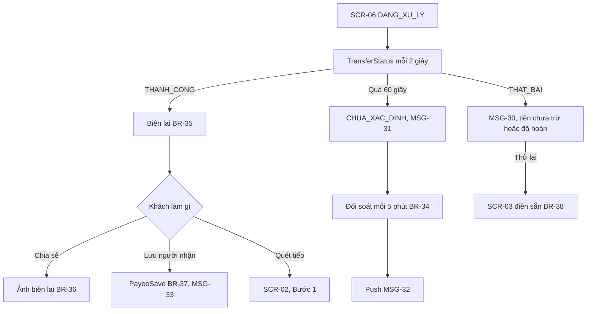

**Luồng chính**

| **Bước** | **Actor** | **Mô tả** |
| --- | --- | --- |
| 1 | App | **SCR-06** "Đang chuyển tiền…"; gọi \[TransferStatus\] |
| 2 | Máy chủ | Nhận ghi có thành công từ ngân hàng nhận |
| 3 | App | **SCR-06** `THANH_CONG`, rung nhẹ, biên lai |
| 4 | Người trả tiền | Giơ màn hình cho người bán; bấm "Quét tiếp" |

**Luồng thay thế**

| **Mã** | **Điều kiện** | **Xử lý** |
| --- | --- | --- |
| A1 | Chia sẻ biên lai | BR-36 |
| A2 | Lưu người nhận | Bật ô, đặt tên → \[PayeeSave\]; MSG-33 |
| A3 | Về trang chủ khi đang xử lý | Kết quả qua push MSG-32 |
| A4 | Thất bại, bấm Thử lại | BR-38 |

**Luồng lỗi**

| **Mã** | **Điều kiện** | **Xử lý** |
| --- | --- | --- |
| E1 | Ngân hàng nhận từ chối | MSG-30 |
| E2 | Quá 60 giây | MSG-31 |
| E3 | Danh bạ đầy | MSG-34 |
| E4 | Mất mạng trên app | Banner MSG-35; khi có mạng gọi lại \[TransferStatus\] |

#### UC-07 Xem chi tiết giao dịch

**Luồng chính**

| **Bước** | **Actor** | **Mô tả** |
| --- | --- | --- |
| 1 | Người trả tiền | Chạm push MSG-32 hoặc mở giao dịch từ lịch sử của app |
| 2 | App | Gọi \[TxDetail\]; hiện **SCR-07** với trạng thái hiện tại và biên lai |
| 3 | Người trả tiền | Bấm "Chuyển lại" |
| 4 | App | Mở **SCR-03** điền sẵn (BR-38) |

**Luồng thay thế**

| **Mã** | **Điều kiện** | **Xử lý** |
| --- | --- | --- |
| A1 | Giao dịch `CHUA_XAC_DINH` | Hiện MSG-31 và hạn có kết quả; không có Chuyển lại |
| A2 | Cần hỗ trợ | Link "Liên hệ hỗ trợ" mở kênh hỗ trợ sẵn có, kèm mã giao dịch |

## 6. Điểm vào

| **Điểm vào** | **Dẫn tới** | **Ghi chú** |
| --- | --- | --- |
| Nút Quét QR ở màn đăng nhập | UC-01 | BR-01 |
| Nút giữa thanh điều hướng | **SCR-02** | |
| Menu nhanh biểu tượng app | UC-01 | |
| Chia sẻ ảnh QR từ app khác vào app ngân hàng | UC-02 bước chọn ảnh | Sau khi đăng nhập |
| Tra tên xong ở **SCR-02** (Bước 1) | **SCR-03** | |
| "Sửa" ở **SCR-04** (Bước 3) | **SCR-03** | Giữ dữ liệu đã nhập |
| "Chuyển lại" ở chi tiết giao dịch (Bước 4) | **SCR-03** điền sẵn người nhận, số tiền, nội dung | Tra tên lại |
| "Xác nhận" ở **SCR-03** (Bước 2) | UC-04 | |
| Quay lại từ màn đăng ký khuôn mặt thành công | **SCR-04** | Giữ giao dịch nếu chưa quá 10 phút |
| Gửi lệnh ở Bước 3 | **SCR-06** | |
| Push kết quả | **SCR-07** | |
| Lịch sử giao dịch sẵn có của app | **SCR-07** | |

## 7. Mô tả màn hình

<!-- Bước 1 · Quét mã QR -->
### SCR-01 Trang chủ (phần liên quan)

| **#** | **Thành phần** | **Loại** | **Hành vi** |
| --- | --- | --- | --- |
| 1 | Nút Quét QR | Tab bar, nút giữa | Nổi bật nhất trên thanh điều hướng; mở **SCR-02** |
| 2 | Số dư tài khoản chính | Card | Ẩn mặc định, chạm con mắt để hiện |

### SCR-02 Quét QR

| **#** | **Thành phần** | **Loại** | **Hành vi** |
| --- | --- | --- | --- |
| 1 | Camera toàn màn | Camera view | Đọc liên tục (BR-03) |
| 2 | Khung ngắm | Overlay | Chỉ để hướng dẫn, đọc được cả ngoài khung |
| 3 | Chú thích | Text | "Đưa mã QR vào khung để quét" |
| 4 | Đèn flash | Icon toggle | Bật, tắt đèn |
| 5 | Phóng to | Slider | 1×–4× |
| 6 | Chọn ảnh QR | Button | Mở thư viện ảnh (BR-04) |
| 7 | Đóng | Icon | Về màn trước |
| 8 | Gợi ý | Banner | MSG-02 sau 15 giây |
| 9 | Lớp phủ kiểm tra | Overlay | "Đang kiểm tra người nhận…" khi tra tên |
| 10 | Chế độ không camera | Empty state | MSG-01, "Mở cài đặt", "Chọn ảnh QR" |

<!-- Bước 2 · Chọn số tiền -->
### SCR-03 Chọn số tiền

| **#** | **Thành phần** | **Loại** | **Bắt buộc** | **Validate / hành vi** |
| --- | --- | --- | --- | --- |
| 1 | Người nhận | Card | – | Tên chủ tài khoản (chữ lớn), logo và tên ngân hàng, số tài khoản che giữa |
| 2 | Banner cảnh báo | Banner | – | MSG-15 khi có cờ |
| 3 | Số tiền | Amount display | Có | BR-11; QR động thì khoá (BR-12) |
| 4 | Bằng chữ | Text | – | Cập nhật khi gõ |
| 5 | Lỗi | Text đỏ | – | MSG-11, MSG-12, MSG-13 |
| 6 | Gợi ý nhanh | Chips | – | BR-19 |
| 7 | Nội dung | Text | Có | BR-13; đếm ký tự |
| 8 | Tài khoản nguồn | Dòng chọn | Có | BR-14 |
| 9 | Phí | Text | – | BR-15 |
| 10 | Bàn phím số | Keypad | – | 0–9, 000, xoá; ẩn với QR động |
| 11 | "Xác nhận" | Button | – | Mục 4.1; nằm trên bàn phím |

<!-- Bước 3 · Xác nhận & xác thực chuyển khoản -->
### SCR-04 Xem lại giao dịch (gồm màn cảnh báo)

| **#** | **Thành phần** | **Loại** | **Hành vi** |
| --- | --- | --- | --- |
| 1 | Số tiền | Text lớn | Kèm bằng chữ |
| 2 | Người nhận | List | Tên chủ tài khoản, ngân hàng, số tài khoản đầy đủ |
| 3 | Nội dung | Text | Bản sẽ gửi |
| 4 | Tài khoản nguồn | Text | Số tài khoản che giữa |
| 5 | Phí, tổng trừ | Text | |
| 6 | Cách xác thực | Info | BR-25; MSG-23 khi chưa đăng ký |
| 7 | Banner cảnh báo nhẹ | Banner | BR-22 khi chấm điểm lỗi |
| 8 | "Sửa", "Chuyển tiền" | Button | Mục 4.2; "Chuyển tiền" dính đáy |
| 9 | Màn cảnh báo | Full screen | Biểu tượng cảnh báo, MSG-19, MSG-20; nút chính "Dừng giao dịch"; ô tích; "Tiếp tục" bật sau 5 giây; số tổng đài khẩn |

### SCR-05 Xác thực giao dịch

| **#** | **Thành phần** | **Loại** | **Hành vi** |
| --- | --- | --- | --- |
| 1 | Tóm tắt | Card | Người nhận, số tiền |
| 2 | PIN Smart OTP | 6 ô số | Bàn phím xáo vị trí; ẩn ký tự |
| 3 | Dùng sinh trắc | Link | Khi đã bật sinh trắc thiết bị |
| 4 | Khuôn mặt | Camera tròn | Hướng dẫn, kiểm tra người thật, tiến trình |
| 5 | Đếm ngược | Timer | 3 phút (BR-29) |
| 6 | Quên PIN | Link | A3 UC-05 |

<!-- Bước 4 · Hoàn thành chuyển khoản -->
### SCR-06 Kết quả & biên lai

| **#** | **Thành phần** | **Loại** | **Hành vi** |
| --- | --- | --- | --- |
| 1 | Trạng thái | Icon + tiêu đề | Mục 4.2 |
| 2 | Số tiền | Text lớn | Kèm bằng chữ |
| 3 | Biên lai | List | BR-35 |
| 4 | Chia sẻ | Button | BR-36 |
| 5 | Lưu người nhận | Checkbox + Text | BR-37 |
| 6 | Quét tiếp, Về trang chủ, Thử lại | Button | Theo trạng thái |

### SCR-07 Chi tiết giao dịch

| **#** | **Thành phần** | **Loại** | **Hành vi** |
| --- | --- | --- | --- |
| 1 | Trạng thái, số tiền | Header | Màu theo trạng thái |
| 2 | Biên lai | List | BR-35; mã giao dịch sao chép được |
| 3 | Mốc thời gian | Timeline | Gửi lệnh, kết quả, hoàn tiền (nếu có) |
| 4 | Chia sẻ, Chuyển lại | Button | `THANH_CONG` |
| 5 | Liên hệ hỗ trợ | Link | A2 UC-07 |

## 8. API

### 8.1 Bước 1 · Quét mã QR

| **API** | **Request chính** | **Response chính** | **Timeout / retry** |
| --- | --- | --- | --- |
| \[Login\] | Khoá thiết bị, chữ ký sinh trắc | Phiên đăng nhập | 10s / 1 lần |
| \[RecipientInquiry\] | Chuỗi QR đã giải mã (bank_bin, account_or_card, amount, note) | recipient_name, bank_name, masked_account, risk_flag, inquiry_id (hiệu lực 10 phút) | 5s / người dùng tự thử lại |

Giải mã, kiểm tra CRC và phân loại QR (BR-05) chạy trên thiết bị.

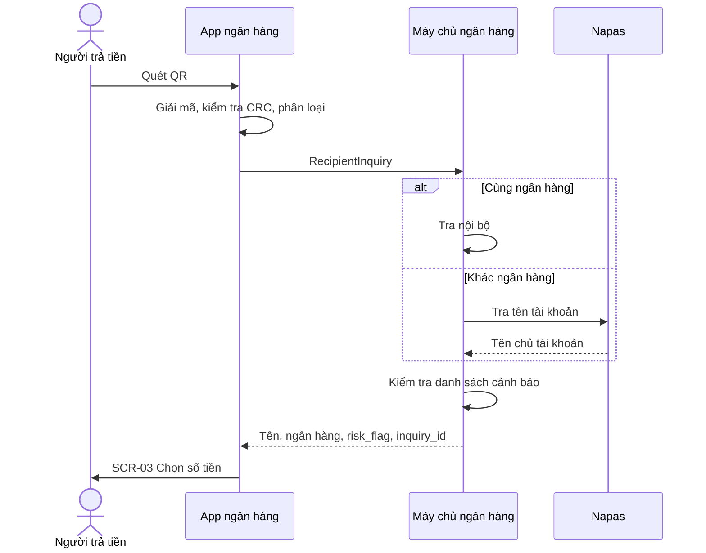

**Map lỗi → thông báo**

| **Nhóm lỗi** | **Message** |
| --- | --- |
| Không có quyền camera | MSG-01 |
| Chưa đọc được sau 15 giây | MSG-02 |
| Ảnh không có QR | MSG-03 |
| QR là đường link | MSG-04 |
| QR động hết hạn | MSG-05 |
| Tài khoản nhận không tồn tại, bị khoá | MSG-06 |
| Tra tên lỗi, quá thời gian | MSG-07 |
| QR không hỗ trợ | MSG-08 |
| QR hỏng | MSG-09 |
| Camera không khả dụng | MSG-10 |

### 8.2 Bước 2 · Chọn số tiền

| **API** | **Request chính** | **Response chính** | **Timeout / retry** |
| --- | --- | --- | --- |
| \[AccountsList\] | – | Tài khoản nguồn, số dư khả dụng | 5s / 1 lần |
| \[LimitInfo\] | source_account | Hạn mức giao dịch, hạn mức ngày, đã dùng hôm nay | 3s / 1 lần |
| \[FeeQuote\] | source_account, bank_bin, amount | fee | 3s / 1 lần; cache theo ngân hàng nhận |
| \[RecipientInquiry\] | Như Bước 1 | Tên, inquiry_id mới | 5s / người dùng thử lại |

Kiểm tra BR-17 chạy trên máy với số dư, hạn mức đã tải; máy chủ kiểm tra lại ở Bước 3.

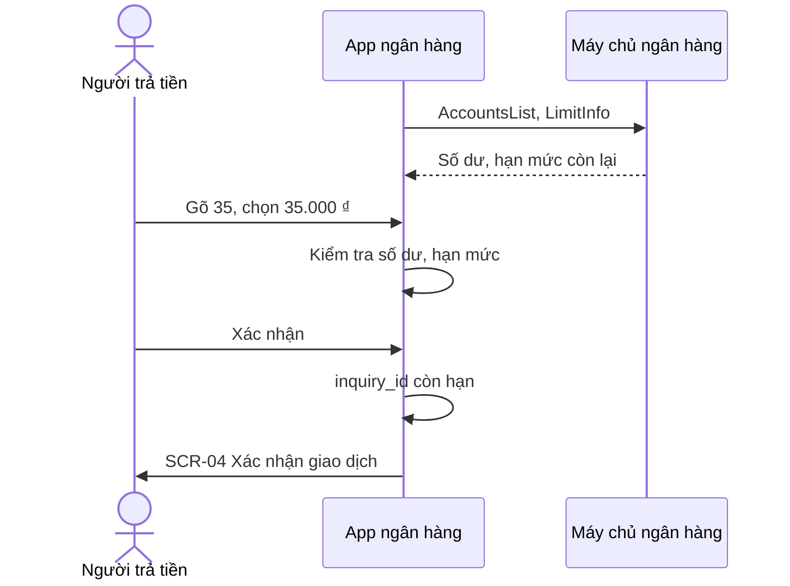

**Map lỗi → thông báo**

| **Nhóm lỗi** | **Message** |
| --- | --- |
| Không đủ số dư | MSG-11 |
| Vượt hạn mức | MSG-12 |
| Dưới số tiền tối thiểu | MSG-13 |
| Tên người nhận thay đổi | MSG-14 |
| Người nhận có cờ cảnh báo | MSG-15 |
| Không tải được số dư, hạn mức | MSG-16 |
| Không có tài khoản nguồn | MSG-17 |
| Mất mạng | MSG-18 |

### 8.3 Bước 3 · Xác nhận & xác thực chuyển khoản

| **API** | **Request chính** | **Response chính** | **Timeout / retry** |
| --- | --- | --- | --- |
| \[TransferPrepare\] | inquiry_id, amount, note, source_account | transaction_id, auth_level, risk_result, risk_reasons, duplicate_hint, idempotency_key | 5s / 1 lần |
| \[FaceVerify\] | transaction_id, dữ liệu khuôn mặt mã hoá | verified, liveness | 15s / không retry tự động |
| \[TransferSubmit\] | transaction_id, chữ ký Smart OTP, idempotency_key | status `DANG_XU_LY` hoặc lỗi | 30s / gửi lại cùng key |

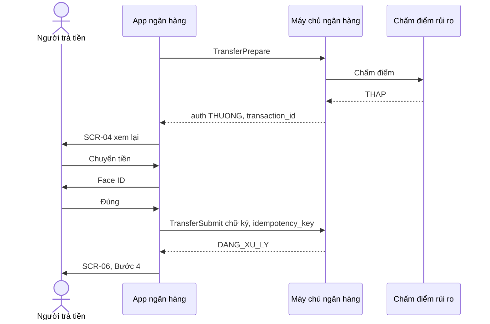

**Map lỗi → thông báo**

| **Nhóm lỗi** | **Message** |
| --- | --- |
| Người nhận đáng ngờ, giao dịch bất thường | MSG-19 |
| Đang có cuộc gọi | MSG-20 |
| Bị chặn vì rủi ro | MSG-21 |
| Giao dịch trùng | MSG-22 |
| Chưa đăng ký khuôn mặt | MSG-23 |
| Sai PIN | MSG-24 |
| Khoá Smart OTP | MSG-25 |
| Khuôn mặt thất bại | MSG-26 |
| Hết thời gian xác thực | MSG-27 |
| Số dư, hạn mức thay đổi; mất mạng | MSG-28 |

### 8.4 Bước 4 · Hoàn thành chuyển khoản

| **API** | **Request chính** | **Response chính** | **Timeout / retry** |
| --- | --- | --- | --- |
| \[TransferStatus\] | transaction_id | status, reason_code, refunded | 3s / mỗi 2 giây tới 60 giây |
| \[TxDetail\] | transaction_id | Chi tiết, mốc thời gian, allowed_actions | 5s / 1 lần |
| \[ReceiptImage\] | transaction_id | Ảnh biên lai | 5s / 1 lần; có thể tạo trên máy |
| \[PayeeSave\] | bank, account, nickname | payee_id | 5s / 1 lần |

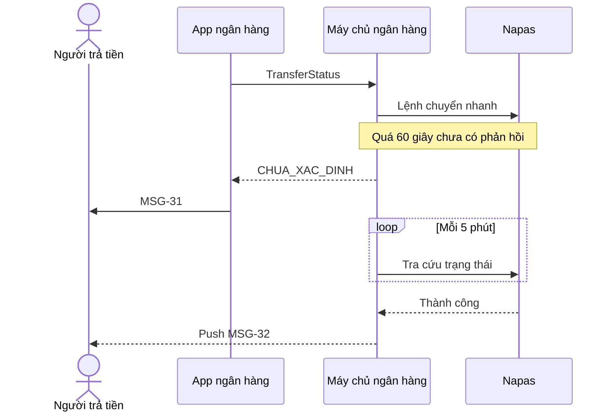

**Map lỗi → thông báo**

| **Nhóm** | **Message** |
| --- | --- |
| Thành công | MSG-29 |
| Thất bại | MSG-30 |
| Chưa xác định | MSG-31 |
| Có kết quả cuối (push) | MSG-32 |
| Đã lưu người nhận | MSG-33 |
| Danh bạ đầy | MSG-34 |
| Mất mạng | MSG-35 |

## 9. Danh sách thông báo

| **ID** | **Nơi hiện** | **Nội dung (VI)** |
| --- | --- | --- |
| MSG-01 | Empty state **SCR-02** | Bạn chưa cho phép dùng camera. Bật camera trong Cài đặt hoặc chọn ảnh QR có sẵn. \[Mở cài đặt\] \[Chọn ảnh QR\] |
| MSG-02 | Banner **SCR-02** | Chưa đọc được mã. Thử bật đèn, đưa máy gần hơn, hoặc chọn ảnh QR |
| MSG-03 | Toast | Không tìm thấy mã QR trong ảnh này |
| MSG-04 | Bottom sheet | Mã này là một đường link: {tên miền}. Ngân hàng không bao giờ yêu cầu bạn nhập mật khẩu, mã OTP qua link lạ. \[Mở bằng trình duyệt\] \[Quét lại\] |
| MSG-05 | Popup | Mã QR này đã hết hạn. Vui lòng xin người nhận mã mới |
| MSG-06 | Popup | Tài khoản nhận không tồn tại hoặc đang bị khoá. Vui lòng kiểm tra lại với người nhận |
| MSG-07 | Popup | Chưa kiểm tra được thông tin người nhận. \[Thử lại\] \[Quét mã khác\] |
| MSG-08 | Bottom sheet | App chưa hỗ trợ loại mã này{: tên loại}. Bạn có thể nhập số tài khoản để chuyển khoản |
| MSG-09 | Toast | Mã QR bị lỗi hoặc không đầy đủ. Vui lòng quét lại |
| MSG-10 | Toast | Camera đang được ứng dụng khác sử dụng |
| MSG-11 | Inline số tiền | Số dư khả dụng không đủ. Số dư hiện tại: {số dư} ₫ |
| MSG-12 | Inline số tiền | Vượt hạn mức chuyển tiền. Hôm nay bạn còn chuyển được {số tiền} ₫. \[Đổi hạn mức\] |
| MSG-13 | Inline số tiền | Số tiền tối thiểu là 1.000 ₫ |
| MSG-14 | Popup | Tên người nhận vừa cập nhật thành "{tên mới}". Bạn có chắc vẫn chuyển cho người này? \[Tiếp tục\] \[Quét mã khác\] |
| MSG-15 | Banner | Tài khoản nhận đã bị báo cáo có dấu hiệu lừa đảo. Hãy kiểm tra kỹ trước khi chuyển |
| MSG-16 | Toast | Chưa cập nhật được số dư. Bạn vẫn có thể tiếp tục |
| MSG-17 | Popup | Bạn chưa có tài khoản thanh toán có thể chuyển tiền. Vui lòng liên hệ tổng đài {số} |
| MSG-18 | Toast | Kết nối không ổn định, vui lòng thử lại |
| MSG-19 | Màn cảnh báo | {Tài khoản này đã bị báo cáo có dấu hiệu lừa đảo / Giao dịch này khác thói quen của bạn}. Ngân hàng, công an, cơ quan nhà nước **không bao giờ** yêu cầu bạn chuyển tiền qua điện thoại. ☐ Tôi hiểu rủi ro và tự chịu trách nhiệm \[Dừng giao dịch\] \[Tiếp tục\] |
| MSG-20 | Màn cảnh báo | Bạn có đang được ai đó hướng dẫn chuyển tiền qua điện thoại không? Nếu có, hãy dừng lại và gọi tổng đài {số} |
| MSG-21 | Popup | Giao dịch tạm thời không thể thực hiện để bảo vệ tài khoản của bạn. Gọi {số} để được hỗ trợ |
| MSG-22 | Popup | Bạn vừa chuyển {số tiền} ₫ cho {tên} lúc {giờ}. Bạn có muốn chuyển thêm lần nữa? \[Vẫn chuyển\] \[Huỷ\] |
| MSG-23 | Info **SCR-04** | Giao dịch trên 10 triệu đồng hoặc tổng trong ngày trên 20 triệu đồng cần xác thực khuôn mặt. Bạn chưa đăng ký. \[Đăng ký ngay\] |
| MSG-24 | Inline **SCR-05** | Mã PIN chưa đúng. Bạn còn {n} lần thử |
| MSG-25 | Popup | Smart OTP đã bị khoá do nhập sai 5 lần. \[Mở khoá Smart OTP\] |
| MSG-26 | Popup | Xác thực khuôn mặt chưa thành công. Vui lòng thử lại sau 15 phút, ở nơi đủ sáng |
| MSG-27 | Toast | Phiên xác thực đã hết hạn. Bấm Chuyển tiền để thử lại |
| MSG-28 | Popup | {Số dư hoặc hạn mức vừa thay đổi, vui lòng kiểm tra lại số tiền / Kết nối không ổn định, vui lòng thử lại} |
| MSG-29 | **SCR-06** | Chuyển tiền thành công |
| MSG-30 | **SCR-06** | Giao dịch không thành công: {Tài khoản nhận không nhận được tiền lúc này / Ngân hàng nhận đang bảo trì / Giao dịch bị từ chối}. Tiền {chưa bị trừ / đã được hoàn về tài khoản của bạn} |
| MSG-31 | **SCR-06**, **SCR-07** | Giao dịch đang được ngân hàng xác nhận. **Vui lòng không chuyển lại.** Chúng tôi sẽ báo kết quả cho bạn, chậm nhất trong 1 ngày làm việc |
| MSG-32 | Push | Giao dịch {số tiền} ₫ tới {tên} lúc {giờ}: {Thành công / Không thành công, tiền đã được hoàn về tài khoản} |
| MSG-33 | Toast | Đã lưu {tên gợi nhớ} vào danh bạ |
| MSG-34 | Toast | Danh bạ đã đủ 200 người nhận. Xoá bớt để lưu người mới |
| MSG-35 | Banner | Mất kết nối. Kết quả giao dịch sẽ được cập nhật khi có mạng |

## 10. Yêu cầu phi chức năng

| **Mục** | **Yêu cầu** |
| --- | --- |
| Hiệu năng | Camera sẵn sàng ≤ 1 giây sau khi mở **SCR-02**; giải mã ≤ 300 ms; \[RecipientInquiry\] ≤ 2 giây (p95); **SCR-03** hiện ≤ 500 ms; kiểm tra BR-17 và bằng chữ cập nhật ≤ 100 ms sau mỗi lần gõ; \[TransferPrepare\] gồm chấm điểm ≤ 1 giây (p95); \[TransferSubmit\] phản hồi nhận lệnh ≤ 2 giây (p95); 95% giao dịch có kết quả ≤ 10 giây; push kết quả cuối ≤ 1 phút sau khi có kết quả |
| Bảo mật | Không lưu ảnh (BR-10); mọi gọi API trong phiên đăng nhập đã xác thực; chặn chụp màn hình ở lớp phủ kết quả trên Android theo chính sách chung của app; Số dư ẩn mặc định; chặn chụp màn hình theo chính sách chung của app; Smart OTP gắn thiết bị; chặn chụp màn hình ở **SCR-05**; dữ liệu khuôn mặt mã hoá, không lưu trên máy; idempotency bắt buộc; Biên lai không chứa số dư; số tài khoản che giữa |
| Riêng tư | Số tài khoản người nhận hiển thị che bớt, chỉ hiện 4 số cuối khi chưa xác nhận |
| Log / audit | Mỗi lần tra tên: thời điểm, ngân hàng nhận, kết quả, risk_flag (không log chuỗi QR đầy đủ); Số tiền, nguồn, nội dung khi bấm Xác nhận; lỗi gặp phải; Kết quả rủi ro, cảnh báo đã hiện và lựa chọn của khách, mức xác thực, kết quả từng lần xác thực; Thời điểm từng trạng thái, mã lý do, lệnh hoàn tiền |
| Tracking | Mở quét (nguồn lối tắt), thời gian tới đọc được, dùng đèn, phóng to, chọn ảnh, loại QR, kết quả tra tên; Thời gian chọn số tiền, dùng gợi ý, đổi tài khoản nguồn, sửa nội dung, lỗi số dư, hạn mức, bỏ giữa chừng; Thời gian ở **SCR-04**, bấm Sửa, gặp cảnh báo (loại, lựa chọn), loại xác thực, thất bại, bỏ dở; Phân bố kết quả, thời gian tới kết quả, thoát khi đang xử lý, chia sẻ, lưu người nhận, quét tiếp, thử lại, chuyển lại |
| Accessibility | Thông báo bằng giọng đọc khi đọc được mã ("Đã quét. Đang kiểm tra người nhận"); nút đèn, chọn ảnh có nhãn; hỗ trợ cỡ chữ lớn của hệ thống; Số tiền đọc kèm bằng chữ; bàn phím số có nhãn đọc màn hình; lỗi được đọc ngay khi xuất hiện; **SCR-04** đọc tuần tự theo thứ tự quan trọng; nút "Dừng giao dịch" là trọng tâm mặc định ở màn cảnh báo; hướng dẫn khuôn mặt có lời đọc; Kết quả thông báo bằng giọng đọc; trạng thái phân biệt bằng biểu tượng và chữ, không chỉ màu |
| Tuân thủ | Ngưỡng xác thực theo Quyết định 2345/QĐ-NHNN, là cấu hình; lưu bằng chứng xác thực từng giao dịch |
| Tính đúng | Hoàn tiền tự động khi thất bại đã trừ; không có giao dịch kẹt ở `CHUA_XAC_DINH` quá 1 ngày làm việc |
