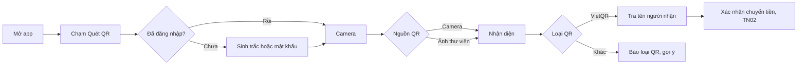

> **Mã:** DE04-TN01-PRD · **Trạng thái:** đã chốt · **Người viết:** Design · **SRS:** [SRS.md](SRS.md)

# PRD Quét mã QR (App ngân hàng, chuyển khoản QR)

## 1. Bối cảnh và vấn đề

### 1.1 Bối cảnh

Quét mã QR là bước đầu tiên của chuyển khoản QR (xem [README](../../README.md)). Người dùng quét QR ở quầy hàng, xe bánh mì, bàn ăn, hoá đơn tiền điện, hoặc ảnh QR bạn bè gửi qua tin nhắn. Thường họ đang đứng, một tay cầm điện thoại, có người chờ phía sau, ánh sáng kém hoặc QR dán trên mặt cong, bị trầy.

### 1.2 Vấn đề

| **Vấn đề** | **Hệ quả** |
| --- | --- |
| Mở app, đăng nhập, tìm nút quét mất nhiều bước | Người phía sau phải chờ, người dùng chuyển sang tiền mặt |
| Quét trong tối, QR nhỏ hoặc bị lóa không nhận | Đứng loay hoay, quét lại nhiều lần |
| QR được gửi dạng ảnh trong tin nhắn | Không có máy thứ hai để quét |
| QR giả dán đè lên QR thật của cửa hàng | Tiền chuyển nhầm người, khó đòi lại |
| Quét phải QR không phải QR chuyển khoản (link web, QR ví khác) | Báo lỗi chung chung, không biết làm gì |

### 1.3 Mục tiêu

- Từ mở app tới nhận diện được QR ≤ 5 giây (trung vị) khi đã bật đăng nhập sinh trắc.
- Tỉ lệ nhận diện thành công lần quét đầu ≥ 95% với QR hợp lệ.
- 100% QR chuyển khoản hiện **tên chủ tài khoản thật** từ ngân hàng nhận trước khi nhập số tiền.

## 2. Người dùng

| **Nhóm** | **Nhu cầu với tính năng này** |
| --- | --- |
| Người trả tiền ở cửa hàng, quán ăn | Mở quét nhanh nhất có thể, một tay |
| Người chia tiền với bạn bè | Quét ảnh QR bạn gửi qua tin nhắn |
| Người lớn tuổi | Biết chắc đã quét đúng người nhận |
| Người dùng ở nơi tối | Bật đèn, phóng to để quét được |

## 3. Phạm vi

### 3.1 Trong phạm vi (MVP)

- Lối tắt Quét QR: trên màn đăng nhập, trang chủ app, biểu tượng app (giữ để mở menu nhanh).
- Màn quét: camera, khung ngắm, đèn flash, phóng to, chọn ảnh từ thư viện.
- Nhận diện QR chuẩn VietQR chuyển tiền tới tài khoản hoặc thẻ của mọi ngân hàng thành viên Napas; phân biệt QR tĩnh (không có số tiền) và QR động (có số tiền).
- Tra tên chủ tài khoản người nhận trước khi chuyển.
- Báo lỗi rõ cho QR không hỗ trợ, QR hỏng.

### 3.2 Ngoài phạm vi

- QR thanh toán hoá đơn của cửa hàng qua cổng thanh toán (QR merchant), QR rút tiền ATM → phase sau.
- QR thanh toán quốc tế.
- Quét mã vạch, quét hoá đơn giấy để thanh toán.
- Chuyển tiền không qua QR (nhập số tài khoản) – xem Đề 7.

## 4. Nguyên tắc sản phẩm

### 4.1 Nhanh như rút ví

Quét QR là hành động được ưu tiên nhất trong app: tới được trong 1 chạm từ màn đăng nhập.

### 4.2 Người nhận phải rõ ràng

Sau khi quét, tên chủ tài khoản do ngân hàng nhận trả về luôn hiện to nhất, trước số tiền.

### 4.3 Lỗi phải nói được cần làm gì

Không có "QR không hợp lệ" chung chung: nói rõ đây là loại QR gì và người dùng có thể làm gì tiếp.

### 4.4 Không chuyển tiền trong màn quét

Màn quét chỉ đọc mã. Mọi giao dịch đều đi qua màn xác nhận (TN02).

## 5. Quy tắc nghiệp vụ

| **Quy tắc** | **Giá trị** |
| --- | --- |
| Chuẩn QR hỗ trợ | VietQR (theo chuẩn EMVCo) chuyển tiền tới tài khoản, thẻ ngân hàng thành viên Napas |
| QR tĩnh | Không có số tiền; người trả tự nhập |
| QR động | Có số tiền (và có thể có nội dung) do người nhận đặt; người trả không sửa được số tiền |
| Ảnh từ thư viện | JPG, PNG, HEIC; tối đa 10 MB |
| Tra tên người nhận | Bắt buộc; không có tên thì không cho chuyển |
| Thời gian chờ camera | Không nhận được QR sau 15 giây → gợi ý bật đèn, chọn ảnh |

## 6. Luồng trải nghiệm

| **Bước** | **Giai đoạn** | **Trải nghiệm** | **Đầu ra** |
| --- | --- | --- | --- |
| 1 | Mở quét | Nút Quét QR ở giữa thanh điều hướng hoặc trên màn đăng nhập | Camera mở |
| 2 | Quét | Khung ngắm, đèn, phóng to; hoặc chọn ảnh | Chuỗi QR |
| 3 | Nhận diện | Rung nhẹ khi đọc được; đọc loại QR | Thông tin người nhận |
| 4 | Tra tên | Hiện tên chủ tài khoản, ngân hàng | Sang TN02 |

## 7. Use Cases, User Stories và Acceptance Criteria

### UC1. Mở quét nhanh

#### US1.1 Quét ngay từ màn đăng nhập

User Story: Là người trả tiền, tôi muốn chạm Quét QR ngay ở màn đăng nhập để không phải vào trang chủ trước.

AC01: Màn đăng nhập có nút Quét QR; chạm → xác thực sinh trắc → mở camera.

AC02: Trang chủ có nút Quét QR nổi bật ở thanh điều hướng.

AC03: Giữ biểu tượng app có lối tắt "Quét QR".

AC04: Chưa cấp quyền camera → giải thích lý do, hỏi quyền; từ chối thì vẫn chọn ảnh được.

### UC2. Quét mã

#### US2.1 Quét bằng camera

User Story: Là người trả tiền, tôi muốn quét được cả khi tối hoặc QR nhỏ.

AC01: Đọc được QR ở bất kỳ vị trí nào trong khung hình; rung nhẹ khi đọc được.

AC02: Có nút đèn flash và kéo để phóng to.

AC03: 15 giây không nhận → gợi ý bật đèn, đưa gần hơn, hoặc chọn ảnh.

#### US2.2 Quét từ ảnh

User Story: Là người chia tiền, tôi muốn chọn ảnh QR bạn gửi để chuyển tiền.

AC01: Chọn ảnh từ thư viện; nhận diện QR trong ảnh.

AC02: Ảnh có nhiều QR → cho chọn QR cần dùng.

AC03: Ảnh không có QR → báo rõ.

### UC3. Nhận diện và kiểm tra người nhận

#### US3.1 Biết chắc người nhận

User Story: Là người trả tiền, tôi muốn thấy tên chủ tài khoản thật để tránh QR giả.

AC01: QR hợp lệ → tra tên tại ngân hàng nhận; hiện tên, ngân hàng, số tài khoản che bớt.

AC02: Tài khoản không tồn tại, bị khoá → báo, không cho chuyển.

AC03: Tài khoản nằm trong danh sách cảnh báo lừa đảo → cảnh báo nổi bật trước khi tiếp tục (chi tiết cảnh báo ở TN02).

#### US3.2 QR không phải chuyển khoản

AC01: QR là link web → hiện link, hỏi có mở bằng trình duyệt không; cảnh báo không nhập mật khẩu ngân hàng ở link lạ.

AC02: QR merchant, QR ví không liên kết, QR quốc tế → báo "chưa hỗ trợ" và tên loại QR.

AC03: QR hỏng, sai mã kiểm tra → báo quét lại.

## 8. Chỉ số theo dõi

| **Chỉ số** | **Định nghĩa** | **Mục tiêu MVP** |
| --- | --- | --- |
| Thời gian tới nhận diện | Từ chạm Quét QR tới đọc được QR hợp lệ | ≤ 5 giây (trung vị) |
| Tỉ lệ nhận diện lần đầu | Phiên quét đọc được QR ngay / phiên quét có QR hợp lệ | ≥ 95% |
| Tỉ lệ dùng ảnh thư viện | Phiên quét bằng ảnh / tổng phiên quét | Theo dõi |
| Tỉ lệ QR không hỗ trợ | Theo loại QR | Theo dõi; ưu tiên phase sau |
| Tỉ lệ dừng sau cảnh báo | Phiên dừng sau cảnh báo tài khoản đáng ngờ / phiên gặp cảnh báo | Theo dõi |

## 9. Phụ thuộc và rủi ro

| **Mục** | **Mô tả** | **Hướng xử lý** |
| --- | --- | --- |
| Dịch vụ tra tên của Napas | Chậm hoặc lỗi | Timeout 5 giây, cho thử lại; không có tên thì không chuyển |
| QR dán đè | Kẻ gian thay QR cửa hàng | Luôn hiện tên chủ tài khoản to, rõ; nhắc người dùng đối chiếu |
| Camera máy cũ | Lấy nét kém | Cho phóng to, đèn, chọn ảnh |
| Ảnh chụp màn hình QR | Có thể chứa QR đã hết hạn | QR động kiểm tra thời hạn (nếu có) |

## 10. Câu hỏi mở

> Mọi câu hỏi dưới đây đã được PO chốt ngày 20/11/2026; quyết định ghi sau mỗi câu và đã cập nhật vào SRS.

- Có cho quét khi chưa đăng nhập không? → **Đã chốt:** Không. Chạm Quét QR ở màn đăng nhập sẽ yêu cầu sinh trắc trước, rồi mở camera (SRS BR-01).
- Tra tên người nhận lúc nào? → **Đã chốt:** Ngay sau khi nhận diện, trước khi mở màn nhập số tiền (SRS BR-07).
- QR động có hạn sử dụng không? → **Đã chốt:** Nếu QR chứa thời hạn thì kiểm tra; quá hạn thì báo và không cho chuyển (SRS BR-06).
- Có lưu lịch sử mã đã quét? → **Đã chốt:** Không lưu riêng; người nhận đã chuyển thành công nằm trong lịch sử giao dịch (TN04).
