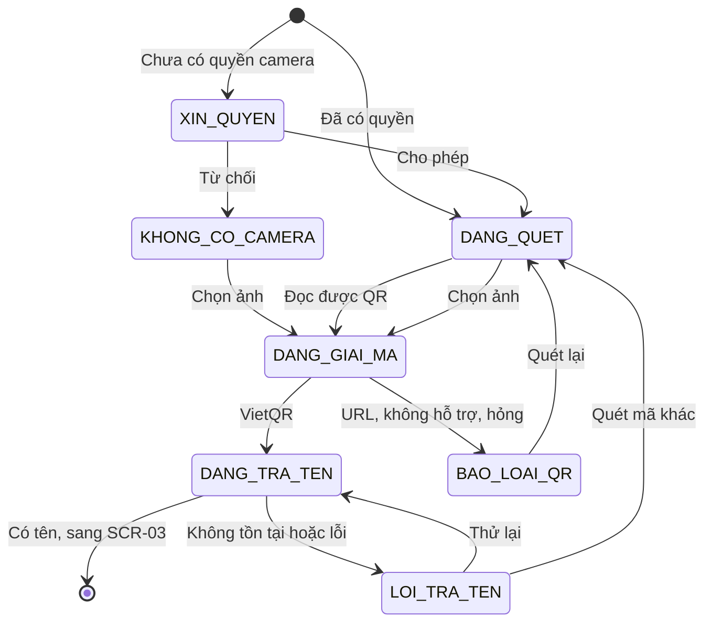
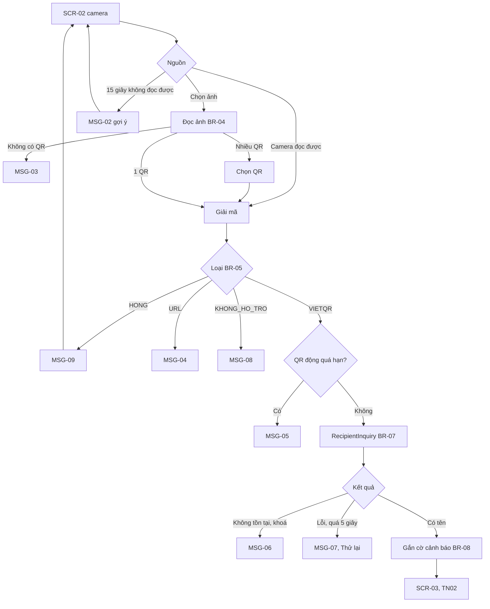
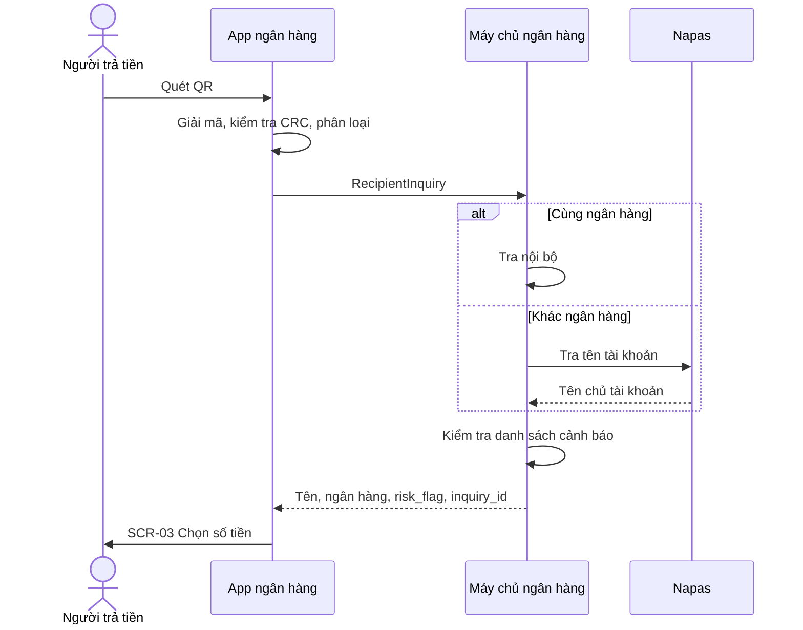

> **Mã:** DE04-TN01-SRS · **Trạng thái:** đã chốt · **Người viết:** Design · **PRD:** [PRD.md](PRD.md)

# UC-DE04-01 - Quét mã QR

> SRS này mô tả từ lúc mở màn quét đến khi có thông tin người nhận đã tra tên; chọn số tiền xem [SRS TN02](../TN02-chon-so-tien/SRS.md).

## 1. Tổng quan

| **Mục** | **Nội dung** |
| --- | --- |
| Mục tiêu | Người trả tiền mở quét nhanh, đọc được QR từ camera hoặc ảnh, biết chắc người nhận là ai |
| Actor | Người trả tiền · App ngân hàng · Máy chủ ngân hàng · Napas (tra tên tài khoản liên ngân hàng) |
| Phạm vi | Lối tắt quét, quyền camera, màn quét, chọn ảnh, giải mã VietQR, phân loại QR, tra tên người nhận, cảnh báo tài khoản đáng ngờ |
| Ngoài phạm vi | QR merchant, QR rút tiền, QR quốc tế, mã vạch |
| Nền tảng | App ngân hàng iOS / Android |

## 2. User Story

| **ID** | **As a** | **I want** | **So that** |
| --- | --- | --- | --- |
| US-01 | Người trả tiền | Mở quét QR trong 1 chạm từ màn đăng nhập | Không bắt người khác chờ |
| US-02 | Người trả tiền | Quét được khi tối, QR nhỏ | Không phải dùng tiền mặt |
| US-03 | Người trả tiền | Quét QR từ ảnh trong máy | Chuyển tiền khi bạn gửi QR qua tin nhắn |
| US-04 | Người trả tiền | Thấy tên chủ tài khoản thật | Không chuyển nhầm cho QR giả |
| US-05 | Người trả tiền | Biết vì sao QR không dùng được | Biết làm gì tiếp |

## 3. Business Rules

| **Mã** | **Quy tắc** |
| --- | --- |
| BR-01 | **Lối tắt Quét QR** ở màn đăng nhập, thanh điều hướng trang chủ (nút giữa), menu nhanh của biểu tượng app. Chưa đăng nhập → xác thực sinh trắc (hoặc mật khẩu nếu chưa bật sinh trắc) rồi mở thẳng **SCR-02** |
| BR-02 | **Quyền camera**: chưa hỏi → màn giải thích rồi hỏi quyền hệ điều hành; bị từ chối → **SCR-02** hiện MSG-01 với nút "Mở cài đặt" và "Chọn ảnh QR" |
| BR-03 | **Nhận diện bằng camera**: đọc QR ở mọi vị trí trong khung hình, liên tục; đọc được → rung nhẹ, dừng camera. Không đọc được sau 15 giây → hiện gợi ý MSG-02 (không đóng camera) |
| BR-04 | **Ảnh từ thư viện**: JPG, PNG, HEIC ≤ 10 MB. Không có QR → MSG-03. Nhiều QR → khoanh từng QR trên ảnh, người dùng chạm chọn |
| BR-05 | **Phân loại QR** theo nội dung giải mã: `VIETQR_TINH` (VietQR chuyển tiền, không có số tiền), `VIETQR_DONG` (có số tiền), `URL`, `KHONG_HO_TRO` (QR merchant, ví không liên kết Napas, quốc tế, văn bản khác), `HONG` (sai cấu trúc hoặc sai mã kiểm tra CRC) |
| BR-06 | **QR động**: số tiền 1.000–499.999.999 ₫; nội dung (nếu có) giữ nguyên. QR có thời hạn mà đã quá hạn → MSG-05, không cho chuyển |
| BR-07 | **Tra tên người nhận** ngay sau khi giải mã VietQR: cùng ngân hàng → tra nội bộ; khác ngân hàng → tra qua Napas. Có tên → mở **SCR-03** Chọn số tiền (TN02). Không tồn tại, đóng, bị khoá → MSG-06. Lỗi hoặc quá 5 giây → MSG-07 với "Thử lại" |
| BR-08 | **Tài khoản đáng ngờ**: tài khoản nhận nằm trong danh sách cảnh báo lừa đảo (của ngân hàng hoặc cơ sở dữ liệu dùng chung) → cờ `CANH_BAO` đi theo giao dịch; **SCR-03** hiện banner cảnh báo, và bước xác nhận (TN03) hiện màn cảnh báo toàn trang |
| BR-09 | **QR là URL** → hiện tên miền đầy đủ, MSG-04; chỉ mở bằng trình duyệt ngoài khi người dùng bấm "Mở"; không bao giờ mở trong app ngân hàng |
| BR-10 | **Không lưu ảnh**: ảnh camera không lưu; ảnh thư viện chỉ đọc để giải mã, không tải lên máy chủ. Chỉ chuỗi QR đã giải mã được gửi lên để tra tên |

## 4. Trạng thái

### 4.1 Trạng thái màn quét

### 4.2 Hiển thị theo loại QR

| **Loại** | **Hiển thị** |
| --- | --- |
| `VIETQR_TINH`, `VIETQR_DONG` | Lớp phủ "Đang kiểm tra người nhận…" rồi sang **SCR-03** |
| `URL` | Bottom sheet MSG-04: tên miền, \[Mở\] \[Quét lại\] |
| `KHONG_HO_TRO` | Bottom sheet MSG-08 kèm tên loại QR nếu nhận ra |
| `HONG` | Toast MSG-09, tiếp tục quét |

## 5. Use Case

### UC-01 Mở màn quét

| **Mục** | **Nội dung** |
| --- | --- |
| Tiền điều kiện | App đã cài, thiết bị đã đăng ký với ngân hàng |
| Hậu điều kiện thành công | **SCR-02** mở với camera hoạt động, hoặc chế độ chỉ chọn ảnh |
| Hậu điều kiện thất bại | Ở lại màn đăng nhập hoặc trang chủ |

**Luồng chính**

| **Bước** | **Actor** | **Mô tả** |
| --- | --- | --- |
| 1 | Người trả tiền | Chạm "Quét QR" ở màn đăng nhập |
| 2 | App | Gọi xác thực sinh trắc của hệ điều hành |
| 3 | Người trả tiền | Xác thực thành công |
| 4 | App | Đăng nhập nền (\[Login\]), mở **SCR-02**, bật camera |

**Luồng thay thế**

| **Mã** | **Điều kiện** | **Xử lý** |
| --- | --- | --- |
| A1 | Đã đăng nhập, chạm nút giữa trang chủ | Mở **SCR-02** ngay |
| A2 | Chưa bật sinh trắc | Nhập mật khẩu rồi mở **SCR-02** |
| A3 | Chưa hỏi quyền camera | Màn giải thích "App cần camera để quét mã QR" → hỏi quyền (BR-02) |
| A4 | Từ chối quyền camera | **SCR-02** chế độ chỉ chọn ảnh, MSG-01 |

**Luồng lỗi**

| **Mã** | **Điều kiện** | **Xử lý** |
| --- | --- | --- |
| E1 | Sinh trắc thất bại 3 lần | Chuyển sang nhập mật khẩu |
| E2 | Camera bị app khác chiếm | MSG-10, nút Chọn ảnh vẫn dùng được |

### UC-02 Quét, nhận diện và tra tên người nhận

| **Mục** | **Nội dung** |
| --- | --- |
| Tiền điều kiện | **SCR-02** đang mở |
| Hậu điều kiện thành công | Có thông tin người nhận (tên, ngân hàng, số tài khoản, số tiền và nội dung nếu QR động, cờ cảnh báo); mở **SCR-03** |
| Hậu điều kiện thất bại | Ở lại **SCR-02** với thông báo |

**Luồng chính**

| **Bước** | **Actor** | **Mô tả** |
| --- | --- | --- |
| 1 | Người trả tiền | Đưa camera vào QR |
| 2 | App | Đọc được QR, rung nhẹ, dừng camera; giải mã, phân loại `VIETQR_TINH` |
| 3 | App | Hiện lớp phủ "Đang kiểm tra người nhận…"; gọi \[RecipientInquiry\] |
| 4 | Máy chủ | Tra tên (nội bộ hoặc qua Napas); kiểm tra danh sách cảnh báo |
| 5 | App | Nhận tên chủ tài khoản, ngân hàng; mở **SCR-03** |

**Luồng thay thế**

| **Mã** | **Điều kiện** | **Xử lý** |
| --- | --- | --- |
| A1 | QR động | Số tiền, nội dung từ QR được chuyển sang **SCR-03** và khoá số tiền (TN02) |
| A2 | Chọn ảnh từ thư viện | Theo BR-04 |
| A3 | Ảnh có nhiều QR | Khoanh từng QR, người dùng chạm chọn |
| A4 | Tài khoản trong danh sách cảnh báo | Vẫn mở **SCR-03** với cờ `CANH_BAO` (BR-08) |
| A5 | Bật đèn, phóng to | Nút đèn; kéo hai ngón hoặc thanh trượt để phóng to |

**Luồng lỗi**

| **Mã** | **Điều kiện** | **Xử lý** |
| --- | --- | --- |
| E1 | QR hỏng | MSG-09, tiếp tục quét |
| E2 | QR không hỗ trợ | MSG-08 |
| E3 | QR là URL | MSG-04 (BR-09) |
| E4 | QR động quá hạn | MSG-05 |
| E5 | Tài khoản không tồn tại, bị khoá | MSG-06 |
| E6 | Tra tên lỗi hoặc quá 5 giây | MSG-07; thử lại tối đa 3 lần rồi gợi ý quét lại |

## 6. Điểm vào

| **Điểm vào** | **Dẫn tới** | **Ghi chú** |
| --- | --- | --- |
| Nút Quét QR ở màn đăng nhập | UC-01 | BR-01 |
| Nút giữa thanh điều hướng | **SCR-02** | |
| Menu nhanh biểu tượng app | UC-01 | |
| Chia sẻ ảnh QR từ app khác vào app ngân hàng | UC-02 bước chọn ảnh | Sau khi đăng nhập |

## 7. Mô tả màn hình

### SCR-01 Trang chủ (phần liên quan)

| **#** | **Thành phần** | **Loại** | **Hành vi** |
| --- | --- | --- | --- |
| 1 | Nút Quét QR | Tab bar, nút giữa | Nổi bật nhất trên thanh điều hướng; mở **SCR-02** |
| 2 | Số dư tài khoản chính | Card | Ẩn mặc định, chạm con mắt để hiện |

### SCR-02 Quét QR

| **#** | **Thành phần** | **Loại** | **Hành vi** |
| --- | --- | --- | --- |
| 1 | Camera toàn màn | Camera view | Đọc liên tục (BR-03) |
| 2 | Khung ngắm | Overlay | Chỉ để hướng dẫn, đọc được cả ngoài khung |
| 3 | Chú thích | Text | "Đưa mã QR vào khung để quét" |
| 4 | Đèn flash | Icon toggle | Bật, tắt đèn |
| 5 | Phóng to | Slider | 1×–4× |
| 6 | Chọn ảnh QR | Button | Mở thư viện ảnh (BR-04) |
| 7 | Đóng | Icon | Về màn trước |
| 8 | Gợi ý | Banner | MSG-02 sau 15 giây |
| 9 | Lớp phủ kiểm tra | Overlay | "Đang kiểm tra người nhận…" khi tra tên |
| 10 | Chế độ không camera | Empty state | MSG-01, "Mở cài đặt", "Chọn ảnh QR" |

## 8. API

| **API** | **Request chính** | **Response chính** | **Timeout / retry** |
| --- | --- | --- | --- |
| \[Login\] | Khoá thiết bị, chữ ký sinh trắc | Phiên đăng nhập | 10s / 1 lần |
| \[RecipientInquiry\] | Chuỗi QR đã giải mã (bank_bin, account_or_card, amount, note) | recipient_name, bank_name, masked_account, risk_flag, inquiry_id (hiệu lực 10 phút) | 5s / người dùng tự thử lại |

Giải mã, kiểm tra CRC và phân loại QR (BR-05) chạy trên thiết bị.

**Map lỗi → thông báo**

| **Nhóm lỗi** | **Message** |
| --- | --- |
| Không có quyền camera | MSG-01 |
| Chưa đọc được sau 15 giây | MSG-02 |
| Ảnh không có QR | MSG-03 |
| QR là đường link | MSG-04 |
| QR động hết hạn | MSG-05 |
| Tài khoản nhận không tồn tại, bị khoá | MSG-06 |
| Tra tên lỗi, quá thời gian | MSG-07 |
| QR không hỗ trợ | MSG-08 |
| QR hỏng | MSG-09 |
| Camera không khả dụng | MSG-10 |

## 9. Danh sách thông báo

| **ID** | **Nơi hiện** | **Nội dung (VI)** |
| --- | --- | --- |
| MSG-01 | Empty state **SCR-02** | Bạn chưa cho phép dùng camera. Bật camera trong Cài đặt hoặc chọn ảnh QR có sẵn. \[Mở cài đặt\] \[Chọn ảnh QR\] |
| MSG-02 | Banner **SCR-02** | Chưa đọc được mã. Thử bật đèn, đưa máy gần hơn, hoặc chọn ảnh QR |
| MSG-03 | Toast | Không tìm thấy mã QR trong ảnh này |
| MSG-04 | Bottom sheet | Mã này là một đường link: {tên miền}. Ngân hàng không bao giờ yêu cầu bạn nhập mật khẩu, mã OTP qua link lạ. \[Mở bằng trình duyệt\] \[Quét lại\] |
| MSG-05 | Popup | Mã QR này đã hết hạn. Vui lòng xin người nhận mã mới |
| MSG-06 | Popup | Tài khoản nhận không tồn tại hoặc đang bị khoá. Vui lòng kiểm tra lại với người nhận |
| MSG-07 | Popup | Chưa kiểm tra được thông tin người nhận. \[Thử lại\] \[Quét mã khác\] |
| MSG-08 | Bottom sheet | App chưa hỗ trợ loại mã này{: tên loại}. Bạn có thể nhập số tài khoản để chuyển khoản |
| MSG-09 | Toast | Mã QR bị lỗi hoặc không đầy đủ. Vui lòng quét lại |
| MSG-10 | Toast | Camera đang được ứng dụng khác sử dụng |

## 10. Yêu cầu phi chức năng

| **Mục** | **Yêu cầu** |
| --- | --- |
| Hiệu năng | Camera sẵn sàng ≤ 1 giây sau khi mở **SCR-02**; giải mã ≤ 300 ms; \[RecipientInquiry\] ≤ 2 giây (p95) |
| Bảo mật | Không lưu ảnh (BR-10); mọi gọi API trong phiên đăng nhập đã xác thực; chặn chụp màn hình ở lớp phủ kết quả trên Android theo chính sách chung của app |
| Riêng tư | Số tài khoản người nhận hiển thị che bớt, chỉ hiện 4 số cuối khi chưa xác nhận |
| Log / audit | Mỗi lần tra tên: thời điểm, ngân hàng nhận, kết quả, risk_flag (không log chuỗi QR đầy đủ) |
| Tracking | Mở quét (nguồn lối tắt), thời gian tới đọc được, dùng đèn, phóng to, chọn ảnh, loại QR, kết quả tra tên |
| Accessibility | Thông báo bằng giọng đọc khi đọc được mã ("Đã quét. Đang kiểm tra người nhận"); nút đèn, chọn ảnh có nhãn; hỗ trợ cỡ chữ lớn của hệ thống |
