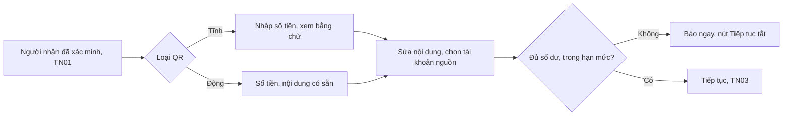

> **Mã:** DE04-TN02-PRD · **Trạng thái:** đã chốt · **Người viết:** Design · **SRS:** [SRS.md](SRS.md)

# PRD Chọn số tiền (App ngân hàng, chuyển khoản QR)

## 1. Bối cảnh và vấn đề

### 1.1 Bối cảnh

Sau khi quét QR và biết người nhận (TN01), người trả tiền chọn số tiền cần chuyển (xem [README](../../README.md)). Với **QR tĩnh** (QR dán ở quầy, QR bạn bè gửi) người trả tự nhập số tiền; với **QR động** (QR in trên hoá đơn, QR của shop online) số tiền đã có sẵn. Đây là bước dễ sai nhất: gõ thừa, thiếu một số 0 là chuyển sai gấp 10 lần.

### 1.2 Vấn đề

| **Vấn đề** | **Hệ quả** |
| --- | --- |
| Gõ thừa, thiếu số 0 khi nhập tiền | Chuyển 50.000 thành 500.000 ₫ hoặc 5.000 ₫ |
| Bàn phím nhỏ, dấu chấm, dấu phẩy lẫn lộn | Không biết mình đã nhập bao nhiêu |
| Nhập xong mới biết không đủ số dư, vượt hạn mức | Phải quay lại, người bán chờ |
| QR động nhưng vẫn sửa được số tiền | Chuyển thiếu, shop không đối soát được |
| Nội dung chuyển khoản mặc định khó hiểu | Người nhận không biết tiền của ai |

### 1.3 Mục tiêu

- Thời gian từ khi vào màn chọn số tiền tới bấm Tiếp tục ≤ 8 giây (trung vị) với QR tĩnh.
- Khiếu nại chuyển sai số tiền qua QR giảm 50%.
- 100% giao dịch QR động chuyển đúng số tiền của QR.

## 2. Người dùng

| **Nhóm** | **Nhu cầu với tính năng này** |
| --- | --- |
| Người trả tiền ở cửa hàng | Gõ nhanh, gợi ý số tiền tròn |
| Người lớn tuổi | Thấy số tiền bằng chữ để chắc chắn |
| Người mua online | Số tiền và nội dung đơn hàng có sẵn, không phải gõ |
| Người có nhiều tài khoản | Chọn tài khoản trả tiền, thấy số dư |

## 3. Phạm vi

### 3.1 Trong phạm vi (MVP)

- Nhập số tiền cho QR tĩnh; số tiền khoá cho QR động.
- Hiện số tiền bằng chữ; gợi ý số tiền nhanh.
- Nội dung chuyển khoản: mặc định, sửa được (QR tĩnh), khoá nếu QR động có nội dung.
- Chọn tài khoản nguồn; hiện số dư khả dụng.
- Kiểm tra ngay số dư, hạn mức giao dịch, hạn mức ngày; hiện phí.

### 3.2 Ngoài phạm vi

- Chia tiền cho nhiều người, tip.
- Trả bằng thẻ tín dụng, ví điện tử.
- Đổi hạn mức (dẫn link tới cài đặt sẵn có của app).
- Xác thực và gửi lệnh (TN03), kết quả (TN04).

## 4. Nguyên tắc sản phẩm

### 4.1 Số tiền phải đọc được hai lần

Số lớn và bằng chữ luôn đi cùng nhau; dấu chấm ngăn nghìn tự chèn.

### 4.2 Báo lỗi trước khi bấm

Không đủ tiền, vượt hạn mức hiện ngay khi gõ, không đợi tới bước xác nhận.

### 4.3 QR động là hợp đồng

Số tiền người nhận đặt trong QR không sửa được.

## 5. Quy tắc nghiệp vụ

| **Quy tắc** | **Giá trị** |
| --- | --- |
| Số tiền | 1.000 ₫ tới hạn mức giao dịch; tối đa 499.999.999 ₫ |
| Hạn mức mặc định | 100.000.000 ₫/giao dịch, 200.000.000 ₫/ngày |
| Phí | 0 ₫ (cấu hình) |
| Nội dung | Tối đa 100 ký tự; liên ngân hàng tự bỏ dấu |
| Gợi ý nhanh | Tối đa 3 số tiền tròn theo số đã gõ |

- Hạn mức, phí là **cấu hình**.

## 6. Luồng trải nghiệm

| **Bước** | **Giai đoạn** | **Trải nghiệm** | **Đầu ra** |
| --- | --- | --- | --- |
| 1 | Xem người nhận | Tên, ngân hàng ở đầu màn | Biết chuyển cho ai |
| 2 | Chọn số tiền | Bàn phím số, bằng chữ, gợi ý | Số tiền |
| 3 | Nội dung, nguồn | Nội dung mặc định, tài khoản, số dư | Lệnh nháp |
| 4 | Tiếp tục | Kiểm tra số dư, hạn mức | Sang xác nhận |

## 7. Use Cases, User Stories và Acceptance Criteria

### UC1. Chọn số tiền với QR tĩnh

#### US1.1 Nhập không nhầm

User Story: Là người trả tiền, tôi muốn thấy số tiền bằng chữ để không gõ nhầm số 0.

AC01: Bàn phím số mở sẵn; số tiền tự chèn dấu chấm ngăn nghìn.

AC02: Dòng bằng chữ ngay dưới: "Năm mươi nghìn đồng".

AC03: Gõ "50" → gợi ý 50.000, 500.000, 5.000.000 ₫; chạm để chọn.

AC04: Xoá hết → nút Tiếp tục tắt.

### UC2. Số tiền với QR động

AC01: Số tiền, nội dung từ QR hiện sẵn, khoá, ghi "Số tiền do người nhận đặt".

AC02: QR động không có nội dung → nội dung mặc định, sửa được.

### UC3. Nội dung, nguồn tiền, giới hạn

#### US3.1 Chọn tài khoản trả tiền

AC01: Mặc định tài khoản chính; chạm để đổi; mỗi tài khoản hiện số dư khả dụng.

AC02: Số dư ẩn mặc định, chạm con mắt để hiện.

#### US3.2 Biết sớm khi không chuyển được

AC01: Số tiền + phí > số dư → báo ngay dưới ô số tiền.

AC02: Vượt hạn mức giao dịch hoặc hạn mức còn lại trong ngày → báo số còn được chuyển, link đổi hạn mức.

AC03: Dưới 1.000 ₫ → báo số tiền tối thiểu.

## 8. Chỉ số theo dõi

| **Chỉ số** | **Định nghĩa** | **Mục tiêu MVP** |
| --- | --- | --- |
| Thời gian chọn số tiền | Mở **SCR-03** → bấm Tiếp tục (trung vị, QR tĩnh) | ≤ 8 giây |
| Dùng gợi ý nhanh | Lượt chọn gợi ý / lượt nhập số tiền | Theo dõi |
| Gặp lỗi số dư, hạn mức | Lượt hiện lỗi / lượt vào **SCR-03** | Theo dõi |
| Sửa số tiền ở bước xác nhận | Lượt quay lại sửa từ TN03 / lượt tới TN03 | Theo dõi; cao là dấu hiệu nhập dễ sai |
| Khiếu nại sai số tiền | Số khiếu nại / 10.000 giao dịch QR | Giảm 50% |

## 9. Phụ thuộc và rủi ro

| **Mục** | **Mô tả** | **Hướng xử lý** |
| --- | --- | --- |
| Số dư thay đổi | Có giao dịch khác cùng lúc | Kiểm tra lại số dư ở TN03 khi gửi lệnh |
| Hạn mức thay đổi | Khách vừa đổi hạn mức | Lấy hạn mức mới mỗi lần mở **SCR-03** |
| Bàn phím hệ điều hành | Có dấu phẩy, chữ | Dùng bàn phím số riêng của app |

## 10. Câu hỏi mở

> Mọi câu hỏi dưới đây đã được PO chốt ngày 20/11/2026; quyết định ghi sau mỗi câu và đã cập nhật vào SRS.

- Nội dung mặc định là gì? → **Đã chốt:** "{TÊN NGƯỜI CHUYỂN} chuyen tien" (SRS BR-13).
- Có cho chọn tài khoản nguồn khác không? → **Đã chốt:** Có, mọi tài khoản thanh toán VND đứng tên khách (SRS BR-14).
- QR động có số tiền vượt hạn mức thì sao? → **Đã chốt:** Hiện số tiền, báo vượt hạn mức, không cho tiếp tục; gợi ý đổi hạn mức (SRS BR-16).
- Có lưu số tiền lần trước cho cùng người nhận? → **Đã chốt:** Không gợi ý số tiền theo lịch sử ở MVP (SRS BR-19).
