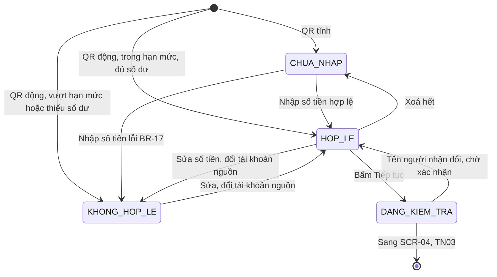
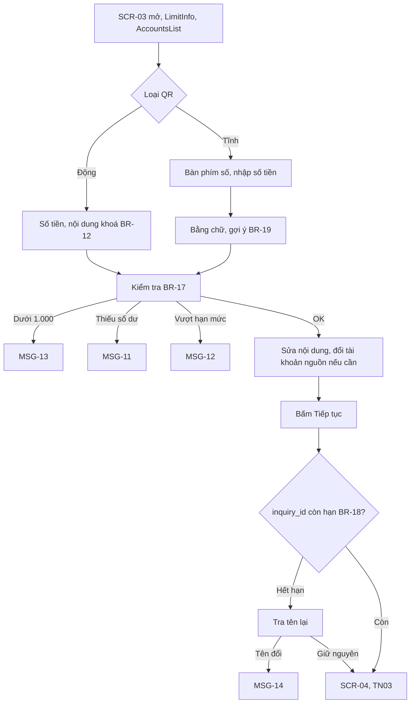
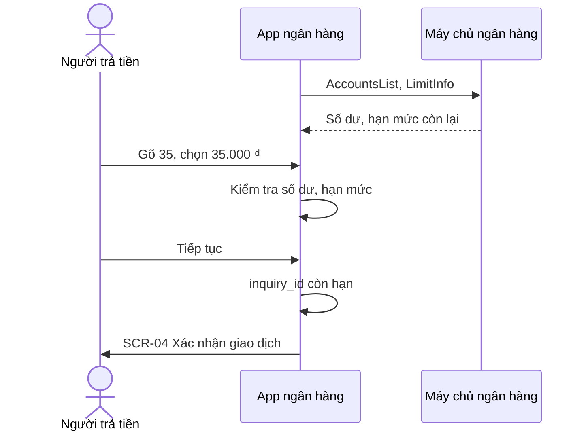

> **Mã:** DE04-TN02-SRS · **Trạng thái:** đã chốt · **Người viết:** Design · **PRD:** [PRD.md](PRD.md)

# UC-DE04-02 - Chọn số tiền

> SRS này mô tả giao dịch ở trạng thái `NHAP`: từ khi có người nhận đã tra tên ([SRS TN01](../TN01-quet-ma-qr/SRS.md)) tới khi bấm Tiếp tục sang xác thực và xác nhận ([SRS TN03](../TN03-xac-thuc-xac-nhan/SRS.md)).

## 1. Tổng quan

| **Mục** | **Nội dung** |
| --- | --- |
| Mục tiêu | Người trả tiền chọn đúng số tiền, nội dung, tài khoản nguồn; biết ngay nếu không đủ tiền hoặc vượt hạn mức |
| Actor | Người trả tiền · App ngân hàng · Máy chủ ngân hàng |
| Phạm vi | Nhập số tiền (QR tĩnh), số tiền khoá (QR động), bằng chữ, gợi ý nhanh, nội dung, tài khoản nguồn, số dư, phí, hạn mức |
| Ngoài phạm vi | Chia tiền, thẻ tín dụng, ví, đổi hạn mức, xác thực (TN03), kết quả (TN04) |
| Nền tảng | App ngân hàng iOS / Android |

## 2. User Story

| **ID** | **As a** | **I want** | **So that** |
| --- | --- | --- | --- |
| US-06 | Người trả tiền | Thấy số tiền bằng chữ | Không gõ nhầm số 0 |
| US-07 | Người trả tiền | Chọn nhanh số tiền tròn | Gõ ít hơn |
| US-08 | Người mua online | Số tiền, nội dung có sẵn từ QR | Không phải gõ, không sai |
| US-09 | Người trả tiền | Chọn tài khoản trả, thấy số dư | Trả từ đúng tài khoản |
| US-10 | Người trả tiền | Biết ngay khi không đủ tiền, vượt hạn mức | Không mất thời gian ở bước sau |

## 3. Business Rules

| **Mã** | **Quy tắc** |
| --- | --- |
| BR-11 | **Số tiền** (QR tĩnh): số nguyên VND, 1.000 → min(hạn mức giao dịch, hạn mức còn lại trong ngày, 499.999.999). Bàn phím số riêng của app (0–9, 000, xoá); tự chèn dấu chấm ngăn nghìn; tối đa 9 chữ số |
| BR-12 | **QR động**: số tiền từ QR hiện sẵn và khoá, nhãn "Số tiền do người nhận đặt"; nội dung trong QR (nếu có) cũng khoá. Không có bàn phím |
| BR-13 | **Nội dung**: mặc định "{TÊN NGƯỜI CHUYỂN} chuyen tien"; 1–100 ký tự; chỉ chữ, số, khoảng trắng và `. , - /`, ký tự khác bị loại khi gõ; chuyển liên ngân hàng tự bỏ dấu khi gửi, ghi chú "Nội dung sẽ được gửi không dấu" |
| BR-14 | **Tài khoản nguồn**: tài khoản thanh toán VND đứng tên khách, đang hoạt động, không phong toả chiều ghi nợ; mặc định tài khoản chính. Số dư khả dụng ẩn mặc định, chạm con mắt để hiện |
| BR-15 | **Phí** theo biểu phí cấu hình (hiện 0 ₫); luôn hiện dòng "Phí: Miễn phí" hoặc số tiền. Tổng trừ = số tiền + phí |
| BR-16 | **Hạn mức**: theo giao dịch và theo ngày (00:00–24:00 giờ Việt Nam), mặc định 100.000.000 ₫ và 200.000.000 ₫. Vượt → MSG-12 với số còn được chuyển hôm nay và link "Đổi hạn mức" (mở cài đặt sẵn có của app) |
| BR-17 | **Kiểm tra tức thì** sau mỗi lần gõ (chờ 300 ms): số tiền < 1.000 → MSG-13; tổng trừ > số dư khả dụng → MSG-11; vượt hạn mức → MSG-12. Có lỗi → nút "Tiếp tục" tắt |
| BR-18 | **Hiệu lực người nhận**: inquiry_id từ TN01 có hiệu lực 10 phút; hết hạn khi bấm Tiếp tục → tra tên lại tự động; tên khác lần trước → MSG-14, khách xác nhận lại |
| BR-19 | **Gợi ý nhanh**: từ số đã gõ x (1–3 chữ số), gợi ý x × 1.000, x × 10.000, x × 100.000; chỉ hiện gợi ý hợp lệ theo BR-17; tối đa 3. Không gợi ý theo lịch sử |
| BR-20 | **Thoát giữa chừng**: bấm quay lại → về **SCR-02** quét mã khác; giao dịch nháp bị bỏ, không lưu |

## 4. Trạng thái

### 4.1 Trạng thái nút Tiếp tục trên SCR-03

| **Trạng thái** | **Hiển thị nút** |
| --- | --- |
| `CHUA_NHAP` | "Tiếp tục" tắt |
| `KHONG_HOP_LE` | Tắt; lỗi đỏ dưới ô số tiền |
| `HOP_LE` | "Tiếp tục" bật |
| `DANG_KIEM_TRA` | Spinner, không bấm lại được |

## 5. Use Case

### UC-03 Chọn số tiền

| **Mục** | **Nội dung** |
| --- | --- |
| Tiền điều kiện | Có người nhận đã tra tên (TN01) |
| Hậu điều kiện thành công | Lệnh nháp có số tiền, nội dung, tài khoản nguồn hợp lệ; mở **SCR-04** (TN03) |
| Hậu điều kiện thất bại | Ở lại **SCR-03** với lỗi, hoặc bỏ giao dịch |

**Luồng chính**

| **Bước** | **Actor** | **Mô tả** |
| --- | --- | --- |
| 1 | App | Mở **SCR-03**: người nhận, tài khoản nguồn mặc định; gọi \[AccountsList\], \[LimitInfo\] |
| 2 | Người trả tiền | Gõ "35" |
| 3 | App | Hiện "35" và gợi ý 35.000, 350.000, 3.500.000 ₫ |
| 4 | Người trả tiền | Chạm 35.000 ₫ |
| 5 | App | Hiện "35.000 ₫ · Ba mươi lăm nghìn đồng"; kiểm tra BR-17 hợp lệ |
| 6 | Người trả tiền | Giữ nội dung mặc định, bấm "Tiếp tục" |
| 7 | App | inquiry_id còn hạn → mở **SCR-04** (TN03) |

**Luồng thay thế**

| **Mã** | **Điều kiện** | **Xử lý** |
| --- | --- | --- |
| A1 | QR động | Bỏ bước 2–5 (BR-12) |
| A2 | Đổi tài khoản nguồn | Bottom sheet danh sách tài khoản, số dư từng tài khoản; chọn xong kiểm tra lại BR-17 |
| A3 | Người nhận có cờ cảnh báo (TN01 BR-08) | Banner đỏ MSG-15 trên đầu **SCR-03** |
| A4 | Quay lại | BR-20 |

**Luồng lỗi**

| **Mã** | **Điều kiện** | **Xử lý** |
| --- | --- | --- |
| E1 | Không đủ số dư | MSG-11 |
| E2 | Vượt hạn mức | MSG-12 |
| E3 | Dưới số tiền tối thiểu | MSG-13 |
| E4 | Tên người nhận đổi khi tra lại | MSG-14 |
| E5 | Không lấy được số dư, hạn mức | MSG-16; nút Tiếp tục vẫn bật, máy chủ kiểm tra ở TN03 |
| E6 | Không còn tài khoản nguồn hợp lệ | MSG-17, không cho tiếp tục |

## 6. Điểm vào

| **Điểm vào** | **Dẫn tới** | **Ghi chú** |
| --- | --- | --- |
| Tra tên xong ở **SCR-02** (TN01) | **SCR-03** | |
| "Sửa" ở **SCR-04** (TN03) | **SCR-03** | Giữ dữ liệu đã nhập |
| "Chuyển lại" ở chi tiết giao dịch (TN04) | **SCR-03** điền sẵn người nhận, số tiền, nội dung | Tra tên lại |

## 7. Mô tả màn hình

### SCR-03 Chọn số tiền

| **#** | **Thành phần** | **Loại** | **Bắt buộc** | **Validate / hành vi** |
| --- | --- | --- | --- | --- |
| 1 | Người nhận | Card | – | Tên chủ tài khoản (chữ lớn), logo và tên ngân hàng, số tài khoản che giữa |
| 2 | Banner cảnh báo | Banner | – | MSG-15 khi có cờ |
| 3 | Số tiền | Amount display | Có | BR-11; QR động thì khoá (BR-12) |
| 4 | Bằng chữ | Text | – | Cập nhật khi gõ |
| 5 | Lỗi | Text đỏ | – | MSG-11, MSG-12, MSG-13 |
| 6 | Gợi ý nhanh | Chips | – | BR-19 |
| 7 | Nội dung | Text | Có | BR-13; đếm ký tự |
| 8 | Tài khoản nguồn | Dòng chọn | Có | BR-14 |
| 9 | Phí | Text | – | BR-15 |
| 10 | Bàn phím số | Keypad | – | 0–9, 000, xoá; ẩn với QR động |
| 11 | "Tiếp tục" | Button | – | Mục 4.1; nằm trên bàn phím |

## 8. API

| **API** | **Request chính** | **Response chính** | **Timeout / retry** |
| --- | --- | --- | --- |
| \[AccountsList\] | – | Tài khoản nguồn, số dư khả dụng | 5s / 1 lần |
| \[LimitInfo\] | source_account | Hạn mức giao dịch, hạn mức ngày, đã dùng hôm nay | 3s / 1 lần |
| \[FeeQuote\] | source_account, bank_bin, amount | fee | 3s / 1 lần; cache theo ngân hàng nhận |
| \[RecipientInquiry\] | Như TN01 | Tên, inquiry_id mới | 5s / người dùng thử lại |

Kiểm tra BR-17 chạy trên máy với số dư, hạn mức đã tải; máy chủ kiểm tra lại ở TN03.

**Map lỗi → thông báo**

| **Nhóm lỗi** | **Message** |
| --- | --- |
| Không đủ số dư | MSG-11 |
| Vượt hạn mức | MSG-12 |
| Dưới số tiền tối thiểu | MSG-13 |
| Tên người nhận thay đổi | MSG-14 |
| Người nhận có cờ cảnh báo | MSG-15 |
| Không tải được số dư, hạn mức | MSG-16 |
| Không có tài khoản nguồn | MSG-17 |
| Mất mạng | MSG-18 |

## 9. Danh sách thông báo

| **ID** | **Nơi hiện** | **Nội dung (VI)** |
| --- | --- | --- |
| MSG-11 | Inline số tiền | Số dư khả dụng không đủ. Số dư hiện tại: {số dư} ₫ |
| MSG-12 | Inline số tiền | Vượt hạn mức chuyển tiền. Hôm nay bạn còn chuyển được {số tiền} ₫. \[Đổi hạn mức\] |
| MSG-13 | Inline số tiền | Số tiền tối thiểu là 1.000 ₫ |
| MSG-14 | Popup | Tên người nhận vừa cập nhật thành "{tên mới}". Bạn có chắc vẫn chuyển cho người này? \[Tiếp tục\] \[Quét mã khác\] |
| MSG-15 | Banner | Tài khoản nhận đã bị báo cáo có dấu hiệu lừa đảo. Hãy kiểm tra kỹ trước khi chuyển |
| MSG-16 | Toast | Chưa cập nhật được số dư. Bạn vẫn có thể tiếp tục |
| MSG-17 | Popup | Bạn chưa có tài khoản thanh toán có thể chuyển tiền. Vui lòng liên hệ tổng đài {số} |
| MSG-18 | Toast | Kết nối không ổn định, vui lòng thử lại |

## 10. Yêu cầu phi chức năng

| **Mục** | **Yêu cầu** |
| --- | --- |
| Hiệu năng | **SCR-03** hiện ≤ 500 ms; kiểm tra BR-17 và bằng chữ cập nhật ≤ 100 ms sau mỗi lần gõ |
| Bảo mật | Số dư ẩn mặc định; chặn chụp màn hình theo chính sách chung của app |
| Log / audit | Số tiền, nguồn, nội dung khi bấm Tiếp tục; lỗi gặp phải |
| Tracking | Thời gian chọn số tiền, dùng gợi ý, đổi tài khoản nguồn, sửa nội dung, lỗi số dư, hạn mức, bỏ giữa chừng |
| Accessibility | Số tiền đọc kèm bằng chữ; bàn phím số có nhãn đọc màn hình; lỗi được đọc ngay khi xuất hiện |
