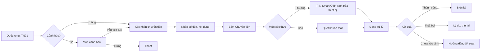

> **Mã:** DE04-TN02-PRD · **Trạng thái:** đã chốt · **Người viết:** Design · **SRS:** [SRS.md](SRS.md)

# PRD Xác nhận và chuyển tiền qua QR (App ngân hàng, chuyển khoản QR)

## 1. Bối cảnh và vấn đề

### 1.1 Bối cảnh

Sau khi quét QR (TN01), người trả tiền nhập số tiền (nếu cần), xác thực và chuyển (xem [README](../../README.md)). Đây là khoảnh khắc **tiền rời khỏi tài khoản**: phải nhanh vì người bán đang chờ, nhưng phải đủ chắc để không chuyển nhầm, không bị lừa. Theo Quyết định 2345/QĐ-NHNN, giao dịch giá trị lớn phải xác thực bằng sinh trắc học khuôn mặt.

### 1.2 Vấn đề

| **Vấn đề** | **Hệ quả** |
| --- | --- |
| Gõ thừa, thiếu số 0 khi nhập tiền | Chuyển 50.000 thành 500.000 ₫ |
| Không rõ khi nào phải quét khuôn mặt | Người dùng bất ngờ, tưởng app lỗi |
| Bị kẻ gian gọi điện hướng dẫn chuyển tiền | Mất tiền, ngân hàng bị khiếu nại |
| Chuyển xong màn hình "Đang xử lý" mãi | Người bán không thấy tiền, người mua chuyển lại lần nữa |
| Người bán muốn xem bằng chứng đã chuyển | Phải chụp màn hình, lộ số dư |

### 1.3 Mục tiêu

- Từ màn xác nhận tới có kết quả ≤ 15 giây (trung vị) với giao dịch dưới ngưỡng sinh trắc khuôn mặt.
- Tỉ lệ khiếu nại chuyển nhầm số tiền qua QR giảm 50%.
- ≥ 99% giao dịch có kết quả cuối (thành công hoặc thất bại) trong 60 giây.

## 2. Người dùng

| **Nhóm** | **Nhu cầu với tính năng này** |
| --- | --- |
| Người trả tiền ở cửa hàng | Xác thực nhanh, thấy "Thành công" to rõ để giơ cho người bán xem |
| Người chuyển số tiền lớn | Biết trước sẽ phải quét khuôn mặt |
| Người lớn tuổi | Đọc được số tiền bằng chữ, không nhầm số 0 |
| Người có thể bị lừa | Được cảnh báo đúng lúc, đủ rõ để dừng lại |

## 3. Phạm vi

### 3.1 Trong phạm vi (MVP)

- Màn xác nhận: người nhận, số tiền (nhập hoặc khoá theo QR động), nội dung, tài khoản nguồn, phí.
- Hiển thị số tiền bằng chữ; gợi ý số tiền nhanh.
- Hạn mức giao dịch, hạn mức ngày.
- Xác thực theo mức tiền: mã PIN Smart OTP hoặc sinh trắc thiết bị; sinh trắc khuôn mặt cho giao dịch vượt ngưỡng hoặc trên thiết bị mới.
- Cảnh báo tài khoản đáng ngờ và giao dịch có dấu hiệu bị dẫn dắt.
- Kết quả: thành công, thất bại, chưa xác định; biên lai, chia sẻ biên lai.
- Lưu người nhận.

### 3.2 Ngoài phạm vi

- Chuyển tiền hẹn lịch, định kỳ (xem Đề 7).
- Chia hoá đơn cho nhiều người.
- Thanh toán bằng thẻ tín dụng qua QR.
- Đăng ký sinh trắc khuôn mặt (luồng riêng của app, ở đây chỉ dẫn link).

## 4. Nguyên tắc sản phẩm

### 4.1 Số tiền là thứ phải đọc được hai lần

Số tiền hiện bằng số lớn và bằng chữ; không bao giờ để lẫn dấu chấm, phẩy.

### 4.2 Nói trước khi đòi

Nếu giao dịch sẽ cần quét khuôn mặt, báo ngay trên màn xác nhận, trước khi bấm Chuyển.

### 4.3 Cảnh báo phải làm người dùng dừng lại

Cảnh báo lừa đảo là màn riêng, có thời gian chờ ngắn và câu hỏi tự kiểm tra, không phải một dòng chữ nhỏ.

### 4.4 Không bao giờ để người dùng không biết tiền đi đâu

Mọi giao dịch kết thúc ở một trong ba trạng thái rõ ràng, kèm điều người dùng nên làm.

## 5. Quy tắc nghiệp vụ

| **Quy tắc** | **Giá trị** |
| --- | --- |
| Số tiền | 1.000 ₫ đến hạn mức giao dịch; tối đa 499.999.999 ₫ (giới hạn chuyển nhanh liên ngân hàng) |
| Hạn mức mặc định | 100.000.000 ₫/giao dịch, 200.000.000 ₫/ngày; người dùng tự hạ hoặc nâng trong khung ngân hàng cho phép |
| Phí | 0 ₫ (cấu hình) |
| Nội dung | Tối đa 100 ký tự; bỏ dấu khi chuyển liên ngân hàng |
| Xác thực thường | Mã PIN Smart OTP 6 số, hoặc sinh trắc thiết bị nếu đã bật |
| Xác thực khuôn mặt | Giao dịch > 10.000.000 ₫, hoặc tổng trong ngày > 20.000.000 ₫, hoặc giao dịch đầu tiên trên thiết bị mới |
| Chờ kết quả | Tối đa 60 giây; quá thì "Chưa xác định", đối soát tự động |

- Ngưỡng xác thực, hạn mức, phí là **cấu hình**, cập nhật theo quy định Ngân hàng Nhà nước.

## 6. Luồng trải nghiệm

| **Bước** | **Giai đoạn** | **Trải nghiệm** | **Đầu ra** |
| --- | --- | --- | --- |
| 1 | Kiểm tra người nhận | Tên, ngân hàng to rõ; cảnh báo nếu đáng ngờ | Người dùng chắc người nhận |
| 2 | Nhập | Số tiền (QR tĩnh), nội dung; xem số dư, phí | Lệnh chuyển |
| 3 | Xác thực | PIN hoặc sinh trắc; khuôn mặt nếu vượt ngưỡng | Lệnh được ký |
| 4 | Kết quả | Thành công to rõ, giờ chuyển, mã giao dịch | Biên lai |

## 7. Use Cases, User Stories và Acceptance Criteria

### UC1. Nhập và kiểm tra lệnh chuyển

#### US1.1 Nhập số tiền không nhầm

User Story: Là người trả tiền, tôi muốn thấy số tiền bằng chữ để không gõ nhầm số 0.

AC01: Bàn phím số; số tiền tự thêm dấu chấm ngăn nghìn; hiện bằng chữ ngay dưới.

AC02: Gợi ý nhanh khi gõ: "50" → 50.000, 500.000, 5.000.000 ₫.

AC03: QR động → số tiền khoá, ghi "Số tiền do người nhận đặt".

AC04: Vượt số dư khả dụng, vượt hạn mức → báo ngay, nút Chuyển disabled.

#### US1.2 Biết trước cách xác thực

AC01: Giao dịch cần quét khuôn mặt → dòng thông báo trên màn xác nhận trước khi bấm Chuyển.

AC02: Chưa đăng ký sinh trắc khuôn mặt mà cần → báo và dẫn tới đăng ký; không cho chuyển.

### UC2. Cảnh báo lừa đảo

#### US2.1 Dừng lại trước tài khoản đáng ngờ

User Story: Là người dùng, tôi muốn được cảnh báo khi người nhận có dấu hiệu lừa đảo để kịp dừng lại.

AC01: Người nhận bị gắn cờ → màn cảnh báo toàn trang, nêu lý do chung, nút "Dừng giao dịch" nổi bật.

AC02: Muốn tiếp tục phải đọc 5 giây và tích "Tôi hiểu rủi ro và tự chịu trách nhiệm".

AC03: Đang có cuộc gọi điện thoại trong lúc chuyển (nếu đọc được) → nhắc "Bạn có đang được ai hướng dẫn chuyển tiền qua điện thoại không?".

### UC3. Xác thực và chuyển

#### US3.1 Xác thực

AC01: Thường: nhập PIN Smart OTP 6 số hoặc sinh trắc thiết bị.

AC02: Vượt ngưỡng hoặc thiết bị mới: quét khuôn mặt có kiểm tra người thật.

AC03: Sai PIN 5 lần → khoá Smart OTP, hướng dẫn mở khoá.

#### US3.2 Biết kết quả

User Story: Là người trả tiền, tôi muốn thấy "Thành công" to rõ để người bán yên tâm.

AC01: Thành công → biểu tượng lớn, số tiền, tên người nhận, giờ, mã giao dịch.

AC02: Thất bại → lý do dễ hiểu; tiền không bị trừ hoặc đã được hoàn.

AC03: Chưa xác định → giải thích, khuyên **không chuyển lại**, báo khi có kết quả.

AC04: Chia sẻ biên lai dạng ảnh, không lộ số dư.

## 8. Chỉ số theo dõi

| **Chỉ số** | **Định nghĩa** | **Mục tiêu MVP** |
| --- | --- | --- |
| Thời gian chuyển | Mở **SCR-03** → có kết quả, giao dịch dưới ngưỡng | ≤ 15 giây (trung vị) |
| Tỉ lệ hoàn tất | Giao dịch thành công / phiên mở **SCR-03** | Theo dõi |
| Tỉ lệ chưa xác định | Giao dịch quá 60 giây / tổng giao dịch | ≤ 1% |
| Tỉ lệ dừng sau cảnh báo | Dừng / gặp cảnh báo | Theo dõi; cao là tốt |
| Chuyển trùng | Giao dịch cùng người nhận, cùng tiền trong 5 phút sau khi có cảnh báo trùng | Giảm theo thời gian |
| Lỗi xác thực khuôn mặt | Lần thất bại / lần quét | ≤ 10% |

## 9. Phụ thuộc và rủi ro

| **Mục** | **Mô tả** | **Hướng xử lý** |
| --- | --- | --- |
| Napas, ngân hàng nhận | Phản hồi chậm, mất kết nối | Trạng thái chưa xác định, đối soát tự động |
| Xác thực khuôn mặt | Ánh sáng kém, máy cũ | Hướng dẫn tư thế, ánh sáng; cho thử lại |
| Quy định thay đổi | Ngưỡng xác thực, hạn mức | Cấu hình, không cố định trong code |
| Lừa đảo qua điện thoại | Người dùng tin kẻ gian hơn cảnh báo | Màn cảnh báo có thời gian chờ, câu hỏi tự kiểm tra |

## 10. Câu hỏi mở

> Mọi câu hỏi dưới đây đã được PO chốt ngày 20/11/2026; quyết định ghi sau mỗi câu và đã cập nhật vào SRS.

- Nội dung mặc định là gì? → **Đã chốt:** "{TÊN NGƯỜI CHUYỂN} chuyen tien", sửa được với QR tĩnh; QR động có nội dung thì khoá (SRS BR-13).
- Có cảnh báo chuyển trùng không? → **Đã chốt:** Có, khi cùng người nhận, cùng số tiền trong 5 phút, kể cả giao dịch đang chưa xác định (SRS BR-20).
- Chưa xác định quá lâu thì sao? → **Đã chốt:** Hệ thống tự đối soát, có kết quả trong tối đa 1 ngày làm việc; thất bại mà tiền đã trừ thì hoàn tự động (SRS BR-22).
- Có cho chọn tài khoản nguồn khác không? → **Đã chốt:** Có, mọi tài khoản thanh toán VND đứng tên khách; mặc định tài khoản chính (SRS BR-14).
