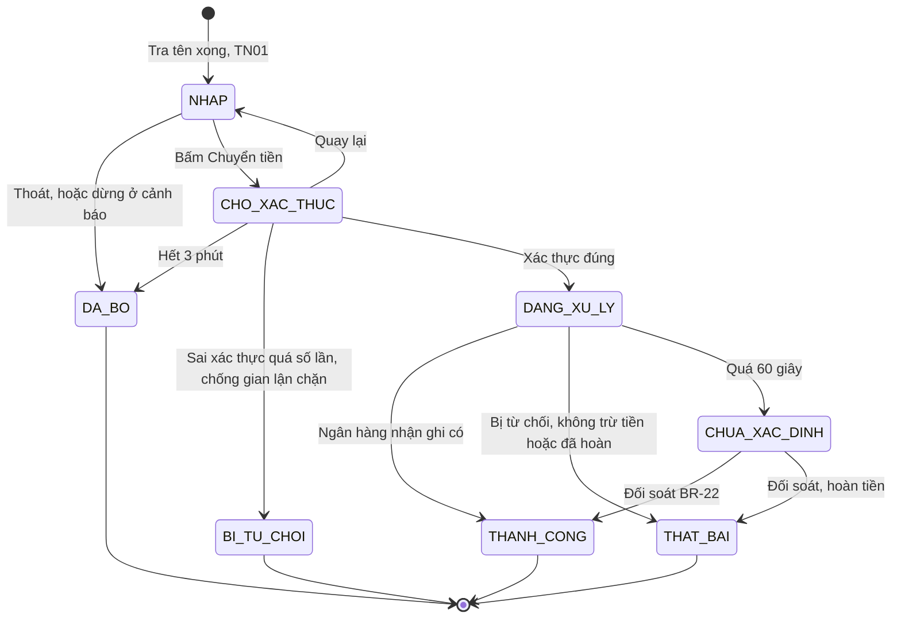
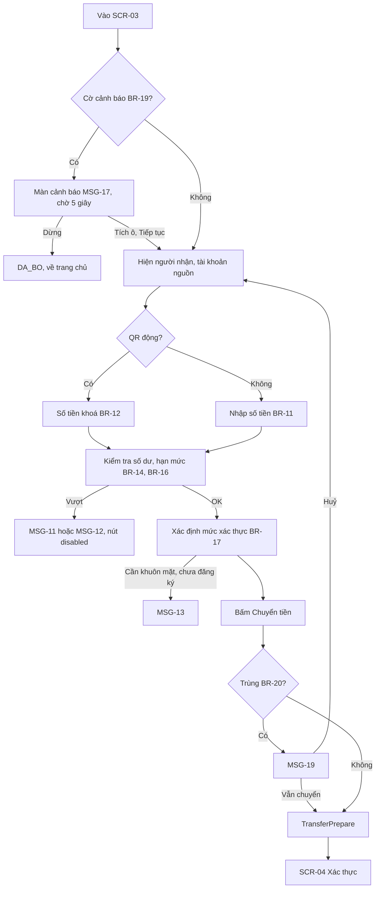
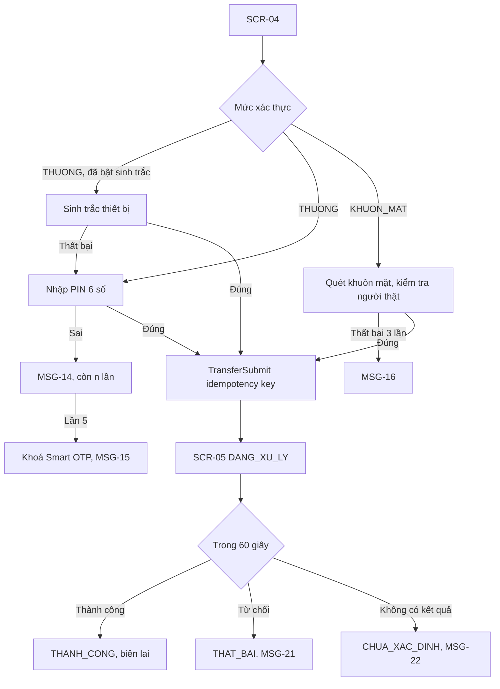
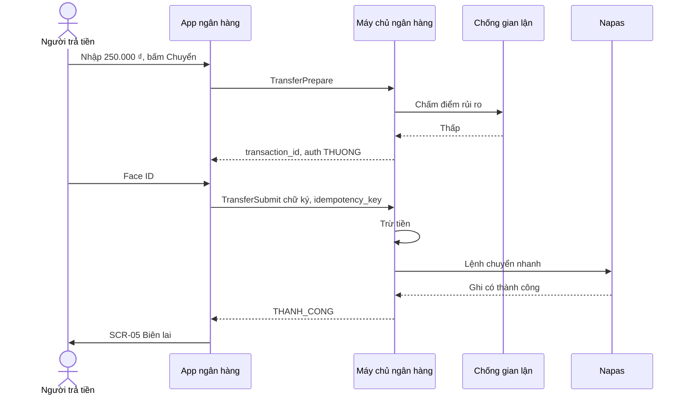

> **Mã:** DE04-TN02-SRS · **Trạng thái:** đã chốt · **Người viết:** Design · **PRD:** [PRD.md](PRD.md)

# UC-DE04-02 - Xác nhận và chuyển tiền qua QR

> SRS này mô tả giao dịch từ `NHAP` (sau khi tra tên ở [SRS TN01](../TN01-quet-ma-qr/SRS.md)) tới `THANH_CONG`, `THAT_BAI` hoặc `CHUA_XAC_DINH`; tra soát xem [SRS TN04](../TN04-lich-su-tra-soat/SRS.md).

## 1. Tổng quan

| **Mục** | **Nội dung** |
| --- | --- |
| Mục tiêu | Người trả tiền xác nhận lệnh chuyển, xác thực đúng mức và nhận kết quả rõ ràng |
| Actor | Người trả tiền · App ngân hàng · Máy chủ ngân hàng · Hệ thống chống gian lận · Napas · Ngân hàng nhận |
| Phạm vi | Màn xác nhận, nhập số tiền, nội dung, tài khoản nguồn, hạn mức, cảnh báo, xác thực PIN / sinh trắc / khuôn mặt, xử lý, kết quả, biên lai, lưu người nhận |
| Ngoài phạm vi | Hẹn lịch, định kỳ, chia hoá đơn, đăng ký sinh trắc khuôn mặt |
| Nền tảng | App ngân hàng iOS / Android |

## 2. User Story

| **ID** | **As a** | **I want** | **So that** |
| --- | --- | --- | --- |
| US-06 | Người trả tiền | Thấy số tiền bằng chữ | Không gõ nhầm số 0 |
| US-07 | Người trả tiền | Biết trước sẽ phải quét khuôn mặt | Không bất ngờ |
| US-08 | Người dùng | Được cảnh báo khi người nhận đáng ngờ | Kịp dừng lại |
| US-09 | Người trả tiền | Xác thực nhanh bằng sinh trắc | Không bắt người bán chờ |
| US-10 | Người trả tiền | Thấy kết quả to rõ, chia sẻ biên lai | Người bán yên tâm |
| US-11 | Người trả tiền | Biết làm gì khi giao dịch chưa rõ kết quả | Không chuyển trùng |

## 3. Business Rules

| **Mã** | **Quy tắc** |
| --- | --- |
| BR-11 | **Số tiền** (QR tĩnh): số nguyên VND 1.000 → min(hạn mức giao dịch, 499.999.999). Tự chèn dấu chấm ngăn nghìn, hiện bằng chữ ("Năm trăm nghìn đồng"). Gợi ý nhanh: số đã gõ × 1.000, × 10.000, × 100.000 (tối đa 3 gợi ý hợp lệ) |
| BR-12 | **QR động**: số tiền khoá, nhãn "Số tiền do người nhận đặt"; nội dung có trong QR cũng khoá |
| BR-13 | **Nội dung**: mặc định "{TÊN NGƯỜI CHUYỂN} chuyen tien"; tối đa 100 ký tự; liên ngân hàng tự bỏ dấu tiếng Việt; chỉ cho chữ, số, khoảng trắng và `. , - /`; ký tự khác bị loại khi gõ |
| BR-14 | **Tài khoản nguồn**: mọi tài khoản thanh toán VND đứng tên khách, trạng thái hoạt động; mặc định tài khoản chính. Hiện số dư khả dụng. Số tiền + phí > số dư → MSG-11 |
| BR-15 | **Phí**: theo biểu phí cấu hình (hiện 0 ₫); luôn hiện dòng "Phí: Miễn phí" hoặc số tiền |
| BR-16 | **Hạn mức**: theo giao dịch và theo ngày (tính từ 00:00 giờ Việt Nam), do khách tự đặt trong khung ngân hàng; mặc định 100.000.000 ₫/giao dịch, 200.000.000 ₫/ngày. Vượt → MSG-12 kèm số còn lại trong ngày và link đổi hạn mức |
| BR-17 | **Mức xác thực**: `THUONG` = PIN Smart OTP 6 số hoặc sinh trắc thiết bị (vân tay, Face ID) nếu đã bật. `KHUON_MAT` = sinh trắc khuôn mặt có kiểm tra người thật, đối chiếu dữ liệu đã đăng ký từ CCCD gắn chip; áp dụng khi số tiền > 10.000.000 ₫, hoặc tổng đã chuyển trong ngày + số tiền > 20.000.000 ₫, hoặc giao dịch chuyển tiền đầu tiên trên thiết bị mới. Cần `KHUON_MAT` → dòng thông báo trên **SCR-03** trước khi bấm Chuyển. Chưa đăng ký khuôn mặt → MSG-13, không cho chuyển |
| BR-18 | **Hiệu lực**: inquiry_id (tra tên) 10 phút, hết hạn → tra lại tự động khi bấm Chuyển. Màn xác thực 3 phút. Sai PIN 5 lần liên tiếp → khoá Smart OTP (MSG-15). Khuôn mặt thất bại 3 lần liên tiếp → tạm khoá xác thực khuôn mặt 15 phút (MSG-16) |
| BR-19 | **Cảnh báo người nhận** (cờ `CANH_BAO` từ TN01 BR-08 hoặc hệ thống chống gian lận chấm điểm cao): mở **SCR-03** với màn cảnh báo toàn trang (MSG-17); nút "Tiếp tục" chỉ bật sau 5 giây và khi đã tích ô xác nhận. Nút "Dừng giao dịch" là nút chính. Nếu đọc được trạng thái đang có cuộc gọi thoại → thêm câu hỏi MSG-18 |
| BR-20 | **Cảnh báo trùng**: đã có giao dịch `THANH_CONG` hoặc `CHUA_XAC_DINH` cùng người nhận, cùng số tiền trong 5 phút → MSG-19 trước khi xác thực |
| BR-21 | **Xử lý**: lệnh được ký gửi \[TransferSubmit\] với idempotency key; chuyển nhanh 24/7. Chờ tối đa 60 giây; không có kết quả → `CHUA_XAC_DINH`. Kết quả cuối gửi qua push và cập nhật trong lịch sử |
| BR-22 | **Đối soát `CHUA_XAC_DINH`**: hệ thống tự tra cứu trạng thái mỗi 5 phút; có kết quả trong tối đa 1 ngày làm việc. Thất bại mà tiền đã trừ → hoàn tự động vào tài khoản nguồn, push MSG-23 |
| BR-23 | **Biên lai**: mã giao dịch, thời gian (giờ:phút:giây, ngày), người nhận, ngân hàng nhận, số tài khoản nhận che giữa, số tiền, bằng chữ, nội dung, phí, tài khoản nguồn che giữa, trạng thái. Chia sẻ dạng ảnh; không chứa số dư |
| BR-24 | **Lưu người nhận**: ô "Lưu người nhận" trên **SCR-05** sau khi thành công; tên gợi nhớ 1–30 ký tự; danh bạ dùng chung với chuyển khoản thường của app; không lưu người nhận bị cờ cảnh báo |

## 4. Trạng thái

### 4.1 Vòng đời giao dịch

`DA_BO`, `BI_TU_CHOI` không xuất hiện trong lịch sử giao dịch; `BI_TU_CHOI` được ghi log an ninh.

### 4.2 Hiển thị kết quả trên SCR-05

| **Trạng thái** | **Hiển thị** |
| --- | --- |
| `DANG_XU_LY` | Vòng tròn chờ, "Đang chuyển tiền…", không có nút thoát trong 10 giây đầu |
| `THANH_CONG` | Dấu tích xanh lớn, "Chuyển tiền thành công", số tiền, tên người nhận, giờ, mã giao dịch; Chia sẻ, Lưu người nhận, Về trang chủ, Quét tiếp |
| `THAT_BAI` | Biểu tượng đỏ, lý do (MSG-21), "Tiền chưa bị trừ" hoặc "Tiền đã được hoàn"; Thử lại |
| `CHUA_XAC_DINH` | Biểu tượng đồng hồ vàng, MSG-22; Xem trong lịch sử; không có Thử lại |

## 5. Use Case

### UC-03 Xác nhận lệnh chuyển

| **Mục** | **Nội dung** |
| --- | --- |
| Tiền điều kiện | Có thông tin người nhận đã tra tên (TN01) |
| Hậu điều kiện thành công | Lệnh hợp lệ chuyển `CHO_XAC_THUC`, mở **SCR-04** |
| Hậu điều kiện thất bại | Ở lại **SCR-03** với lỗi, hoặc `DA_BO` |

**Luồng chính**

| **Bước** | **Actor** | **Mô tả** |
| --- | --- | --- |
| 1 | App | Mở **SCR-03**: tên người nhận, ngân hàng, số tài khoản che giữa; tài khoản nguồn mặc định và số dư khả dụng |
| 2 | Người trả tiền | Nhập số tiền (QR tĩnh); xem số bằng chữ |
| 3 | App | Kiểm tra số dư, hạn mức; tính mức xác thực; hiện dòng thông báo nếu cần khuôn mặt |
| 4 | Người trả tiền | Sửa nội dung (tuỳ chọn); bấm "Chuyển tiền" |
| 5 | App | Gọi \[TransferPrepare\] (kiểm tra lại hạn mức, chống gian lận, tra lại tên nếu inquiry hết hạn) |
| 6 | Máy chủ | Trả transaction_id, mức xác thực, challenge |
| 7 | App | Mở **SCR-04** |

**Luồng thay thế**

| **Mã** | **Điều kiện** | **Xử lý** |
| --- | --- | --- |
| A1 | QR động | Bỏ bước 2 (BR-12) |
| A2 | Đổi tài khoản nguồn | Bottom sheet danh sách tài khoản, số dư từng tài khoản |
| A3 | Người nhận bị cờ | Màn cảnh báo trước bước 1 (BR-19) |
| A4 | Có giao dịch trùng | MSG-19 sau bước 4 (BR-20) |
| A5 | Chống gian lận chấm điểm cao ở bước 5 | Trả về yêu cầu cảnh báo → màn cảnh báo như A3, rồi tiếp tục bước 5 |

**Luồng lỗi**

| **Mã** | **Điều kiện** | **Xử lý** |
| --- | --- | --- |
| E1 | Không đủ số dư | MSG-11 |
| E2 | Vượt hạn mức | MSG-12 |
| E3 | Cần khuôn mặt, chưa đăng ký | MSG-13, nút "Đăng ký ngay" |
| E4 | Chống gian lận chặn hẳn | `BI_TU_CHOI`, MSG-20 |
| E5 | Lỗi mạng | MSG-24, giữ dữ liệu đã nhập |

### UC-04 Xác thực và nhận kết quả

| **Mục** | **Nội dung** |
| --- | --- |
| Tiền điều kiện | Giao dịch `CHO_XAC_THUC` |
| Hậu điều kiện thành công | Giao dịch có trạng thái cuối hoặc `CHUA_XAC_DINH`; **SCR-05** hiện đúng mục 4.2 |
| Hậu điều kiện thất bại | Giao dịch `DA_BO` hoặc `BI_TU_CHOI`; tiền không bị trừ |

**Luồng chính**

| **Bước** | **Actor** | **Mô tả** |
| --- | --- | --- |
| 1 | App | Mở **SCR-04**; mức `THUONG` và đã bật sinh trắc → gọi sinh trắc thiết bị ngay |
| 2 | Người trả tiền | Xác thực thành công |
| 3 | App | Ký lệnh bằng Smart OTP; gọi \[TransferSubmit\]; mở **SCR-05** trạng thái `DANG_XU_LY` |
| 4 | Máy chủ | Trừ tiền, gửi lệnh tới Napas hoặc ghi có nội bộ |
| 5 | App | Nhận `THANH_CONG` (qua phản hồi hoặc \[TransferStatus\] mỗi 2 giây); hiện biên lai |
| 6 | Người trả tiền | Chia sẻ biên lai hoặc bấm "Quét tiếp" |

**Luồng thay thế**

| **Mã** | **Điều kiện** | **Xử lý** |
| --- | --- | --- |
| A1 | Mức `KHUON_MAT` | Màn hướng dẫn (nhìn thẳng, đủ sáng) → quét → đối chiếu trên máy chủ |
| A2 | Huỷ sinh trắc thiết bị | Chuyển sang nhập PIN |
| A3 | Lưu người nhận | Bật ô, đặt tên gợi nhớ → \[PayeeSave\] (BR-24) |
| A4 | `CHUA_XAC_DINH` | MSG-22; khi có kết quả cuối, push MSG-23 |

**Luồng lỗi**

| **Mã** | **Điều kiện** | **Xử lý** |
| --- | --- | --- |
| E1 | Sai PIN | MSG-14; lần thứ 5 → MSG-15, `BI_TU_CHOI` |
| E2 | Khuôn mặt thất bại 3 lần | MSG-16, `BI_TU_CHOI` |
| E3 | Hết 3 phút ở **SCR-04** | `DA_BO`, quay về **SCR-03** với MSG-24 |
| E4 | Mất mạng sau khi gửi lệnh | Gửi lại cùng idempotency key; không chắc đã gửi → `CHUA_XAC_DINH` |
| E5 | Ngân hàng nhận từ chối | `THAT_BAI`, MSG-21 theo mã lý do |

## 6. Điểm vào

| **Điểm vào** | **Dẫn tới** | **Ghi chú** |
| --- | --- | --- |
| Tra tên xong ở **SCR-02** (TN01) | UC-03 | |
| "Thử lại" ở **SCR-05** sau thất bại | UC-03 với dữ liệu cũ | Tra tên lại |
| "Chuyển lại" ở chi tiết giao dịch (TN04) | UC-03 với người nhận, số tiền cũ | Số tiền sửa được |
| Chạm push kết quả | Chi tiết giao dịch (TN04) | |

## 7. Mô tả màn hình

### SCR-03 Xác nhận chuyển tiền

| **#** | **Thành phần** | **Loại** | **Bắt buộc** | **Validate / hành vi** |
| --- | --- | --- | --- | --- |
| 1 | Người nhận | Card | – | Tên chủ tài khoản (cỡ chữ lớn nhất màn), logo và tên ngân hàng, số tài khoản che giữa |
| 2 | Số tiền | Amount input | Có | BR-11; QR động thì khoá (BR-12) |
| 3 | Bằng chữ | Text | – | Cập nhật khi gõ |
| 4 | Gợi ý nhanh | Chips | – | Tối đa 3 |
| 5 | Nội dung | Text | Có | BR-13; đếm ký tự |
| 6 | Tài khoản nguồn | Dòng chọn | Có | BR-14; số dư khả dụng ẩn/hiện |
| 7 | Phí | Text | – | BR-15 |
| 8 | Ghi chú xác thực | Info | – | "Giao dịch này cần xác thực khuôn mặt" khi BR-17 |
| 9 | "Chuyển tiền" | Button | – | Disabled khi lỗi; dính đáy, nằm trên bàn phím |
| 10 | Màn cảnh báo | Full screen | – | MSG-17, MSG-18; nút chính "Dừng giao dịch"; nút phụ "Tiếp tục" bật sau 5 giây + tích ô |

### SCR-04 Xác thực giao dịch

| **#** | **Thành phần** | **Loại** | **Hành vi** |
| --- | --- | --- | --- |
| 1 | Tóm tắt | Card | Người nhận, số tiền, nội dung |
| 2 | PIN Smart OTP | 6 ô số | Bàn phím số ngẫu nhiên vị trí; ẩn ký tự |
| 3 | Dùng sinh trắc | Link | Khi đã bật sinh trắc thiết bị |
| 4 | Quét khuôn mặt | Camera tròn | Hướng dẫn, kiểm tra người thật, tiến trình |
| 5 | Đếm ngược | Timer | 3 phút (BR-18) |
| 6 | Quên PIN | Link | Mở luồng đặt lại Smart OTP |

### SCR-05 Kết quả & biên lai

| **#** | **Thành phần** | **Loại** | **Hành vi** |
| --- | --- | --- | --- |
| 1 | Trạng thái | Icon + tiêu đề | Mục 4.2 |
| 2 | Số tiền | Text lớn | |
| 3 | Chi tiết | List | Theo BR-23 |
| 4 | Chia sẻ | Button | Tạo ảnh biên lai, mở bảng chia sẻ |
| 5 | Lưu người nhận | Checkbox + Text | BR-24 |
| 6 | Quét tiếp, Về trang chủ | Button | |
| 7 | Thử lại | Button | Chỉ `THAT_BAI` |

## 8. API

| **API** | **Request chính** | **Response chính** | **Timeout / retry** |
| --- | --- | --- | --- |
| \[AccountsList\] | – | Tài khoản nguồn, số dư khả dụng | 5s / 1 lần |
| \[LimitInfo\] | source_account | Hạn mức giao dịch, ngày, đã dùng trong ngày, ngưỡng khuôn mặt còn lại | 3s / 1 lần |
| \[TransferPrepare\] | inquiry_id, amount, note, source_account | transaction_id, auth_level, challenge, risk_warning, duplicate_hint | 5s / 1 lần |
| \[FaceVerify\] | transaction_id, ảnh/video khuôn mặt đã mã hoá | verified, liveness | 15s / không retry tự động |
| \[TransferSubmit\] | transaction_id, chữ ký Smart OTP, idempotency_key | status (`DANG_XU_LY`, `THANH_CONG`, `THAT_BAI`) | 30s / gửi lại cùng key |
| \[TransferStatus\] | transaction_id | status, reason_code | 3s / gọi mỗi 2 giây tới 60 giây |
| \[PayeeSave\] | bank, account, nickname | payee_id | 5s / 1 lần |

**Map lỗi → thông báo**

| **Nhóm lỗi** | **Message** |
| --- | --- |
| Không đủ số dư | MSG-11 |
| Vượt hạn mức | MSG-12 |
| Chưa đăng ký sinh trắc khuôn mặt | MSG-13 |
| Sai PIN | MSG-14 |
| Khoá Smart OTP | MSG-15 |
| Khuôn mặt thất bại nhiều lần | MSG-16 |
| Người nhận đáng ngờ | MSG-17 |
| Đang có cuộc gọi | MSG-18 |
| Giao dịch trùng | MSG-19 |
| Bị chặn vì rủi ro | MSG-20 |
| Ngân hàng nhận từ chối | MSG-21 |
| Chưa xác định | MSG-22 |
| Có kết quả sau đối soát | MSG-23 |
| Mất mạng, hết thời gian xác thực | MSG-24 |

## 9. Danh sách thông báo

| **ID** | **Nơi hiện** | **Nội dung (VI)** |
| --- | --- | --- |
| MSG-11 | Inline số tiền | Số dư khả dụng không đủ. Số dư hiện tại: {số dư} ₫ |
| MSG-12 | Inline số tiền | Vượt hạn mức chuyển tiền. Hôm nay bạn còn chuyển được {số tiền} ₫. \[Đổi hạn mức\] |
| MSG-13 | Popup | Giao dịch trên 10 triệu đồng hoặc tổng trong ngày trên 20 triệu đồng cần xác thực khuôn mặt. Bạn chưa đăng ký. \[Đăng ký ngay\] \[Để sau\] |
| MSG-14 | Inline **SCR-04** | Mã PIN chưa đúng. Bạn còn {n} lần thử |
| MSG-15 | Popup | Smart OTP đã bị khoá do nhập sai 5 lần. \[Mở khoá Smart OTP\] |
| MSG-16 | Popup | Xác thực khuôn mặt chưa thành công. Vui lòng thử lại sau 15 phút, ở nơi đủ sáng |
| MSG-17 | Màn cảnh báo | Tài khoản này đã bị báo cáo có dấu hiệu lừa đảo. Ngân hàng, công an, cơ quan nhà nước **không bao giờ** yêu cầu bạn chuyển tiền qua điện thoại. \[Dừng giao dịch\] ☐ Tôi hiểu rủi ro và tự chịu trách nhiệm \[Tiếp tục\] |
| MSG-18 | Màn cảnh báo | Bạn có đang được ai đó hướng dẫn chuyển tiền qua điện thoại không? Nếu có, hãy dừng lại và gọi tổng đài {số} |
| MSG-19 | Popup | Bạn vừa chuyển {số tiền} ₫ cho {tên} lúc {giờ}. Bạn có muốn chuyển thêm lần nữa? \[Vẫn chuyển\] \[Huỷ\] |
| MSG-20 | Popup | Giao dịch tạm thời không thể thực hiện để bảo vệ tài khoản của bạn. Gọi tổng đài {số} để được hỗ trợ |
| MSG-21 | **SCR-05** | Theo lý do: Tài khoản nhận không nhận được tiền lúc này · Ngân hàng nhận đang bảo trì · Giao dịch bị từ chối. Tiền chưa bị trừ khỏi tài khoản của bạn |
| MSG-22 | **SCR-05** | Giao dịch đang được ngân hàng xác nhận. **Vui lòng không chuyển lại.** Chúng tôi sẽ thông báo kết quả cho bạn, chậm nhất trong 1 ngày làm việc |
| MSG-23 | Push | Giao dịch {số tiền} ₫ tới {tên} lúc {giờ}: {Thành công / Không thành công, tiền đã được hoàn về tài khoản} |
| MSG-24 | Toast | Kết nối không ổn định hoặc phiên xác thực đã hết hạn, vui lòng thử lại |

## 10. Yêu cầu phi chức năng

| **Mục** | **Yêu cầu** |
| --- | --- |
| Hiệu năng | \[TransferPrepare\] ≤ 1 giây (p95); 95% giao dịch có kết quả cuối ≤ 10 giây |
| Bảo mật | Smart OTP gắn thiết bị; bàn phím PIN ngẫu nhiên vị trí, chặn chụp màn hình ở **SCR-04**; dữ liệu khuôn mặt mã hoá đầu cuối, không lưu trên thiết bị; idempotency bắt buộc |
| Tuân thủ | Ngưỡng xác thực theo Quyết định 2345/QĐ-NHNN, là cấu hình; lưu bằng chứng xác thực cho mỗi giao dịch |
| Log / audit | Mỗi giao dịch: mức xác thực, kết quả từng lần xác thực, điểm rủi ro, cảnh báo đã hiện và lựa chọn của khách, thời điểm từng trạng thái |
| Tracking | Mở **SCR-03**, gặp cảnh báo (loại) và lựa chọn, dùng gợi ý số tiền, bấm Chuyển, loại xác thực, kết quả, thời gian từng bước, chia sẻ biên lai, lưu người nhận |
| Accessibility | Số tiền và bằng chữ đọc được bằng giọng đọc; kết quả thông báo bằng giọng đọc; nút "Dừng giao dịch" ở màn cảnh báo là nút có trọng tâm mặc định |
