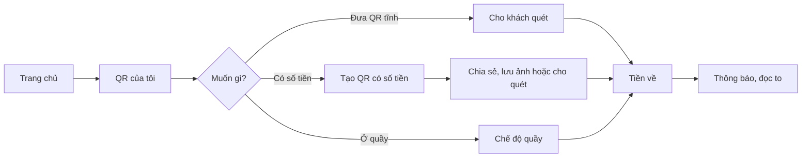

> **Mã:** DE04-TN03-PRD · **Trạng thái:** đã chốt · **Người viết:** Design · **SRS:** [SRS.md](SRS.md)

# PRD Mã QR nhận tiền (App ngân hàng, chuyển khoản QR)

## 1. Bối cảnh và vấn đề

### 1.1 Bối cảnh

Đây là phía **người nhận tiền** của chuyển khoản QR (xem [README](../../README.md)). Người nhận có thể là một cá nhân đòi tiền ăn chung, hoặc một tiểu thương: chủ xe bánh mì, quán cà phê, sạp chợ. Với tiểu thương, câu hỏi quan trọng nhất trong ngày là "Tiền đã về chưa?" khi khách giơ màn hình "Thành công".

### 1.2 Vấn đề

| **Vấn đề** | **Hệ quả** |
| --- | --- |
| Muốn đưa QR cho bạn nhưng phải đọc số tài khoản | Gõ nhầm, chuyển sai người |
| Khách quét QR tĩnh rồi gõ sai số tiền | Phải đòi thêm hoặc trả lại tiền thừa |
| Người bán đang bận tay, không kịp mở app kiểm tra | Bị khách gian lận bằng ảnh "Thành công" giả |
| Thông báo tiền về hiện cả số dư khi điện thoại để trên quầy | Lộ thông tin tài chính |
| In QR ra giấy, đổi tài khoản thì phải in lại | Tốn công |

### 1.3 Mục tiêu

- Từ trang chủ mở được QR của tôi ≤ 2 chạm.
- Thông báo tiền về tới máy người nhận ≤ 5 giây sau khi ghi có (p95).
- ≥ 30% người dùng bật "Đọc to khi tiền về" trong nhóm có ≥ 20 giao dịch nhận mỗi ngày.

## 2. Người dùng

| **Nhóm** | **Nhu cầu với tính năng này** |
| --- | --- |
| Cá nhân nhận tiền bạn bè | Gửi QR qua tin nhắn, có sẵn số tiền |
| Tiểu thương, quán nhỏ | Biết tiền về ngay mà không cầm máy; QR cố định in sẵn |
| Người bán hàng online | QR có số tiền, nội dung đơn hàng để đối chiếu |

## 3. Phạm vi

### 3.1 Trong phạm vi (MVP)

- QR của tôi: VietQR tĩnh theo tài khoản đang chọn.
- Tạo QR có số tiền và nội dung; lưu mẫu QR thường dùng.
- Lưu ảnh QR, chia sẻ QR, in QR khổ A6.
- Thông báo tiền về theo thời gian thực; ẩn số dư trong thông báo.
- Đọc to số tiền khi tiền về.
- Chế độ quầy: màn hình giữ sáng, hiện QR và các khoản vừa nhận.

### 3.2 Ngoài phạm vi

- Loa thông báo phần cứng, kết nối máy POS.
- Tài khoản số đẹp, tài khoản định danh theo tên cửa hàng.
- Quản lý nhiều nhân viên thu ngân, phân quyền.
- Báo cáo doanh thu cho hộ kinh doanh → phase sau.

## 4. Nguyên tắc sản phẩm

### 4.1 Tiền về thì biết ngay, không cần nhìn

Thông báo nhanh và có thể đọc to. Người bán không phải tin vào màn hình của khách.

### 4.2 QR phải tự giải thích

Ảnh QR luôn kèm tên chủ tài khoản, ngân hàng, số tài khoản, số tiền (nếu có) để người quét tự đối chiếu.

### 4.3 Riêng tư trên quầy

Thông báo mặc định không hiện số dư; chế độ quầy không cho người khác dùng app.

## 5. Quy tắc nghiệp vụ

| **Quy tắc** | **Giá trị** |
| --- | --- |
| QR của tôi | VietQR tĩnh, không có số tiền |
| QR có số tiền | 1.000–499.999.999 ₫; nội dung tối đa 50 ký tự, không dấu |
| Mẫu QR | Tối đa 10 mẫu (tên, số tiền, nội dung) |
| Thông báo tiền về | ≤ 5 giây sau khi ghi có; mặc định ẩn số dư |
| Đọc to | Đọc số tiền, tuỳ chọn đọc tên người chuyển |
| Chế độ quầy | Giữ màn hình sáng; thoát cần xác thực |

## 6. Luồng trải nghiệm

| **Bước** | **Giai đoạn** | **Trải nghiệm** | **Đầu ra** |
| --- | --- | --- | --- |
| 1 | Mở QR | Lối tắt trang chủ hoặc từ màn quét | QR của tôi |
| 2 | Tuỳ chỉnh | Đặt số tiền, nội dung; hoặc chọn mẫu | QR có số tiền |
| 3 | Đưa QR | Cho quét trực tiếp, chia sẻ ảnh, in | Người trả quét |
| 4 | Nhận tiền | Push, đọc to, danh sách ở chế độ quầy | Người nhận biết tiền đã về |

## 7. Use Cases, User Stories và Acceptance Criteria

### UC1. QR của tôi

#### US1.1 Đưa QR cho người khác quét

User Story: Là người nhận, tôi muốn mở QR của mình thật nhanh để bạn quét chuyển tiền.

AC01: Trang chủ và màn quét có lối tắt "QR của tôi".

AC02: QR to, giữa màn; độ sáng màn hình tự tăng tối đa khi mở, trả lại khi đóng.

AC03: Hiện tên chủ tài khoản, ngân hàng, số tài khoản (sao chép được).

AC04: Có nhiều tài khoản → chọn tài khoản nhận.

#### US1.2 Chia sẻ, lưu, in QR

AC01: Lưu ảnh QR vào máy; chia sẻ qua ứng dụng khác.

AC02: In QR khổ A6 kèm tên, ngân hàng, dòng "Quét để chuyển khoản".

### UC2. QR có số tiền

#### US2.1 Tạo QR có số tiền

User Story: Là người bán online, tôi muốn gửi QR có sẵn số tiền và mã đơn để khách không gõ sai.

AC01: Nhập số tiền (hiện bằng chữ) và nội dung (tuỳ chọn); QR cập nhật ngay.

AC02: Nội dung có dấu tự bỏ dấu; ký tự không hợp lệ bị loại.

AC03: Lưu thành mẫu để dùng lại; tối đa 10 mẫu.

### UC3. Biết khi tiền về

#### US3.1 Thông báo tiền về

User Story: Là tiểu thương, tôi muốn điện thoại báo ngay khi tiền về để không bị lừa bằng ảnh giả.

AC01: Push "+{số tiền} ₫ từ {TÊN NGƯỜI CHUYỂN} · {nội dung}" trong ≤ 5 giây.

AC02: Mặc định ẩn số dư; bật hiện số dư trong cài đặt.

AC03: Đang mở QR có số tiền mà tiền về đúng số tiền và nội dung → màn QR chuyển sang "Đã nhận".

#### US3.2 Đọc to khi tiền về

AC01: Bật trong Cài đặt thông báo; đọc "Đã nhận {số tiền bằng chữ}".

AC02: Tuỳ chọn đọc tên người chuyển.

#### US3.3 Chế độ quầy

User Story: Là chủ quán, tôi muốn để điện thoại trên quầy hiện QR và các khoản vừa nhận, không ai dùng được app.

AC01: Màn hình giữ sáng, hiện QR và 5 khoản nhận gần nhất theo thời gian thực.

AC02: Không xem được số dư, không vào được chức năng khác; thoát phải xác thực.

## 8. Chỉ số theo dõi

| **Chỉ số** | **Định nghĩa** | **Mục tiêu MVP** |
| --- | --- | --- |
| Độ trễ thông báo | Ghi có → push tới máy (p95) | ≤ 5 giây |
| Tỉ lệ dùng QR có số tiền | QR có số tiền được tạo / tổng lần mở QR của tôi | Theo dõi |
| Tỉ lệ bật đọc to | Người bật / người có ≥ 20 giao dịch nhận/ngày | ≥ 30% |
| Thời gian dùng chế độ quầy | Trung bình mỗi ngày của người dùng chế độ quầy | Theo dõi |
| Khiếu nại "chưa nhận được tiền" | Số khiếu nại phía người nhận / 10.000 giao dịch | Giảm theo thời gian |

## 9. Phụ thuộc và rủi ro

| **Mục** | **Mô tả** | **Hướng xử lý** |
| --- | --- | --- |
| Push của hệ điều hành | Có thể trễ, bị tắt | Chế độ quầy nhận qua kết nối trực tiếp khi app mở; nhắc bật thông báo |
| iOS hạn chế chạy nền | Không đọc to khi app đóng | Đọc to chỉ khi app đang mở; nói rõ trong cài đặt |
| Ảnh QR bị sửa | Kẻ gian thay QR in | Người trả luôn thấy tên thật khi quét (TN01) |
| Pin, màn hình | Chế độ quầy tốn pin | Gợi ý cắm sạc; giảm sáng sau 2 phút không có giao dịch |

## 10. Câu hỏi mở

> Mọi câu hỏi dưới đây đã được PO chốt ngày 20/11/2026; quyết định ghi sau mỗi câu và đã cập nhật vào SRS.

- QR có số tiền có hết hạn không? → **Đã chốt:** Không. QR do app tạo không đặt thời hạn để dùng in sẵn được (SRS BR-26).
- Đọc to có chạy khi app đóng? → **Đã chốt:** Không ở MVP. Chỉ khi app đang mở (mọi màn) hoặc ở chế độ quầy (SRS BR-30).
- Chế độ quầy có hiện tên người chuyển? → **Đã chốt:** Có, viết tắt dạng "NGUYEN V. A" để giảm lộ thông tin (SRS BR-31).
- Khoản nhận "khớp QR" xác định thế nào? → **Đã chốt:** Đúng số tiền và nội dung chứa nội dung của QR, trong lúc màn QR đó đang mở (SRS BR-29).
