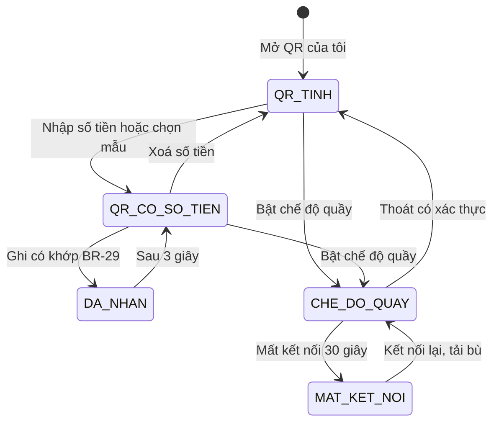
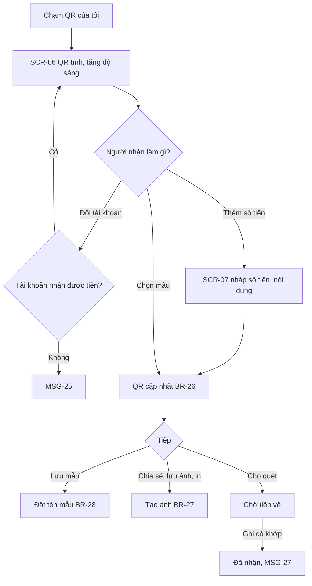
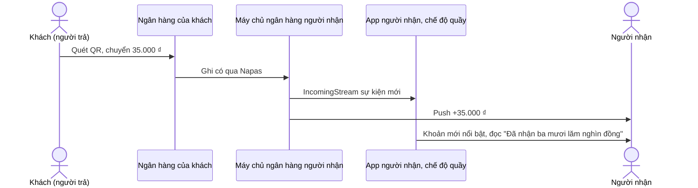

> **Mã:** DE04-TN03-SRS · **Trạng thái:** đã chốt · **Người viết:** Design · **PRD:** [PRD.md](PRD.md)

# UC-DE04-03 - Mã QR nhận tiền

> SRS này mô tả phía người nhận: tạo, chia sẻ QR và nhận thông báo tiền về. Phía người trả tiền xem [SRS TN01](../TN01-quet-ma-qr/SRS.md) và [SRS TN02](../TN02-xac-nhan-chuyen-tien/SRS.md).

## 1. Tổng quan

| **Mục** | **Nội dung** |
| --- | --- |
| Mục tiêu | Người nhận đưa QR nhanh, tạo QR có số tiền, biết ngay khi tiền về |
| Actor | Người nhận tiền · App ngân hàng · Máy chủ ngân hàng · Dịch vụ thông báo đẩy |
| Phạm vi | QR của tôi, chọn tài khoản nhận, QR có số tiền, mẫu QR, lưu, chia sẻ, in, thông báo tiền về, đọc to, chế độ quầy |
| Ngoài phạm vi | Loa phần cứng, POS, tài khoản số đẹp, nhiều thu ngân, báo cáo doanh thu |
| Nền tảng | App ngân hàng iOS / Android |

## 2. User Story

| **ID** | **As a** | **I want** | **So that** |
| --- | --- | --- | --- |
| US-12 | Người nhận | Mở QR của mình trong 2 chạm | Bạn quét ngay |
| US-13 | Người bán online | Gửi QR có sẵn số tiền, nội dung | Khách không gõ sai |
| US-14 | Tiểu thương | Lưu mẫu QR theo món | Không phải nhập lại mỗi lần |
| US-15 | Tiểu thương | Được báo, đọc to khi tiền về | Không bị lừa bằng ảnh giả |
| US-16 | Chủ quán | Để máy trên quầy an toàn | Không ai xem được số dư, dùng app |

## 3. Business Rules

| **Mã** | **Quy tắc** |
| --- | --- |
| BR-25 | **QR của tôi**: VietQR tĩnh (không số tiền) theo tài khoản nhận đang chọn; mặc định tài khoản chính. Chỉ tài khoản thanh toán VND đang hoạt động, không bị khoá chiều ghi có. QR sinh trên thiết bị, không cần mạng sau lần tải danh sách tài khoản đầu tiên. Khi mở màn QR, độ sáng màn hình tăng tối đa; đóng màn thì trả lại |
| BR-26 | **QR có số tiền**: số tiền 1.000–499.999.999 ₫, hiện bằng chữ; nội dung tuỳ chọn, tối đa 50 ký tự, tự bỏ dấu, chỉ chữ, số, khoảng trắng; QR không có thời hạn. QR cập nhật sau 300 ms kể từ lần sửa cuối |
| BR-27 | **Ảnh QR** (lưu, chia sẻ): PNG nền trắng gồm QR, logo ngân hàng, tên chủ tài khoản, ngân hàng, số tài khoản, số tiền và nội dung nếu có, dòng "Quét bằng app ngân hàng bất kỳ". **In** khổ A6 cùng bố cục |
| BR-28 | **Mẫu QR**: tối đa 10 mẫu, mỗi mẫu có tên 1–20 ký tự, số tiền, nội dung; lưu trên máy chủ theo người dùng; sắp xếp theo lần dùng gần nhất |
| BR-29 | **Đã nhận khớp QR**: đang mở màn QR có số tiền, có ghi có vào đúng tài khoản với số tiền bằng số tiền QR và nội dung chứa nội dung QR (không phân biệt hoa thường) → màn QR chuyển "Đã nhận {số tiền}" (MSG-27) trong 3 giây rồi về QR |
| BR-30 | **Thông báo tiền về**: mọi ghi có vào tài khoản → push ≤ 5 giây: "+{số tiền} ₫ · {TÊN NGƯỜI CHUYỂN} · {nội dung}". Số dư mặc định ẩn, bật trong cài đặt. **Đọc to** (cài đặt, mặc định tắt): app đang mở hoặc ở chế độ quầy → đọc "Đã nhận {số tiền bằng chữ}"; tuỳ chọn đọc thêm tên người chuyển. Nhiều khoản trong 2 giây đọc lần lượt |
| BR-31 | **Chế độ quầy**: màn hình giữ sáng; hiện QR của tôi (hoặc mẫu QR đã chọn) và 5 khoản nhận gần nhất (giờ, số tiền, tên viết tắt "NGUYEN V. A"); nhận khoản mới qua kết nối thời gian thực, khoản mới nổi bật 5 giây. Không có điều hướng, không hiện số dư. Thoát cần sinh trắc hoặc mật khẩu. Không có khoản mới sau 2 phút → giảm sáng 50%, khoản mới tới thì sáng lại |
| BR-32 | **Phiên ở chế độ quầy** không hết hạn theo thời gian chờ thông thường của app nhưng chỉ có quyền đọc khoản nhận; tối đa 12 giờ, hết thì về màn đăng nhập |
| BR-33 | **Kết nối thời gian thực** mất > 30 giây ở chế độ quầy → banner MSG-28; tự kết nối lại; khi có lại, tải bù khoản nhận bị lỡ |
| BR-34 | **Tài khoản không nhận được tiền** (khoá ghi có, đóng, phong toả) → không cho tạo QR với tài khoản đó, MSG-25 |

## 4. Trạng thái

### 4.1 Trạng thái màn QR

### 4.2 Hiển thị khoản nhận ở chế độ quầy

| **Trạng thái** | **Hiển thị** |
| --- | --- |
| Khoản mới (≤ 5 giây) | Nền nổi bật, số tiền lớn, có âm thanh và đọc to nếu bật |
| Khoản cũ | Dòng thường: giờ, số tiền, tên viết tắt |
| Chưa có khoản | "Chưa có giao dịch trong phiên này" |
| Mất kết nối | Banner MSG-28; danh sách giữ nguyên |

## 5. Use Case

### UC-05 Đưa QR và tạo QR có số tiền

| **Mục** | **Nội dung** |
| --- | --- |
| Tiền điều kiện | Đã đăng nhập; có ít nhất 1 tài khoản nhận được tiền |
| Hậu điều kiện thành công | QR hiện trên màn, hoặc được lưu, chia sẻ, in |
| Hậu điều kiện thất bại | Không hiện QR, có thông báo lý do |

**Luồng chính**

| **Bước** | **Actor** | **Mô tả** |
| --- | --- | --- |
| 1 | Người nhận | Chạm "QR của tôi" ở trang chủ |
| 2 | App | Mở **SCR-06**: QR tĩnh, tên, ngân hàng, số tài khoản; tăng độ sáng |
| 3 | Người nhận | Chạm "Thêm số tiền" |
| 4 | App | Mở **SCR-07**; người nhận nhập 35.000 ₫, nội dung "ca phe sua" |
| 5 | App | QR cập nhật; hiện "Ba mươi lăm nghìn đồng" |
| 6 | Người nhận | Đưa màn hình cho khách quét |
| 7 | App | Nhận sự kiện ghi có khớp (BR-29) → "Đã nhận 35.000 ₫" |

**Luồng thay thế**

| **Mã** | **Điều kiện** | **Xử lý** |
| --- | --- | --- |
| A1 | Chia sẻ | Tạo ảnh (BR-27), mở bảng chia sẻ hệ điều hành |
| A2 | Lưu ảnh | Hỏi quyền thư viện nếu cần; MSG-26 |
| A3 | In | Mở hộp thoại in của hệ điều hành, khổ A6 |
| A4 | Lưu mẫu | Nhập tên mẫu → \[QrTemplateSave\]; đủ 10 mẫu → MSG-29 |
| A5 | Chọn mẫu ở **SCR-06** | Điền số tiền, nội dung của mẫu |
| A6 | Nhiều tài khoản | Dòng chọn tài khoản ở **SCR-06** |

**Luồng lỗi**

| **Mã** | **Điều kiện** | **Xử lý** |
| --- | --- | --- |
| E1 | Tài khoản không nhận được tiền | MSG-25 |
| E2 | Số tiền ngoài khoảng | Lỗi inline "Số tiền từ 1.000 ₫ đến 499.999.999 ₫" |
| E3 | Từ chối quyền thư viện ảnh | MSG-30 |
| E4 | Lỗi mạng khi lưu mẫu | MSG-31; QR vẫn dùng được |

### UC-06 Nhận thông báo và chế độ quầy

| **Mục** | **Nội dung** |
| --- | --- |
| Tiền điều kiện | Đã cho phép thông báo (push); với chế độ quầy: đã đăng nhập |
| Hậu điều kiện thành công | Người nhận biết khoản tiền về trong ≤ 5 giây |
| Hậu điều kiện thất bại | Khoản tiền vẫn có trong lịch sử (TN04) |

**Luồng chính**

| **Bước** | **Actor** | **Mô tả** |
| --- | --- | --- |
| 1 | Người nhận | Ở **SCR-06** chạm "Chế độ quầy" |
| 2 | App | Mở **SCR-08**: QR lớn, danh sách khoản nhận trống; giữ màn hình sáng; mở kết nối thời gian thực \[IncomingStream\] |
| 3 | Máy chủ | Có ghi có → gửi sự kiện tới **SCR-08** và push |
| 4 | App | Khoản mới hiện trên đầu, nổi bật 5 giây; đọc to nếu bật (BR-30) |
| 5 | Người nhận | Hết ca, chạm "Thoát" → sinh trắc → về **SCR-06** |

**Luồng thay thế**

| **Mã** | **Điều kiện** | **Xử lý** |
| --- | --- | --- |
| A1 | Không ở chế độ quầy, app đóng | Chỉ push (BR-30) |
| A2 | App đang mở ở màn khác | Push trong app (banner) + đọc to nếu bật |
| A3 | Bật hiện số dư | Push thêm "Số dư: {số dư} ₫" |
| A4 | 2 phút không có khoản mới | Giảm sáng (BR-31) |

**Luồng lỗi**

| **Mã** | **Điều kiện** | **Xử lý** |
| --- | --- | --- |
| E1 | Mất kết nối | MSG-28, tự kết nối lại, tải bù (BR-33) |
| E2 | Thông báo bị tắt ở hệ điều hành | Banner trong **SCR-06** gợi ý bật, nút "Mở cài đặt" |
| E3 | Phiên quầy quá 12 giờ | Về màn đăng nhập (BR-32) |

## 6. Điểm vào

| **Điểm vào** | **Dẫn tới** | **Ghi chú** |
| --- | --- | --- |
| Lối tắt "QR của tôi" ở trang chủ (**SCR-01**) | **SCR-06** | |
| Nút "QR của tôi" ở màn quét (**SCR-02**) | **SCR-06** | |
| Menu nhanh biểu tượng app | **SCR-06** | Sau xác thực |
| Cài đặt → Thông báo | Bật đọc to, hiện số dư | |
| Chạm push tiền về | Chi tiết giao dịch (TN04) | |

## 7. Mô tả màn hình

### SCR-06 QR của tôi

| **#** | **Thành phần** | **Loại** | **Hành vi** |
| --- | --- | --- | --- |
| 1 | Chọn tài khoản nhận | Dropdown | BR-25, BR-34 |
| 2 | QR | Image | Kích thước ≥ 60% chiều rộng màn |
| 3 | Thông tin nhận | Text | Tên chủ tài khoản, ngân hàng, số tài khoản + nút sao chép |
| 4 | Số tiền, nội dung | Text | Khi có; nút "Sửa" |
| 5 | "Thêm số tiền" | Button | Mở **SCR-07** |
| 6 | Mẫu QR | Chips cuộn ngang | Tối đa 10; chạm để dùng |
| 7 | Lưu ảnh · Chia sẻ · In | Icon buttons | BR-27 |
| 8 | Chế độ quầy | Button | Mở **SCR-08** |
| 9 | Trạng thái đã nhận | Overlay | MSG-27, 3 giây |
| 10 | Nhắc bật thông báo | Banner | E2 UC-06 |

### SCR-07 Tạo QR có số tiền

| **#** | **Thành phần** | **Loại** | **Bắt buộc** | **Validate / hành vi** |
| --- | --- | --- | --- | --- |
| 1 | Số tiền | Amount input | Có | BR-26; bằng chữ bên dưới |
| 2 | Nội dung | Text | Không | ≤ 50 ký tự, tự bỏ dấu |
| 3 | Xem trước QR | Image | – | Cập nhật sau 300 ms |
| 4 | "Lưu thành mẫu" | Checkbox + Text | Không | Tên mẫu 1–20 ký tự |
| 5 | "Xong" | Button | – | Về **SCR-06** với QR có số tiền |

### SCR-08 Chế độ quầy

| **#** | **Thành phần** | **Loại** | **Hành vi** |
| --- | --- | --- | --- |
| 1 | QR | Image lớn | QR tĩnh hoặc mẫu đã chọn; tên chủ tài khoản bên dưới |
| 2 | Khoản vừa nhận | List | 5 dòng mới nhất (BR-31), mục 4.2 |
| 3 | Tổng phiên | Text | "Đã nhận {n} khoản · {tổng} ₫ từ {giờ bắt đầu}" |
| 4 | Biểu tượng đọc to | Icon toggle | Bật, tắt đọc to ngay tại quầy |
| 5 | Banner kết nối | Banner | MSG-28 |
| 6 | "Thoát" | Button nhỏ | Cần xác thực |

## 8. API

| **API** | **Request chính** | **Response chính** | **Timeout / retry** |
| --- | --- | --- | --- |
| \[ReceivableAccounts\] | – | Tài khoản nhận được tiền: số, tên, ngân hàng, trạng thái | 5s / 1 lần; cache trên máy |
| \[QrTemplateList\], \[QrTemplateSave\], \[QrTemplateDelete\] | name, amount, note | Danh sách mẫu | 5s / 1 lần |
| \[IncomingStream\] | account_ids | Luồng sự kiện ghi có: thời gian, số tiền, tên người chuyển, nội dung, mã giao dịch | Kết nối lâu dài; tự nối lại sau 2, 4, 8… tối đa 30 giây |
| \[IncomingSince\] | account_ids, since | Các khoản nhận từ thời điểm | 5s / 1 lần; dùng khi tải bù |
| \[NotificationSettings\] | speak, speak_name, show_balance | Cài đặt đã lưu | 5s / 1 lần |
| \[CounterSessionStart\] | account_id | Phiên quầy chỉ đọc, hết hạn sau 12 giờ | 5s / 1 lần |

QR sinh trên thiết bị theo chuẩn VietQR từ số tài khoản, mã ngân hàng, số tiền, nội dung.

**Map lỗi → thông báo**

| **Nhóm lỗi** | **Message** |
| --- | --- |
| Tài khoản không nhận được tiền | MSG-25 |
| Đã lưu ảnh | MSG-26 |
| Nhận khớp QR | MSG-27 |
| Mất kết nối ở chế độ quầy | MSG-28 |
| Đủ 10 mẫu | MSG-29 |
| Không có quyền thư viện ảnh | MSG-30 |
| Mất mạng, lỗi máy chủ | MSG-31 |

## 9. Danh sách thông báo

| **ID** | **Nơi hiện** | **Nội dung (VI)** |
| --- | --- | --- |
| MSG-25 | Inline | Tài khoản này hiện không nhận được tiền. Vui lòng chọn tài khoản khác hoặc liên hệ tổng đài {số} |
| MSG-26 | Toast | Đã lưu ảnh QR vào thư viện |
| MSG-27 | Overlay **SCR-06** | ✓ Đã nhận {số tiền} ₫ từ {TÊN NGƯỜI CHUYỂN} |
| MSG-28 | Banner **SCR-08** | Mất kết nối. Đang kết nối lại… Thông báo đẩy vẫn hoạt động nếu có mạng |
| MSG-29 | Toast | Bạn đã có 10 mẫu QR. Xoá bớt để lưu mẫu mới |
| MSG-30 | Popup | Cho phép truy cập Ảnh để lưu QR. \[Mở cài đặt\] |
| MSG-31 | Toast | Kết nối không ổn định, vui lòng thử lại |

## 10. Yêu cầu phi chức năng

| **Mục** | **Yêu cầu** |
| --- | --- |
| Hiệu năng | Mở **SCR-06** ≤ 1 giây (QR sinh trên máy); push ≤ 5 giây (p95) sau ghi có; sự kiện tới **SCR-08** ≤ 2 giây (p95) |
| Độ tin cậy | Không mất khoản nhận: luôn tải bù sau khi mất kết nối; mã giao dịch không trùng trong danh sách |
| Bảo mật, riêng tư | Chế độ quầy chỉ đọc, không hiện số dư; tên người chuyển viết tắt; ảnh QR không chứa số dư |
| Pin | Chế độ quầy giảm sáng khi không có giao dịch; cảnh báo khi pin < 20% và chưa cắm sạc |
| Log / audit | Bật, thoát chế độ quầy (thời điểm, thiết bị); thay đổi cài đặt thông báo |
| Tracking | Mở QR (nguồn), tạo QR có số tiền, dùng mẫu, chia sẻ, lưu ảnh, in, bật đọc to, thời lượng chế độ quầy, số khoản nhận trong phiên |
| Accessibility | QR có mô tả cho giọng đọc ("Mã QR nhận tiền của {tên}"); đọc to dùng giọng tiếng Việt của hệ điều hành; chữ ở chế độ quầy đọc được từ khoảng cách 1 m |
