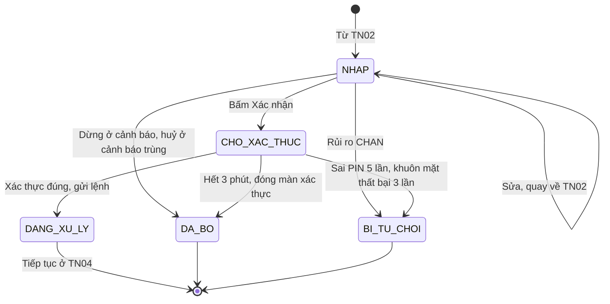
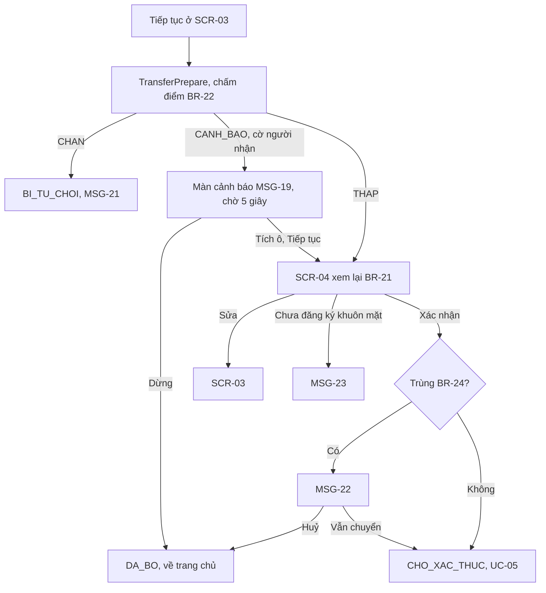
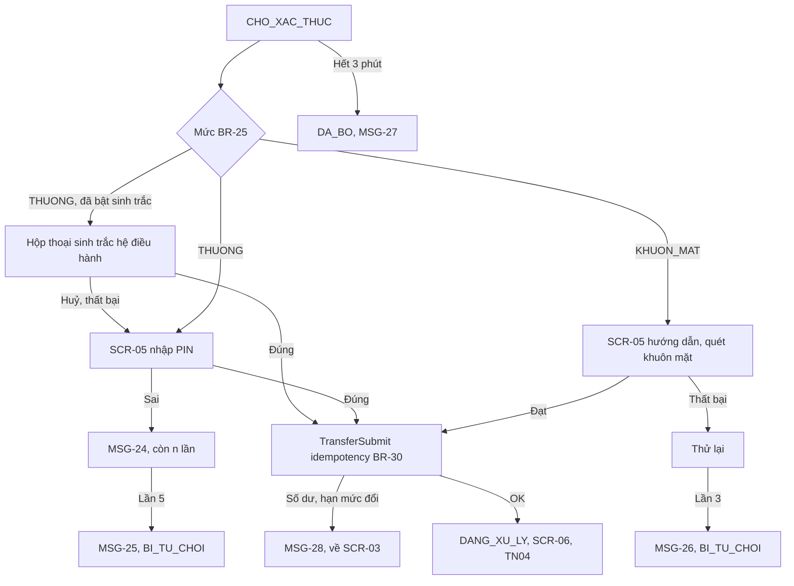
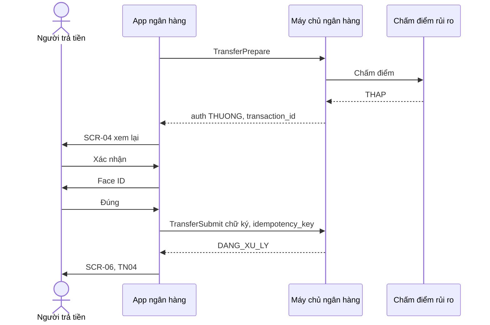

> **Mã:** DE04-TN03-SRS · **Trạng thái:** đã chốt · **Người viết:** Design · **PRD:** [PRD.md](PRD.md)

# UC-DE04-03 - Xác thực và xác nhận chuyển khoản

> SRS này mô tả giao dịch từ `NHAP` (sau [SRS TN02](../TN02-chon-so-tien/SRS.md)) qua `CHO_XAC_THUC` tới khi lệnh được gửi (`DANG_XU_LY`); kết quả xem [SRS TN04](../TN04-hoan-thanh-chuyen-khoan/SRS.md).

## 1. Tổng quan

| **Mục** | **Nội dung** |
| --- | --- |
| Mục tiêu | Người trả tiền xem lại, xác nhận, xác thực đúng mức; dừng lại được khi có dấu hiệu lừa đảo |
| Actor | Người trả tiền · App ngân hàng · Máy chủ ngân hàng · Hệ thống chấm điểm rủi ro |
| Phạm vi | Màn xác nhận, cảnh báo lừa đảo, cảnh báo trùng, mức xác thực, PIN Smart OTP, sinh trắc thiết bị, sinh trắc khuôn mặt, khoá khi sai, gửi lệnh |
| Ngoài phạm vi | Cài Smart OTP, đăng ký khuôn mặt, tạm giữ giao dịch, kết quả (TN04) |
| Nền tảng | App ngân hàng iOS / Android |

## 2. User Story

| **ID** | **As a** | **I want** | **So that** |
| --- | --- | --- | --- |
| US-11 | Người trả tiền | Xem lại toàn bộ trước khi xác thực | Sửa kịp nếu sai |
| US-12 | Người trả tiền | Biết trước cách xác thực | Không bất ngờ |
| US-13 | Người dùng | Được cảnh báo khi có dấu hiệu lừa đảo | Kịp dừng lại |
| US-14 | Người trả tiền | Xác thực bằng sinh trắc | Không bắt người bán chờ |
| US-15 | Người trả tiền | Không bị chuyển trùng | Không mất tiền oan |

## 3. Business Rules

| **Mã** | **Quy tắc** |
| --- | --- |
| BR-21 | **Màn xác nhận** (**SCR-04**) chỉ đọc, thứ tự: số tiền và bằng chữ; người nhận (tên chủ tài khoản, ngân hàng, số tài khoản đầy đủ); nội dung (bản sẽ gửi); tài khoản nguồn; phí; tổng trừ; cách xác thực. Nút "Sửa" về **SCR-03** giữ dữ liệu; nút chính "Xác nhận". Thứ tự luôn là Xác nhận rồi mới Xác thực |
| BR-22 | **Chấm điểm rủi ro** khi mở **SCR-04** (\[TransferPrepare\]): đầu vào gồm cờ người nhận (TN01 BR-08), người nhận mới, số tiền so với thói quen 90 ngày, thiết bị mới trong 24 giờ, giờ 23:00–05:00. Kết quả `THAP`, `CANH_BAO`, `CHAN`. Quá 800 ms hoặc lỗi → coi là `CANH_BAO` mức nhẹ (chỉ banner, không màn toàn trang) |
| BR-23 | **Theo kết quả**: `THAP` → bình thường. `CANH_BAO` (hoặc cờ người nhận) → trước **SCR-04** hiện màn cảnh báo toàn trang (MSG-19, thêm MSG-20 nếu đọc được đang có cuộc gọi thoại); "Tiếp tục" bật sau 5 giây và khi tích "Tôi hiểu rủi ro và tự chịu trách nhiệm"; nút chính "Dừng giao dịch". `CHAN` → giao dịch `BI_TU_CHOI`, MSG-21 |
| BR-24 | **Cảnh báo trùng**: có giao dịch `THANH_CONG` hoặc `CHUA_XAC_DINH` cùng người nhận, cùng số tiền trong 5 phút → khi bấm "Xác nhận" hiện MSG-22 \[Vẫn chuyển\] \[Huỷ\] |
| BR-25 | **Mức xác thực**: `THUONG` = PIN Smart OTP 6 số, hoặc sinh trắc thiết bị (vân tay, Face ID) nếu khách đã bật. `KHUON_MAT` = sinh trắc khuôn mặt có kiểm tra người thật, đối chiếu dữ liệu đã đăng ký từ CCCD gắn chip; áp dụng khi số tiền > 10.000.000 ₫, hoặc tổng đã chuyển trong ngày + số tiền > 20.000.000 ₫, hoặc giao dịch chuyển tiền đầu tiên trên thiết bị mới. **SCR-04** ghi rõ cách xác thực trước khi bấm |
| BR-26 | **Chưa đăng ký khuôn mặt** mà cần `KHUON_MAT` → **SCR-04** hiện MSG-23 thay nút Xác nhận bằng "Đăng ký ngay"; không cho chuyển |
| BR-27 | **Sinh trắc thiết bị** (mức `THUONG`): bấm Xác nhận → hộp thoại sinh trắc của hệ điều hành ngay; huỷ hoặc thất bại theo hệ điều hành → chuyển sang nhập PIN trên **SCR-05** |
| BR-28 | **PIN**: bàn phím số xáo vị trí; sai → MSG-24 với số lần còn lại; sai 5 lần liên tiếp → khoá Smart OTP (MSG-25), giao dịch `BI_TU_CHOI`. **Khuôn mặt**: thất bại → thử lại; 3 lần liên tiếp → tạm khoá xác thực khuôn mặt 15 phút (MSG-26), giao dịch `BI_TU_CHOI` |
| BR-29 | **Thời gian**: **SCR-05** có hiệu lực 3 phút kể từ khi bấm Xác nhận; hết → giao dịch `DA_BO`, quay về **SCR-04** với MSG-27, bấm Xác nhận lại để bắt đầu lại |
| BR-30 | **Gửi lệnh**: xác thực đúng → ký lệnh bằng Smart OTP, gọi \[TransferSubmit\] kèm idempotency key sinh khi mở **SCR-04**; bấm, gửi lại nhiều lần chỉ tạo 1 lệnh. Máy chủ kiểm tra lại số dư, hạn mức; lỗi → MSG-28 và quay về **SCR-03**. Gửi thành công → giao dịch `DANG_XU_LY`, mở **SCR-06** (TN04) |

## 4. Trạng thái

### 4.1 Giao dịch trong phạm vi TN03

`DA_BO`, `BI_TU_CHOI` không xuất hiện trong lịch sử giao dịch; `BI_TU_CHOI` được ghi log an ninh.

### 4.2 Hiển thị nút trên SCR-04

| **Tình huống** | **Hiển thị** |
| --- | --- |
| Bình thường | "Xác nhận" (chính), "Sửa" (phụ) |
| Cần khuôn mặt, đã đăng ký | "Xác nhận" + dòng "Giao dịch này cần xác thực khuôn mặt" |
| Cần khuôn mặt, chưa đăng ký | "Đăng ký ngay" thay "Xác nhận", MSG-23 |
| Rủi ro lỗi, cảnh báo nhẹ | Banner vàng trên đầu màn |

## 5. Use Case

### UC-04 Xem lại và xác nhận

| **Mục** | **Nội dung** |
| --- | --- |
| Tiền điều kiện | Lệnh nháp hợp lệ từ TN02 |
| Hậu điều kiện thành công | Giao dịch `CHO_XAC_THUC`, mở xác thực |
| Hậu điều kiện thất bại | `DA_BO`, `BI_TU_CHOI`, hoặc quay về **SCR-03** |

**Luồng chính**

| **Bước** | **Actor** | **Mô tả** |
| --- | --- | --- |
| 1 | App | Gọi \[TransferPrepare\]; nhận transaction_id, mức xác thực, kết quả rủi ro `THAP` |
| 2 | App | Hiện **SCR-04** theo BR-21 |
| 3 | Người trả tiền | Kiểm tra, bấm "Xác nhận" |
| 4 | App | Không trùng; giao dịch `CHO_XAC_THUC`; sang UC-05 |

**Luồng thay thế**

| **Mã** | **Điều kiện** | **Xử lý** |
| --- | --- | --- |
| A1 | Rủi ro `CANH_BAO` | Màn cảnh báo trước **SCR-04** (BR-23) |
| A2 | Bấm Sửa | Về **SCR-03** (TN02), giữ dữ liệu |
| A3 | Có giao dịch trùng | MSG-22 (BR-24) |

**Luồng lỗi**

| **Mã** | **Điều kiện** | **Xử lý** |
| --- | --- | --- |
| E1 | Rủi ro `CHAN` | MSG-21 |
| E2 | Cần khuôn mặt, chưa đăng ký | MSG-23 |
| E3 | \[TransferPrepare\] lỗi mạng | MSG-28, ở lại **SCR-03** |

### UC-05 Xác thực và gửi lệnh

| **Mục** | **Nội dung** |
| --- | --- |
| Tiền điều kiện | Giao dịch `CHO_XAC_THUC` |
| Hậu điều kiện thành công | Lệnh được gửi; giao dịch `DANG_XU_LY`; mở **SCR-06** (TN04) |
| Hậu điều kiện thất bại | `DA_BO` hoặc `BI_TU_CHOI`; tiền không bị trừ |

**Luồng chính**

| **Bước** | **Actor** | **Mô tả** |
| --- | --- | --- |
| 1 | App | Mức `THUONG`, đã bật Face ID → hiện hộp thoại Face ID |
| 2 | Người trả tiền | Xác thực thành công |
| 3 | App | Ký lệnh, gọi \[TransferSubmit\] |
| 4 | Máy chủ | Kiểm tra lại số dư, hạn mức; nhận lệnh |
| 5 | App | Mở **SCR-06** trạng thái "Đang chuyển tiền…" (TN04) |

**Luồng thay thế**

| **Mã** | **Điều kiện** | **Xử lý** |
| --- | --- | --- |
| A1 | Chưa bật sinh trắc | Nhập PIN trên **SCR-05** |
| A2 | Mức `KHUON_MAT` | Hướng dẫn → camera trước → \[FaceVerify\] |
| A3 | Quên PIN | Link "Quên PIN" mở luồng đặt lại Smart OTP; giao dịch `DA_BO` |

**Luồng lỗi**

| **Mã** | **Điều kiện** | **Xử lý** |
| --- | --- | --- |
| E1 | Sai PIN | MSG-24; lần 5 → MSG-25 |
| E2 | Khuôn mặt thất bại 3 lần | MSG-26 |
| E3 | Hết 3 phút | MSG-27 |
| E4 | Máy chủ báo số dư, hạn mức không còn đủ | MSG-28 |
| E5 | Mất mạng khi gửi | Gửi lại cùng idempotency key; không chắc lệnh đã tới → vẫn mở **SCR-06**, TN04 xử lý `CHUA_XAC_DINH` |

## 6. Điểm vào

| **Điểm vào** | **Dẫn tới** | **Ghi chú** |
| --- | --- | --- |
| "Tiếp tục" ở **SCR-03** (TN02) | UC-04 | |
| Quay lại từ màn đăng ký khuôn mặt thành công | **SCR-04** | Giữ giao dịch nếu chưa quá 10 phút |

## 7. Mô tả màn hình

### SCR-04 Xác nhận giao dịch (gồm màn cảnh báo)

| **#** | **Thành phần** | **Loại** | **Hành vi** |
| --- | --- | --- | --- |
| 1 | Số tiền | Text lớn | Kèm bằng chữ |
| 2 | Người nhận | List | Tên chủ tài khoản, ngân hàng, số tài khoản đầy đủ |
| 3 | Nội dung | Text | Bản sẽ gửi |
| 4 | Tài khoản nguồn | Text | Số tài khoản che giữa |
| 5 | Phí, tổng trừ | Text | |
| 6 | Cách xác thực | Info | BR-25; MSG-23 khi chưa đăng ký |
| 7 | Banner cảnh báo nhẹ | Banner | BR-22 khi chấm điểm lỗi |
| 8 | "Sửa", "Xác nhận" | Button | Mục 4.2; "Xác nhận" dính đáy |
| 9 | Màn cảnh báo | Full screen | Biểu tượng cảnh báo, MSG-19, MSG-20; nút chính "Dừng giao dịch"; ô tích; "Tiếp tục" bật sau 5 giây; số tổng đài khẩn |

### SCR-05 Xác thực giao dịch

| **#** | **Thành phần** | **Loại** | **Hành vi** |
| --- | --- | --- | --- |
| 1 | Tóm tắt | Card | Người nhận, số tiền |
| 2 | PIN Smart OTP | 6 ô số | Bàn phím xáo vị trí; ẩn ký tự |
| 3 | Dùng sinh trắc | Link | Khi đã bật sinh trắc thiết bị |
| 4 | Khuôn mặt | Camera tròn | Hướng dẫn, kiểm tra người thật, tiến trình |
| 5 | Đếm ngược | Timer | 3 phút (BR-29) |
| 6 | Quên PIN | Link | A3 UC-05 |

## 8. API

| **API** | **Request chính** | **Response chính** | **Timeout / retry** |
| --- | --- | --- | --- |
| \[TransferPrepare\] | inquiry_id, amount, note, source_account | transaction_id, auth_level, risk_result, risk_reasons, duplicate_hint, idempotency_key | 5s / 1 lần |
| \[FaceVerify\] | transaction_id, dữ liệu khuôn mặt mã hoá | verified, liveness | 15s / không retry tự động |
| \[TransferSubmit\] | transaction_id, chữ ký Smart OTP, idempotency_key | status `DANG_XU_LY` hoặc lỗi | 30s / gửi lại cùng key |

**Map lỗi → thông báo**

| **Nhóm lỗi** | **Message** |
| --- | --- |
| Người nhận đáng ngờ, giao dịch bất thường | MSG-19 |
| Đang có cuộc gọi | MSG-20 |
| Bị chặn vì rủi ro | MSG-21 |
| Giao dịch trùng | MSG-22 |
| Chưa đăng ký khuôn mặt | MSG-23 |
| Sai PIN | MSG-24 |
| Khoá Smart OTP | MSG-25 |
| Khuôn mặt thất bại | MSG-26 |
| Hết thời gian xác thực | MSG-27 |
| Số dư, hạn mức thay đổi; mất mạng | MSG-28 |

## 9. Danh sách thông báo

| **ID** | **Nơi hiện** | **Nội dung (VI)** |
| --- | --- | --- |
| MSG-19 | Màn cảnh báo | {Tài khoản này đã bị báo cáo có dấu hiệu lừa đảo / Giao dịch này khác thói quen của bạn}. Ngân hàng, công an, cơ quan nhà nước **không bao giờ** yêu cầu bạn chuyển tiền qua điện thoại. ☐ Tôi hiểu rủi ro và tự chịu trách nhiệm \[Dừng giao dịch\] \[Tiếp tục\] |
| MSG-20 | Màn cảnh báo | Bạn có đang được ai đó hướng dẫn chuyển tiền qua điện thoại không? Nếu có, hãy dừng lại và gọi tổng đài {số} |
| MSG-21 | Popup | Giao dịch tạm thời không thể thực hiện để bảo vệ tài khoản của bạn. Gọi {số} để được hỗ trợ |
| MSG-22 | Popup | Bạn vừa chuyển {số tiền} ₫ cho {tên} lúc {giờ}. Bạn có muốn chuyển thêm lần nữa? \[Vẫn chuyển\] \[Huỷ\] |
| MSG-23 | Info **SCR-04** | Giao dịch trên 10 triệu đồng hoặc tổng trong ngày trên 20 triệu đồng cần xác thực khuôn mặt. Bạn chưa đăng ký. \[Đăng ký ngay\] |
| MSG-24 | Inline **SCR-05** | Mã PIN chưa đúng. Bạn còn {n} lần thử |
| MSG-25 | Popup | Smart OTP đã bị khoá do nhập sai 5 lần. \[Mở khoá Smart OTP\] |
| MSG-26 | Popup | Xác thực khuôn mặt chưa thành công. Vui lòng thử lại sau 15 phút, ở nơi đủ sáng |
| MSG-27 | Toast | Phiên xác thực đã hết hạn. Bấm Xác nhận để thử lại |
| MSG-28 | Popup | {Số dư hoặc hạn mức vừa thay đổi, vui lòng kiểm tra lại số tiền / Kết nối không ổn định, vui lòng thử lại} |

## 10. Yêu cầu phi chức năng

| **Mục** | **Yêu cầu** |
| --- | --- |
| Hiệu năng | \[TransferPrepare\] gồm chấm điểm ≤ 1 giây (p95); \[TransferSubmit\] phản hồi nhận lệnh ≤ 2 giây (p95) |
| Bảo mật | Smart OTP gắn thiết bị; chặn chụp màn hình ở **SCR-05**; dữ liệu khuôn mặt mã hoá, không lưu trên máy; idempotency bắt buộc |
| Tuân thủ | Ngưỡng xác thực theo Quyết định 2345/QĐ-NHNN, là cấu hình; lưu bằng chứng xác thực từng giao dịch |
| Log / audit | Kết quả rủi ro, cảnh báo đã hiện và lựa chọn của khách, mức xác thực, kết quả từng lần xác thực |
| Tracking | Thời gian ở **SCR-04**, bấm Sửa, gặp cảnh báo (loại, lựa chọn), loại xác thực, thất bại, bỏ dở |
| Accessibility | **SCR-04** đọc tuần tự theo thứ tự quan trọng; nút "Dừng giao dịch" là trọng tâm mặc định ở màn cảnh báo; hướng dẫn khuôn mặt có lời đọc |
