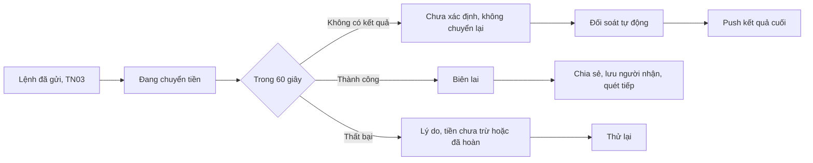

> **Mã:** DE04-TN04-PRD · **Trạng thái:** đã chốt · **Người viết:** Design · **SRS:** [SRS.md](SRS.md)

# PRD Hoàn thành chuyển khoản (App ngân hàng, chuyển khoản QR)

## 1. Bối cảnh và vấn đề

### 1.1 Bối cảnh

Sau khi xác thực (TN03), lệnh được gửi đi và người trả tiền chờ kết quả (xem [README](../../README.md)). Ở quầy, người trả thường giơ màn hình "Thành công" cho người bán xem. Kết quả phải rõ, nhanh, và trung thực: khi ngân hàng chưa biết kết quả, app phải nói "chưa xác định" thay vì để người dùng chuyển lại.

### 1.2 Vấn đề

| **Vấn đề** | **Hệ quả** |
| --- | --- |
| Màn "Đang xử lý" quay mãi | Người dùng chuyển lại, bị trừ tiền hai lần |
| Thất bại nhưng không biết tiền đã bị trừ chưa | Lo lắng, gọi tổng đài |
| Màn thành công nhỏ, không có giờ, không có mã | Người bán nghi ảnh chụp giả |
| Muốn gửi bằng chứng chuyển tiền phải chụp màn hình | Lộ số dư, số tài khoản |
| Người nhận quen phải quét QR lại mỗi lần | Mất thời gian |

### 1.3 Mục tiêu

- ≥ 99% giao dịch có kết quả cuối trong 60 giây.
- Giao dịch chuyển trùng do "Đang xử lý" lâu giảm 70%.
- ≥ 15% giao dịch thành công được chia sẻ biên lai bằng nút trong app (thay vì chụp màn hình).

## 2. Người dùng

| **Nhóm** | **Nhu cầu với tính năng này** |
| --- | --- |
| Người trả tiền ở cửa hàng | Kết quả to rõ để giơ cho người bán |
| Người chuyển cho bạn bè | Gửi biên lai qua tin nhắn |
| Người gặp lỗi | Biết tiền ở đâu, phải làm gì |
| Người trả cùng một nơi thường xuyên | Lưu người nhận, chuyển lại nhanh |

## 3. Phạm vi

### 3.1 Trong phạm vi (MVP)

- Màn đang xử lý; kết quả: thành công, thất bại, chưa xác định.
- Đối soát tự động giao dịch chưa xác định; thông báo khi có kết quả cuối.
- Biên lai; chia sẻ biên lai dạng ảnh.
- Lưu người nhận; quét tiếp; chuyển lại.
- Chi tiết giao dịch (mở từ thông báo, lịch sử).

### 3.2 Ngoài phạm vi

- Lịch sử giao dịch đầy đủ, tìm kiếm (tính năng sẵn có của app).
- Tra soát, khiếu nại (dẫn tới kênh hỗ trợ sẵn có).
- Phía người nhận tiền (thông báo tiền về).

## 4. Nguyên tắc sản phẩm

### 4.1 Ba kết quả, không mập mờ

Thành công, thất bại, hoặc chưa xác định, mỗi kết quả nói rõ tiền đang ở đâu và nên làm gì.

### 4.2 Chưa rõ thì đừng chuyển lại

Khi chưa xác định, app nói thẳng "Vui lòng không chuyển lại" và tự báo khi có kết quả.

### 4.3 Bằng chứng gọn, không lộ thông tin

Biên lai có mã giao dịch, thời gian tới giây; không có số dư.

## 5. Quy tắc nghiệp vụ

| **Quy tắc** | **Giá trị** |
| --- | --- |
| Thời gian chờ kết quả | 60 giây; quá thì "Chưa xác định" |
| Đối soát | Tự động; có kết quả trong tối đa 1 ngày làm việc |
| Thất bại sau khi đã trừ tiền | Hoàn tự động về tài khoản nguồn |
| Danh bạ người nhận | Tối đa 200; dùng chung với chuyển khoản thường |
| Biên lai | Ảnh PNG; không có số dư |

## 6. Luồng trải nghiệm

| **Bước** | **Giai đoạn** | **Trải nghiệm** | **Đầu ra** |
| --- | --- | --- | --- |
| 1 | Đang xử lý | Vòng chờ, "Đang chuyển tiền…" | – |
| 2 | Kết quả | Biểu tượng lớn, số tiền, người nhận, giờ, mã | Người trả, người bán yên tâm |
| 3 | Sau đó | Chia sẻ biên lai, lưu người nhận, quét tiếp | Bằng chứng, lần sau nhanh hơn |
| 4 | Ngoại lệ | Push khi giao dịch chưa xác định có kết quả | Biết chắc tiền đi hay hoàn |

## 7. Use Cases, User Stories và Acceptance Criteria

### UC1. Nhận kết quả

#### US1.1 Thành công rõ ràng

User Story: Là người trả tiền, tôi muốn màn thành công to rõ để người bán tin ngay.

AC01: Dấu tích lớn, "Chuyển tiền thành công", số tiền, tên người nhận, ngân hàng, thời gian tới giây, mã giao dịch.

AC02: Không có số dư trên màn kết quả.

#### US1.2 Thất bại

AC01: Lý do dễ hiểu; ghi rõ "Tiền chưa bị trừ" hoặc "Tiền đã được hoàn".

AC02: Nút "Thử lại" mở lại bước chọn số tiền với dữ liệu cũ.

#### US1.3 Chưa xác định

AC01: Giải thích, khuyên không chuyển lại; không có nút Thử lại.

AC02: Khi có kết quả cuối → push; chi tiết giao dịch cập nhật.

### UC2. Sau khi thành công

#### US2.1 Chia sẻ biên lai

AC01: Nút Chia sẻ tạo ảnh biên lai, mở bảng chia sẻ của điện thoại.

#### US2.2 Lưu người nhận, quét tiếp

AC01: Ô "Lưu người nhận" với tên gợi nhớ; người nhận bị cảnh báo không lưu được.

AC02: "Quét tiếp" mở lại màn quét; "Về trang chủ".

#### US2.3 Chi tiết giao dịch

AC01: Mở từ push, lịch sử: thông tin như biên lai, trạng thái hiện tại.

AC02: Giao dịch thành công có nút "Chuyển lại" (người nhận, số tiền, nội dung cũ).

## 8. Chỉ số theo dõi

| **Chỉ số** | **Định nghĩa** | **Mục tiêu MVP** |
| --- | --- | --- |
| Có kết quả trong 60 giây | Giao dịch có kết quả cuối ≤ 60 giây / tổng | ≥ 99% |
| Chuyển trùng | Cùng người nhận, cùng tiền trong 5 phút sau "Chưa xác định" | Giảm 70% |
| Chia sẻ biên lai | Giao dịch chia sẻ / giao dịch thành công | ≥ 15% |
| Lưu người nhận | Lượt lưu / giao dịch thành công với người nhận mới | Theo dõi |
| Thời gian đối soát | "Chưa xác định" → kết quả cuối (trung vị) | Theo dõi |

## 9. Phụ thuộc và rủi ro

| **Mục** | **Mô tả** | **Hướng xử lý** |
| --- | --- | --- |
| Napas, ngân hàng nhận | Không phản hồi | Trạng thái chưa xác định, đối soát tự động |
| Push | Bị tắt | Chi tiết giao dịch luôn có trạng thái mới; banner nhắc khi mở app |
| Ảnh biên lai giả | Người khác sửa ảnh | Mã giao dịch để người nhận tra trong app của họ |

## 10. Câu hỏi mở

> Mọi câu hỏi dưới đây đã được PO chốt ngày 20/11/2026; quyết định ghi sau mỗi câu và đã cập nhật vào SRS.

- Màn đang xử lý có cho thoát? → **Đã chốt:** Không trong 10 giây đầu; sau đó cho "Về trang chủ", giao dịch vẫn xử lý tiếp (SRS BR-31).
- Thất bại có hoàn phí? → **Đã chốt:** Có, hoàn cả số tiền và phí nếu đã trừ (SRS BR-33).
- Biên lai có hiện số tài khoản nguồn? → **Đã chốt:** Có, che giữa (SRS BR-35).
- "Thử lại" có cần quét lại? → **Đã chốt:** Không; mở lại bước chọn số tiền, tra tên lại tự động (SRS BR-38).
