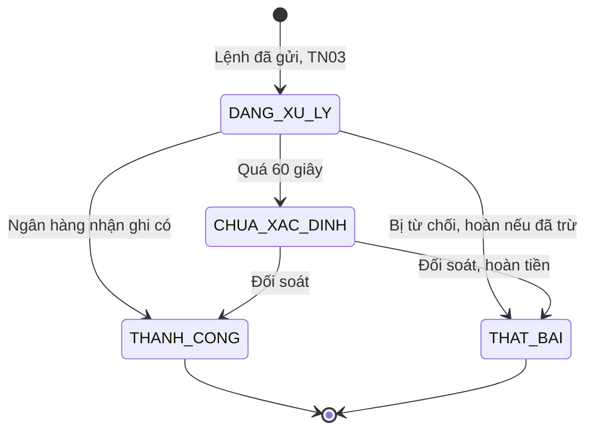
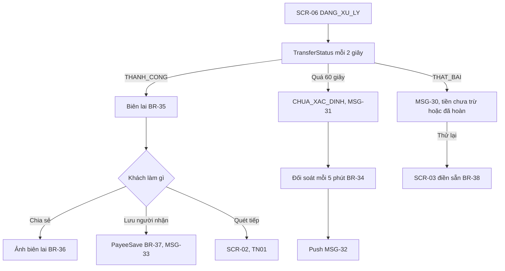
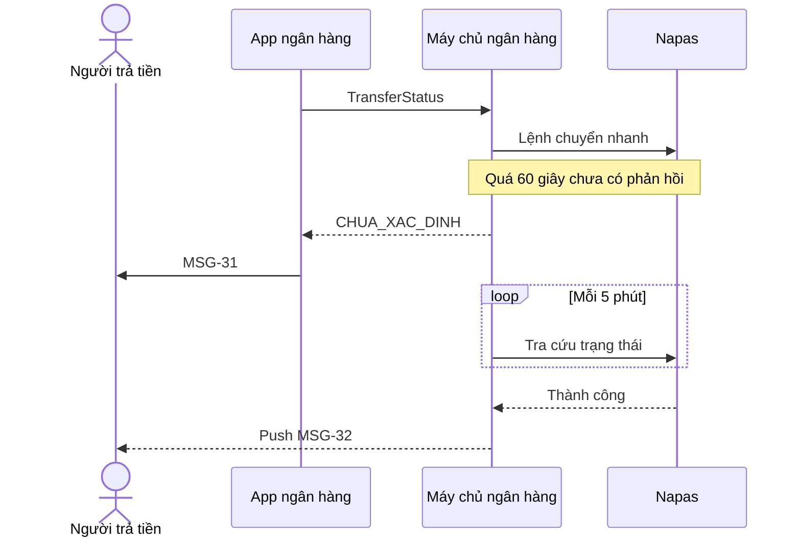

> **Mã:** DE04-TN04-SRS · **Trạng thái:** đã chốt · **Người viết:** Design · **PRD:** [PRD.md](PRD.md)

# UC-DE04-04 - Hoàn thành chuyển khoản

> SRS này mô tả giao dịch từ `DANG_XU_LY` (sau [SRS TN03](../TN03-xac-thuc-xac-nhan/SRS.md)) tới `THANH_CONG` hoặc `THAT_BAI`, gồm trạng thái `CHUA_XAC_DINH`, biên lai và chi tiết giao dịch.

## 1. Tổng quan

| **Mục** | **Nội dung** |
| --- | --- |
| Mục tiêu | Người trả tiền nhận kết quả rõ ràng, có biên lai, biết làm gì khi lỗi hoặc chưa rõ kết quả |
| Actor | Người trả tiền · App ngân hàng · Máy chủ ngân hàng · Napas · Ngân hàng nhận |
| Phạm vi | Đang xử lý, thành công, thất bại, chưa xác định, đối soát, hoàn tiền tự động, push kết quả, biên lai, chia sẻ, lưu người nhận, quét tiếp, chi tiết giao dịch, chuyển lại |
| Ngoài phạm vi | Lịch sử đầy đủ, tra soát, phía người nhận |
| Nền tảng | App ngân hàng iOS / Android |

## 2. User Story

| **ID** | **As a** | **I want** | **So that** |
| --- | --- | --- | --- |
| US-16 | Người trả tiền | Thấy "Thành công" to rõ | Người bán yên tâm |
| US-17 | Người trả tiền | Biết tiền ở đâu khi thất bại | Không lo lắng |
| US-18 | Người trả tiền | Biết không nên chuyển lại khi chưa rõ kết quả | Không bị trừ hai lần |
| US-19 | Người trả tiền | Chia sẻ biên lai không lộ số dư | Làm bằng chứng |
| US-20 | Người trả tiền | Lưu người nhận, chuyển lại | Lần sau nhanh hơn |

## 3. Business Rules

| **Mã** | **Quy tắc** |
| --- | --- |
| BR-31 | **Đang xử lý** (**SCR-06**): vòng chờ, "Đang chuyển tiền…", tóm tắt người nhận, số tiền. 10 giây đầu không có nút thoát; sau đó hiện "Về trang chủ" (giao dịch vẫn xử lý, kết quả qua push). App gọi \[TransferStatus\] mỗi 2 giây |
| BR-32 | **Kết quả trong 60 giây**: `THANH_CONG` (ngân hàng nhận ghi có) hoặc `THAT_BAI` (bị từ chối). Quá 60 giây không có kết quả → `CHUA_XAC_DINH` |
| BR-33 | **Thất bại**: hiện lý do theo mã (MSG-30); tiền chưa trừ → "Tiền chưa bị trừ"; đã trừ → hoàn số tiền và phí về tài khoản nguồn ngay, "Tiền đã được hoàn" |
| BR-34 | **Chưa xác định**: MSG-31; không có nút Thử lại. Máy chủ tra cứu trạng thái mỗi 5 phút; có kết quả cuối trong tối đa 1 ngày làm việc; thất bại mà đã trừ → hoàn tự động. Có kết quả cuối → push MSG-32; chi tiết giao dịch cập nhật |
| BR-35 | **Biên lai**: trạng thái, số tiền và bằng chữ, người nhận (tên, ngân hàng, số tài khoản che giữa), nội dung đã gửi, phí, tài khoản nguồn che giữa, thời gian (giờ:phút:giây, ngày), mã giao dịch, nhãn "Chuyển khoản QR". Không có số dư |
| BR-36 | **Chia sẻ biên lai**: tạo ảnh PNG theo BR-35 có logo ngân hàng; mở bảng chia sẻ của hệ điều hành; chỉ cho `THANH_CONG` |
| BR-37 | **Lưu người nhận**: trên **SCR-06** khi `THANH_CONG` và người nhận chưa có trong danh bạ; tên gợi nhớ 1–30 ký tự (mặc định tên chủ tài khoản); danh bạ tối đa 200, dùng chung với chuyển khoản thường; không lưu người nhận có cờ cảnh báo |
| BR-38 | **Thử lại / Chuyển lại**: "Thử lại" (`THAT_BAI`) và "Chuyển lại" (chi tiết giao dịch `THANH_CONG`) mở **SCR-03** (TN02) điền sẵn người nhận, số tiền (QR động thì vẫn khoá), nội dung; tra tên lại tự động |

## 4. Trạng thái

### 4.1 Giao dịch trong phạm vi TN04

### 4.2 Hiển thị trên SCR-06

| **Trạng thái** | **Hiển thị** | **Nút** |
| --- | --- | --- |
| `DANG_XU_LY` | Vòng chờ, "Đang chuyển tiền…" | "Về trang chủ" sau 10 giây |
| `THANH_CONG` | Tích xanh lớn, "Chuyển tiền thành công", biên lai | Chia sẻ, Lưu người nhận, Quét tiếp, Về trang chủ |
| `THAT_BAI` | Biểu tượng đỏ, MSG-30 | Thử lại, Về trang chủ |
| `CHUA_XAC_DINH` | Đồng hồ vàng, MSG-31 | Xem chi tiết, Về trang chủ |

## 5. Use Case

### UC-06 Nhận kết quả

| **Mục** | **Nội dung** |
| --- | --- |
| Tiền điều kiện | Giao dịch `DANG_XU_LY` |
| Hậu điều kiện thành công | **SCR-06** hiện đúng kết quả; khách nhận push khi có kết quả cuối |
| Hậu điều kiện thất bại | – |

**Luồng chính**

| **Bước** | **Actor** | **Mô tả** |
| --- | --- | --- |
| 1 | App | **SCR-06** "Đang chuyển tiền…"; gọi \[TransferStatus\] |
| 2 | Máy chủ | Nhận ghi có thành công từ ngân hàng nhận |
| 3 | App | **SCR-06** `THANH_CONG`, rung nhẹ, biên lai |
| 4 | Người trả tiền | Giơ màn hình cho người bán; bấm "Quét tiếp" |

**Luồng thay thế**

| **Mã** | **Điều kiện** | **Xử lý** |
| --- | --- | --- |
| A1 | Chia sẻ biên lai | BR-36 |
| A2 | Lưu người nhận | Bật ô, đặt tên → \[PayeeSave\]; MSG-33 |
| A3 | Về trang chủ khi đang xử lý | Kết quả qua push MSG-32 |
| A4 | Thất bại, bấm Thử lại | BR-38 |

**Luồng lỗi**

| **Mã** | **Điều kiện** | **Xử lý** |
| --- | --- | --- |
| E1 | Ngân hàng nhận từ chối | MSG-30 |
| E2 | Quá 60 giây | MSG-31 |
| E3 | Danh bạ đầy | MSG-34 |
| E4 | Mất mạng trên app | Banner MSG-35; khi có mạng gọi lại \[TransferStatus\] |

### UC-07 Xem chi tiết giao dịch

**Luồng chính**

| **Bước** | **Actor** | **Mô tả** |
| --- | --- | --- |
| 1 | Người trả tiền | Chạm push MSG-32 hoặc mở giao dịch từ lịch sử của app |
| 2 | App | Gọi \[TxDetail\]; hiện **SCR-07** với trạng thái hiện tại và biên lai |
| 3 | Người trả tiền | Bấm "Chuyển lại" |
| 4 | App | Mở **SCR-03** điền sẵn (BR-38) |

**Luồng thay thế**

| **Mã** | **Điều kiện** | **Xử lý** |
| --- | --- | --- |
| A1 | Giao dịch `CHUA_XAC_DINH` | Hiện MSG-31 và hạn có kết quả; không có Chuyển lại |
| A2 | Cần hỗ trợ | Link "Liên hệ hỗ trợ" mở kênh hỗ trợ sẵn có, kèm mã giao dịch |

## 6. Điểm vào

| **Điểm vào** | **Dẫn tới** | **Ghi chú** |
| --- | --- | --- |
| Gửi lệnh ở TN03 | **SCR-06** | |
| Push kết quả | **SCR-07** | |
| Lịch sử giao dịch sẵn có của app | **SCR-07** | |

## 7. Mô tả màn hình

### SCR-06 Kết quả & biên lai

| **#** | **Thành phần** | **Loại** | **Hành vi** |
| --- | --- | --- | --- |
| 1 | Trạng thái | Icon + tiêu đề | Mục 4.2 |
| 2 | Số tiền | Text lớn | Kèm bằng chữ |
| 3 | Biên lai | List | BR-35 |
| 4 | Chia sẻ | Button | BR-36 |
| 5 | Lưu người nhận | Checkbox + Text | BR-37 |
| 6 | Quét tiếp, Về trang chủ, Thử lại | Button | Theo trạng thái |

### SCR-07 Chi tiết giao dịch

| **#** | **Thành phần** | **Loại** | **Hành vi** |
| --- | --- | --- | --- |
| 1 | Trạng thái, số tiền | Header | Màu theo trạng thái |
| 2 | Biên lai | List | BR-35; mã giao dịch sao chép được |
| 3 | Mốc thời gian | Timeline | Gửi lệnh, kết quả, hoàn tiền (nếu có) |
| 4 | Chia sẻ, Chuyển lại | Button | `THANH_CONG` |
| 5 | Liên hệ hỗ trợ | Link | A2 UC-07 |

## 8. API

| **API** | **Request chính** | **Response chính** | **Timeout / retry** |
| --- | --- | --- | --- |
| \[TransferStatus\] | transaction_id | status, reason_code, refunded | 3s / mỗi 2 giây tới 60 giây |
| \[TxDetail\] | transaction_id | Chi tiết, mốc thời gian, allowed_actions | 5s / 1 lần |
| \[ReceiptImage\] | transaction_id | Ảnh biên lai | 5s / 1 lần; có thể tạo trên máy |
| \[PayeeSave\] | bank, account, nickname | payee_id | 5s / 1 lần |

**Map lỗi → thông báo**

| **Nhóm** | **Message** |
| --- | --- |
| Thành công | MSG-29 |
| Thất bại | MSG-30 |
| Chưa xác định | MSG-31 |
| Có kết quả cuối (push) | MSG-32 |
| Đã lưu người nhận | MSG-33 |
| Danh bạ đầy | MSG-34 |
| Mất mạng | MSG-35 |

## 9. Danh sách thông báo

| **ID** | **Nơi hiện** | **Nội dung (VI)** |
| --- | --- | --- |
| MSG-29 | **SCR-06** | Chuyển tiền thành công |
| MSG-30 | **SCR-06** | Giao dịch không thành công: {Tài khoản nhận không nhận được tiền lúc này / Ngân hàng nhận đang bảo trì / Giao dịch bị từ chối}. Tiền {chưa bị trừ / đã được hoàn về tài khoản của bạn} |
| MSG-31 | **SCR-06**, **SCR-07** | Giao dịch đang được ngân hàng xác nhận. **Vui lòng không chuyển lại.** Chúng tôi sẽ báo kết quả cho bạn, chậm nhất trong 1 ngày làm việc |
| MSG-32 | Push | Giao dịch {số tiền} ₫ tới {tên} lúc {giờ}: {Thành công / Không thành công, tiền đã được hoàn về tài khoản} |
| MSG-33 | Toast | Đã lưu {tên gợi nhớ} vào danh bạ |
| MSG-34 | Toast | Danh bạ đã đủ 200 người nhận. Xoá bớt để lưu người mới |
| MSG-35 | Banner | Mất kết nối. Kết quả giao dịch sẽ được cập nhật khi có mạng |

## 10. Yêu cầu phi chức năng

| **Mục** | **Yêu cầu** |
| --- | --- |
| Hiệu năng | 95% giao dịch có kết quả ≤ 10 giây; push kết quả cuối ≤ 1 phút sau khi có kết quả |
| Tính đúng | Hoàn tiền tự động khi thất bại đã trừ; không có giao dịch kẹt ở `CHUA_XAC_DINH` quá 1 ngày làm việc |
| Bảo mật | Biên lai không chứa số dư; số tài khoản che giữa |
| Log / audit | Thời điểm từng trạng thái, mã lý do, lệnh hoàn tiền |
| Tracking | Phân bố kết quả, thời gian tới kết quả, thoát khi đang xử lý, chia sẻ, lưu người nhận, quét tiếp, thử lại, chuyển lại |
| Accessibility | Kết quả thông báo bằng giọng đọc; trạng thái phân biệt bằng biểu tượng và chữ, không chỉ màu |
