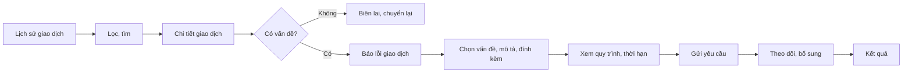

> **Mã:** DE04-TN04-PRD · **Trạng thái:** đã chốt · **Người viết:** Design · **SRS:** [SRS.md](SRS.md)

# PRD Lịch sử giao dịch và tra soát (App ngân hàng, chuyển khoản QR)

## 1. Bối cảnh và vấn đề

### 1.1 Bối cảnh

Sau mỗi lần chuyển hoặc nhận tiền, người dùng cần xem lại và đôi khi cần ngân hàng xử lý sự cố (xem [README](../../README.md)): người bán nói chưa nhận được tiền, chuyển nhầm người vì quét nhầm QR, tiền bị trừ mà giao dịch báo lỗi. Hiện nay phần lớn trường hợp này đi qua tổng đài, mất 10–15 phút mỗi cuộc gọi.

### 1.2 Vấn đề

| **Vấn đề** | **Hệ quả** |
| --- | --- |
| Lịch sử chỉ có số tiền, mã giao dịch khó hiểu | Không nhận ra khoản nào là khoản nào |
| Không tìm được giao dịch theo tên người nhận | Cuộn mãi, bỏ cuộc |
| Muốn báo lỗi phải gọi tổng đài, đọc lại mã giao dịch | Tốn thời gian, đọc nhầm |
| Không biết yêu cầu tra soát đang tới đâu | Gọi lại nhiều lần |
| Chuyển nhầm người mà không biết ngân hàng làm được gì | Kỳ vọng sai, thất vọng |

### 1.3 Mục tiêu

- Tìm được giao dịch cần tìm ≤ 20 giây (trung vị).
- ≥ 70% yêu cầu tra soát giao dịch QR được tạo trong app thay vì tổng đài.
- 100% yêu cầu tra soát có trạng thái và thời hạn xử lý hiển thị trong app.

## 2. Người dùng

| **Nhóm** | **Nhu cầu với tính năng này** |
| --- | --- |
| Người trả tiền | Tìm lại giao dịch, lấy biên lai, báo lỗi |
| Người nhận tiền, tiểu thương | Xem các khoản nhận trong ngày, đối chiếu |
| Người chuyển nhầm | Biết quy trình, khả năng lấy lại tiền, thời gian |
| Người nghi bị lừa | Báo ngay để ngân hàng phối hợp xử lý |

## 3. Phạm vi

### 3.1 Trong phạm vi (MVP)

- Lịch sử giao dịch: tiền vào, tiền ra; lọc theo thời gian, loại; tìm theo tên, nội dung, số tiền.
- Chi tiết giao dịch: đầy đủ thông tin, biên lai, chuyển lại, lưu người nhận.
- Tạo yêu cầu tra soát cho giao dịch QR: người nhận chưa nhận, chuyển nhầm, trừ tiền nhưng lỗi, nghi lừa đảo.
- Theo dõi trạng thái tra soát, bổ sung thông tin khi được yêu cầu.

### 3.2 Ngoài phạm vi

- Sao kê tài khoản dạng file → tính năng sẵn có của app.
- Màn xử lý tra soát của nhân viên ngân hàng (xem Đề 7 cho phía nội bộ).
- Phân loại chi tiêu, biểu đồ.
- Tra soát giao dịch thẻ.

## 4. Nguyên tắc sản phẩm

### 4.1 Lịch sử phải đọc như sổ ghi chép

Mỗi dòng nói ai, bao nhiêu, khi nào, vì sao (nội dung) bằng chữ dễ hiểu.

### 4.2 Báo lỗi ngay tại giao dịch

Nút "Báo lỗi giao dịch" ở chi tiết; mọi thông tin giao dịch được điền sẵn.

### 4.3 Nói thật về khả năng xử lý

Chuyển nhầm người: ngân hàng chỉ đề nghị bên nhận hoàn trả, cần người nhận đồng ý. Nói rõ trước khi gửi.

## 5. Quy tắc nghiệp vụ

| **Quy tắc** | **Giá trị** |
| --- | --- |
| Lịch sử xem trong app | 12 tháng gần nhất; mỗi lần lọc tối đa 3 tháng |
| Tạo tra soát | Giao dịch chuyển đi trong 60 ngày gần nhất |
| Số yêu cầu | 1 yêu cầu đang mở cho mỗi giao dịch |
| Phí tra soát | Miễn phí |
| Thời hạn xử lý | Theo loại: 1–7 ngày làm việc |
| Bổ sung thông tin | Trong 3 ngày làm việc kể từ khi được yêu cầu |

## 6. Luồng trải nghiệm

| **Bước** | **Giai đoạn** | **Trải nghiệm** | **Đầu ra** |
| --- | --- | --- | --- |
| 1 | Tìm | Danh sách nhóm theo ngày; tìm theo tên, số tiền | Giao dịch cần xem |
| 2 | Xem | Chi tiết đầy đủ, biên lai | Thông tin, bằng chứng |
| 3 | Báo lỗi | Chọn vấn đề, mô tả ngắn, ảnh đính kèm | Yêu cầu tra soát |
| 4 | Theo dõi | Trạng thái, hạn xử lý, yêu cầu bổ sung | Kết quả |

## 7. Use Cases, User Stories và Acceptance Criteria

### UC1. Xem lịch sử

#### US1.1 Tìm giao dịch

User Story: Là người trả tiền, tôi muốn tìm giao dịch theo tên người nhận để lấy lại biên lai.

AC01: Danh sách nhóm theo ngày; mỗi dòng: tên đối tác, nội dung, số tiền (+ xanh, − đen), giờ, nhãn QR, trạng thái nếu chưa thành công.

AC02: Lọc: 7 ngày, 30 ngày, tháng này, tuỳ chọn (tối đa 3 tháng); Tiền vào, Tiền ra.

AC03: Tìm theo tên, nội dung, số tiền; không phân biệt dấu.

#### US1.2 Xem chi tiết

AC01: Đầy đủ như biên lai (TN02); có nút Chia sẻ biên lai, Chuyển lại, Lưu người nhận, Báo lỗi giao dịch.

AC02: Giao dịch chưa xác định → giải thích và thời hạn có kết quả.

### UC2. Tra soát

#### US2.1 Báo người nhận chưa nhận được tiền

User Story: Là người trả tiền, tôi muốn báo ngân hàng khi người bán nói chưa nhận được tiền.

AC01: Chỉ cho giao dịch thành công; hiện gợi ý "Người nhận nên kiểm tra lại sau 15 phút" nếu giao dịch < 15 phút.

AC02: Gửi xong có mã yêu cầu, thời hạn xử lý.

#### US2.2 Báo chuyển nhầm

User Story: Là người dùng quét nhầm QR, tôi muốn đề nghị lấy lại tiền.

AC01: Trước khi gửi hiện rõ: ngân hàng sẽ liên hệ ngân hàng nhận đề nghị hoàn trả; cần người nhận đồng ý; không chắc chắn lấy lại được.

AC02: Mô tả bắt buộc.

#### US2.3 Báo nghi bị lừa đảo

AC01: Có lựa chọn "Tôi nghi bị lừa đảo"; hiện số tổng đài khẩn và hướng dẫn trình báo công an.

AC02: Yêu cầu loại này được ưu tiên xử lý.

#### US2.4 Theo dõi yêu cầu

AC01: Trạng thái: Đã tiếp nhận, Đang xử lý, Cần bổ sung, Đã giải quyết, Không thành công (có lý do).

AC02: Mỗi lần đổi trạng thái có push; "Cần bổ sung" mở thẳng màn bổ sung.

## 8. Chỉ số theo dõi

| **Chỉ số** | **Định nghĩa** | **Mục tiêu MVP** |
| --- | --- | --- |
| Thời gian tìm giao dịch | Mở lịch sử → mở đúng chi tiết | ≤ 20 giây (trung vị) |
| Tỉ lệ tra soát trong app | Yêu cầu tạo trong app / tổng yêu cầu giao dịch QR | ≥ 70% |
| Tỉ lệ đúng hạn | Yêu cầu giải quyết trong thời hạn / tổng yêu cầu | ≥ 90% |
| Tỉ lệ bổ sung đúng hạn | Bổ sung trong 3 ngày / yêu cầu cần bổ sung | Theo dõi |
| Cuộc gọi tổng đài về QR | Số cuộc gọi / 10.000 giao dịch QR | Giảm 40% |

## 9. Phụ thuộc và rủi ro

| **Mục** | **Mô tả** | **Hướng xử lý** |
| --- | --- | --- |
| Ngân hàng nhận | Phản hồi tra soát chậm | Thời hạn theo loại; tự động nhắc |
| Chuyển nhầm | Người nhận không đồng ý hoàn | Nói rõ trước khi gửi; kết quả "Không thành công" có hướng dẫn tiếp |
| Lạm dụng | Tạo yêu cầu giả để gây phiền người nhận | 1 yêu cầu mở mỗi giao dịch; lưu vết |
| Dữ liệu lịch sử lớn | Tìm kiếm chậm | Giới hạn 3 tháng mỗi lần lọc |

## 10. Câu hỏi mở

> Mọi câu hỏi dưới đây đã được PO chốt ngày 20/11/2026; quyết định ghi sau mỗi câu và đã cập nhật vào SRS.

- Người nhận có tạo tra soát được không? → **Đã chốt:** Không ở MVP. Chỉ bên chuyển tạo; người nhận gọi tổng đài (SRS BR-38).
- Giao dịch chưa xác định có tạo tra soát được không? → **Đã chốt:** Không. Hệ thống đã tự đối soát; nút Báo lỗi ẩn và thay bằng thời hạn có kết quả (SRS BR-39).
- Có cho huỷ yêu cầu đã gửi? → **Đã chốt:** Có, khi còn "Đã tiếp nhận" hoặc "Cần bổ sung" (SRS BR-43).
- Ảnh đính kèm bắt buộc không? → **Đã chốt:** Không bắt buộc, trừ loại "Nghi lừa đảo" khuyến khích ảnh tin nhắn (SRS BR-40).
