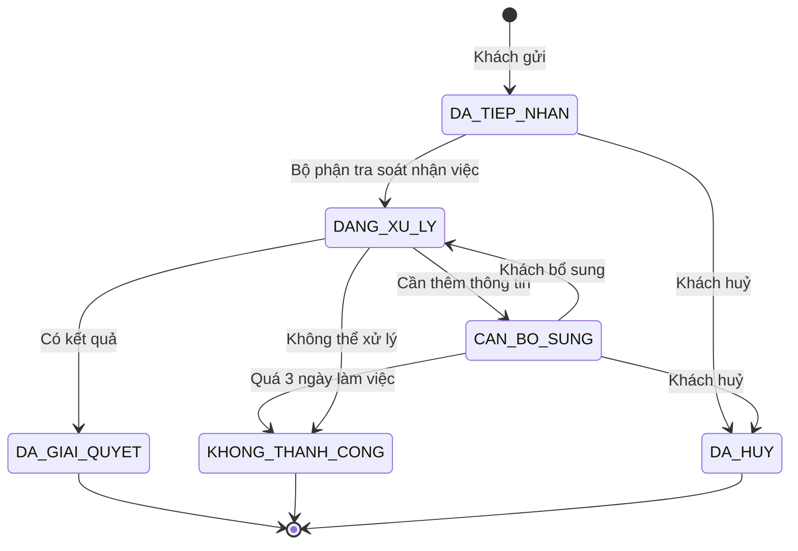
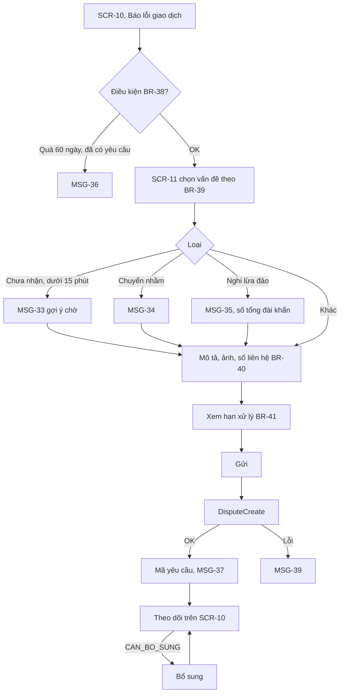
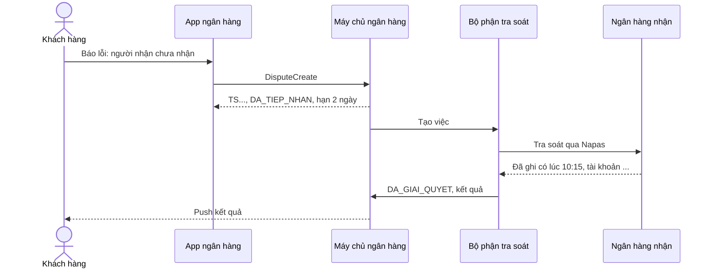

> **Mã:** DE04-TN04-SRS · **Trạng thái:** đã chốt · **Người viết:** Design · **PRD:** [PRD.md](PRD.md)

# UC-DE04-04 - Lịch sử giao dịch và tra soát

> SRS này mô tả việc xem lại giao dịch (của [TN02](../TN02-xac-nhan-chuyen-tien/SRS.md) và [TN03](../TN03-ma-qr-nhan-tien/SRS.md)) và yêu cầu tra soát phía khách hàng. Xử lý tra soát phía ngân hàng diễn ra ở hệ thống nội bộ, ngoài phạm vi đề.

## 1. Tổng quan

| **Mục** | **Nội dung** |
| --- | --- |
| Mục tiêu | Khách tìm, xem lại giao dịch; tự tạo và theo dõi yêu cầu tra soát |
| Actor | Khách hàng · App ngân hàng · Máy chủ ngân hàng · Bộ phận tra soát (nội bộ) · Ngân hàng nhận |
| Phạm vi | Danh sách, lọc, tìm kiếm, chi tiết giao dịch, chuyển lại, tạo tra soát, theo dõi, bổ sung, huỷ yêu cầu |
| Ngoài phạm vi | Sao kê file, màn xử lý nội bộ, phân loại chi tiêu, tra soát thẻ |
| Nền tảng | App ngân hàng iOS / Android |

## 2. User Story

| **ID** | **As a** | **I want** | **So that** |
| --- | --- | --- | --- |
| US-17 | Khách hàng | Tìm giao dịch theo tên, số tiền | Lấy lại biên lai nhanh |
| US-18 | Người nhận | Xem các khoản nhận trong ngày | Đối chiếu với tiền bán hàng |
| US-19 | Người trả tiền | Báo lỗi ngay tại giao dịch | Không phải gọi tổng đài |
| US-20 | Người chuyển nhầm | Biết trước ngân hàng làm được gì | Không kỳ vọng sai |
| US-21 | Khách hàng | Theo dõi yêu cầu tra soát | Không phải hỏi lại |

## 3. Business Rules

| **Mã** | **Quy tắc** |
| --- | --- |
| BR-35 | **Phạm vi lịch sử**: 12 tháng gần nhất; mỗi bộ lọc thời gian tối đa 3 tháng; mặc định 30 ngày. Tải 20 giao dịch mỗi lần, nhóm theo ngày, mới nhất trước |
| BR-36 | **Dòng giao dịch**: tên đối tác (tên gợi nhớ nếu đã lưu, nếu không thì tên chủ tài khoản), nội dung (1 dòng), số tiền có dấu + (tiền vào) hoặc − (tiền ra), giờ, nhãn "QR" nếu khởi tạo từ QR, nhãn trạng thái khi khác `THANH_CONG` |
| BR-37 | **Tìm kiếm** trên tên đối tác, nội dung, số tiền chính xác; không phân biệt dấu, hoa thường; tối thiểu 2 ký tự hoặc 1 số tiền ≥ 1.000; tìm trong khoảng thời gian đang lọc |
| BR-38 | **Điều kiện tạo tra soát**: giao dịch **chuyển đi** của chính khách, trong 60 ngày, chưa có yêu cầu đang mở. Người nhận không tạo tra soát trong app |
| BR-39 | **Loại vấn đề** theo trạng thái giao dịch: `THANH_CONG` → Người nhận chưa nhận được tiền · Chuyển nhầm người hoặc nhầm số tiền · Nghi bị lừa đảo. `THAT_BAI` → Bị trừ tiền nhưng giao dịch không thành công (chỉ khi tiền chưa được hoàn sau 1 ngày làm việc). `CHUA_XAC_DINH` → không tạo, hiện thời hạn đối soát |
| BR-40 | **Thông tin yêu cầu**: loại vấn đề; mô tả 10–500 ký tự (bắt buộc với Chuyển nhầm, Nghi lừa đảo); số điện thoại liên hệ (điền sẵn); đính kèm 0–3 ảnh, mỗi ảnh ≤ 5 MB. Người nhận chưa nhận mà giao dịch < 15 phút → MSG-33 gợi ý chờ, vẫn cho gửi |
| BR-41 | **Thời hạn xử lý** (ngày làm việc): Người nhận chưa nhận 2 · Trừ tiền nhưng lỗi 1 · Chuyển nhầm 7 · Nghi lừa đảo 1 (ưu tiên, kèm số tổng đài khẩn). Hiện hạn dự kiến dạng ngày cụ thể |
| BR-42 | **Thông báo trước khi gửi** theo loại: Chuyển nhầm → MSG-34 (cần người nhận đồng ý, không chắc lấy lại được); Nghi lừa đảo → MSG-35 (gọi tổng đài khẩn, trình báo công an, khoá tài khoản nếu lộ thông tin) |
| BR-43 | **Trạng thái tra soát**: `DA_TIEP_NHAN` → `DANG_XU_LY` → `CAN_BO_SUNG` (khách bổ sung trong 3 ngày làm việc, quá hạn → `KHONG_THANH_CONG` lý do thiếu thông tin) → `DA_GIAI_QUYET` hoặc `KHONG_THANH_CONG` (có lý do). Khách huỷ khi `DA_TIEP_NHAN` hoặc `CAN_BO_SUNG` → `DA_HUY` |
| BR-44 | **Chuyển lại**: từ chi tiết giao dịch QR thành công → mở **SCR-03** (TN02) với người nhận cũ (tra tên lại), số tiền cũ (sửa được), nội dung cũ. Ẩn với người nhận bị cờ cảnh báo |

## 4. Trạng thái

### 4.1 Vòng đời yêu cầu tra soát

### 4.2 Hiển thị trạng thái

| **Trạng thái** | **Khách thấy** | **Hành động** |
| --- | --- | --- |
| `DA_TIEP_NHAN` | Đã tiếp nhận · dự kiến xong {ngày} | Huỷ yêu cầu |
| `DANG_XU_LY` | Đang xử lý · dự kiến xong {ngày} | – |
| `CAN_BO_SUNG` | Cần bổ sung: {nội dung ngân hàng hỏi} · hạn {ngày} | Bổ sung, Huỷ yêu cầu |
| `DA_GIAI_QUYET` | Kết quả: {mô tả}; nếu có hoàn tiền: số tiền, ngày | – |
| `KHONG_THANH_CONG` | Lý do; hướng dẫn tiếp (ví dụ trình báo công an) | Gọi tổng đài |
| `DA_HUY` | Đã huỷ yêu cầu | – |

## 5. Use Case

### UC-07 Xem lịch sử và chi tiết

| **Mục** | **Nội dung** |
| --- | --- |
| Tiền điều kiện | Đã đăng nhập |
| Hậu điều kiện thành công | Hiện **SCR-10** của giao dịch cần tìm |
| Hậu điều kiện thất bại | Ở lại **SCR-09** với trạng thái rỗng hoặc lỗi |

**Luồng chính**

| **Bước** | **Actor** | **Mô tả** |
| --- | --- | --- |
| 1 | Khách hàng | Mở "Lịch sử giao dịch" |
| 2 | App | Gọi \[TxHistory\] 30 ngày, mọi loại; hiện **SCR-09** |
| 3 | Khách hàng | Gõ "banh mi" vào ô tìm |
| 4 | App | Lọc theo BR-37; hiện kết quả |
| 5 | Khách hàng | Chạm một dòng |
| 6 | App | Gọi \[TxDetail\]; hiện **SCR-10** |

**Luồng thay thế**

| **Mã** | **Điều kiện** | **Xử lý** |
| --- | --- | --- |
| A1 | Đổi khoảng thời gian | Bottom sheet chọn nhanh hoặc tuỳ chọn ≤ 3 tháng (BR-35) |
| A2 | Lọc Tiền vào / Tiền ra | Segmented control |
| A3 | Chia sẻ biên lai | Như TN02 BR-23 |
| A4 | Chuyển lại | BR-44 |
| A5 | Giao dịch `CHUA_XAC_DINH` | **SCR-10** hiện MSG-22 (TN02) và hạn có kết quả; không có nút Báo lỗi |

**Luồng lỗi**

| **Mã** | **Điều kiện** | **Xử lý** |
| --- | --- | --- |
| E1 | Khoảng thời gian > 3 tháng | MSG-32 |
| E2 | Không có kết quả | "Không tìm thấy giao dịch phù hợp" |
| E3 | Lỗi mạng | MSG-39 |

### UC-08 Tạo và theo dõi yêu cầu tra soát

| **Mục** | **Nội dung** |
| --- | --- |
| Tiền điều kiện | Giao dịch thoả BR-38, BR-39 |
| Hậu điều kiện thành công | Yêu cầu `DA_TIEP_NHAN`, có mã, hạn xử lý; **SCR-10** hiện khối tra soát |
| Hậu điều kiện thất bại | Không tạo yêu cầu |

**Luồng chính**

| **Bước** | **Actor** | **Mô tả** |
| --- | --- | --- |
| 1 | Khách hàng | Ở **SCR-10** bấm "Báo lỗi giao dịch" |
| 2 | App | Mở **SCR-11** với thông tin giao dịch điền sẵn (chỉ đọc); danh sách vấn đề theo BR-39 |
| 3 | Khách hàng | Chọn "Người nhận chưa nhận được tiền", mô tả ngắn |
| 4 | App | Hiện hạn xử lý dự kiến (BR-41) |
| 5 | Khách hàng | Bấm "Gửi yêu cầu" |
| 6 | App | Gọi \[DisputeCreate\] |
| 7 | Máy chủ | Tạo yêu cầu `DA_TIEP_NHAN`, mã `TS` + 10 số; gửi push xác nhận |
| 8 | App | Về **SCR-10** với khối tra soát; MSG-37 |

**Luồng thay thế**

| **Mã** | **Điều kiện** | **Xử lý** |
| --- | --- | --- |
| A1 | Chuyển nhầm | MSG-34 trước khi gửi; mô tả bắt buộc |
| A2 | Nghi lừa đảo | MSG-35; nút gọi tổng đài khẩn; nút "Khoá tài khoản tạm thời" dẫn tới tính năng khoá nhanh sẵn có |
| A3 | Ngân hàng yêu cầu bổ sung | Push MSG-38 → **SCR-10** → "Bổ sung" mở form trả lời + ảnh → \[DisputeSupplement\] |
| A4 | Huỷ yêu cầu | Popup xác nhận → \[DisputeCancel\] → `DA_HUY` |
| A5 | Có kết quả | Push; **SCR-10** hiện kết quả theo mục 4.2 |

**Luồng lỗi**

| **Mã** | **Điều kiện** | **Xử lý** |
| --- | --- | --- |
| E1 | Không đủ điều kiện | MSG-36 |
| E2 | Mô tả quá ngắn khi bắt buộc | Lỗi inline "Vui lòng mô tả ít nhất 10 ký tự" |
| E3 | Ảnh quá 5 MB, quá 3 ảnh | Lỗi inline |
| E4 | Lỗi mạng | MSG-39; giữ dữ liệu đã nhập |

## 6. Điểm vào

| **Điểm vào** | **Dẫn tới** | **Ghi chú** |
| --- | --- | --- |
| Trang chủ → Lịch sử giao dịch | **SCR-09** | |
| Chạm push kết quả giao dịch, tiền về | **SCR-10** | TN02, TN03 |
| Chạm push tra soát | **SCR-10** khối tra soát | |
| "Xem trong lịch sử" ở **SCR-05** (TN02) | **SCR-10** | |
| Cài đặt → Yêu cầu hỗ trợ của tôi | Danh sách yêu cầu tra soát | Lọc từ **SCR-09** các giao dịch có yêu cầu |

## 7. Mô tả màn hình

### SCR-09 Lịch sử giao dịch

| **#** | **Thành phần** | **Loại** | **Hành vi** |
| --- | --- | --- | --- |
| 1 | Chọn tài khoản | Dropdown | Mặc định tài khoản chính |
| 2 | Ô tìm kiếm | Search | BR-37 |
| 3 | Khoảng thời gian | Chip | Mở bottom sheet (A1) |
| 4 | Tất cả / Tiền vào / Tiền ra | Segmented | A2 |
| 5 | Tổng kỳ | Text | "Vào +{x} ₫ · Ra −{y} ₫" theo bộ lọc |
| 6 | Danh sách | Grouped list | Nhóm theo ngày; dòng theo BR-36 |
| 7 | Tải thêm | Spinner | 20 dòng mỗi lần |
| 8 | Trạng thái rỗng, lỗi | Empty state | |

### SCR-10 Chi tiết giao dịch

| **#** | **Thành phần** | **Loại** | **Hành vi** |
| --- | --- | --- | --- |
| 1 | Số tiền, trạng thái | Header | Màu theo trạng thái; nhãn QR |
| 2 | Chi tiết | List | Như biên lai TN02 BR-23; mã giao dịch sao chép được |
| 3 | Hành động | Buttons | Chia sẻ biên lai, Chuyển lại (BR-44), Lưu người nhận, Báo lỗi giao dịch (BR-38) |
| 4 | Khối tra soát | Card | Mã yêu cầu, loại, trạng thái mục 4.2, mốc thời gian, nút theo trạng thái |
| 5 | Ghi chú chưa xác định | Info | A5 UC-07 |

### SCR-11 Báo lỗi giao dịch

| **#** | **Thành phần** | **Loại** | **Bắt buộc** | **Validate / hành vi** |
| --- | --- | --- | --- | --- |
| 1 | Giao dịch | Card chỉ đọc | – | Người nhận, số tiền, thời gian, mã giao dịch |
| 2 | Vấn đề | Radio | Có | BR-39 |
| 3 | Thông tin quan trọng | Info | – | MSG-33, MSG-34 hoặc MSG-35 theo loại |
| 4 | Mô tả | Textarea | Theo loại | 10–500 ký tự (BR-40) |
| 5 | Ảnh đính kèm | Upload | Không | 0–3 ảnh, ≤ 5 MB |
| 6 | Số điện thoại liên hệ | Tel | Có | Điền sẵn, sửa được |
| 7 | Hạn xử lý dự kiến | Text | – | BR-41 |
| 8 | "Gửi yêu cầu" | Button | – | Disabled khi thiếu ô bắt buộc |

## 8. API

| **API** | **Request chính** | **Response chính** | **Timeout / retry** |
| --- | --- | --- | --- |
| \[TxHistory\] | account, from, to, direction, keyword, cursor | Giao dịch theo BR-36, tổng vào, tổng ra, next_cursor | 5s / 1 lần |
| \[TxDetail\] | transaction_id | Chi tiết, dispute (nếu có), allowed_actions | 5s / 1 lần |
| \[DisputeOptions\] | transaction_id | eligible, issue_types, sla_days theo loại | 3s / 1 lần |
| \[DisputeCreate\] | transaction_id, issue_type, description, phone, attachments, idempotency_key | dispute_id, status, due_date | 10s / gửi lại cùng key |
| \[DisputeSupplement\] | dispute_id, answer, attachments | status | 10s / 1 lần |
| \[DisputeCancel\] | dispute_id | status | 5s / 1 lần |

**Map lỗi → thông báo**

| **Nhóm lỗi** | **Message** |
| --- | --- |
| Khoảng thời gian quá dài | MSG-32 |
| Giao dịch vừa xong, người nhận chưa nhận | MSG-33 |
| Chuyển nhầm | MSG-34 |
| Nghi lừa đảo | MSG-35 |
| Không đủ điều kiện tra soát | MSG-36 |
| Gửi yêu cầu thành công | MSG-37 |
| Cần bổ sung | MSG-38 |
| Mất mạng, lỗi máy chủ | MSG-39 |

## 9. Danh sách thông báo

| **ID** | **Nơi hiện** | **Nội dung (VI)** |
| --- | --- | --- |
| MSG-32 | Inline | Mỗi lần xem tối đa 3 tháng. Vui lòng chọn khoảng ngắn hơn |
| MSG-33 | Info **SCR-11** | Giao dịch đã thành công lúc {giờ}. Người nhận có thể thấy tiền về chậm vài phút; hãy nhờ họ kiểm tra lại sau 15 phút |
| MSG-34 | Info **SCR-11** | Với giao dịch chuyển nhầm, ngân hàng sẽ đề nghị ngân hàng nhận liên hệ người nhận để hoàn trả. Việc hoàn trả cần người nhận đồng ý, nên không chắc chắn lấy lại được tiền |
| MSG-35 | Info **SCR-11** | Nếu bạn bị lừa đảo: gọi ngay tổng đài khẩn {số} để được hỗ trợ, khoá tài khoản nếu đã lộ mật khẩu hoặc OTP, và trình báo cơ quan công an gần nhất |
| MSG-36 | Popup | Giao dịch này không thể tạo yêu cầu tra soát trong app {lý do: quá 60 ngày / đã có yêu cầu đang xử lý}. Gọi tổng đài {số} để được hỗ trợ |
| MSG-37 | Toast | Đã gửi yêu cầu {mã}. Dự kiến có kết quả trước ngày {ngày} |
| MSG-38 | Push | Yêu cầu {mã} cần thêm thông tin. Vui lòng bổ sung trước ngày {ngày} |
| MSG-39 | Toast | Kết nối không ổn định, vui lòng thử lại |

## 10. Yêu cầu phi chức năng

| **Mục** | **Yêu cầu** |
| --- | --- |
| Hiệu năng | \[TxHistory\] ≤ 1 giây (p95) với 30 ngày; giao dịch mới xuất hiện trong lịch sử ≤ 5 giây |
| Bảo mật, riêng tư | Ảnh đính kèm mã hoá khi lưu; chỉ bộ phận tra soát xem được; số tài khoản đối tác che giữa trong danh sách |
| Lưu trữ | Yêu cầu tra soát và đính kèm lưu theo quy định lưu trữ chứng từ ngân hàng |
| Log / audit | Mọi thay đổi trạng thái tra soát: ai, khi nào, nội dung trao đổi |
| Tracking | Mở lịch sử, dùng tìm, lọc, mở chi tiết, chia sẻ biên lai, chuyển lại, bắt đầu và gửi tra soát (loại), bỏ dở, bổ sung, huỷ |
| Accessibility | Số tiền đọc rõ "trừ" hoặc "cộng"; trạng thái không chỉ dùng màu; danh sách nhóm ngày có tiêu đề cho giọng đọc |
